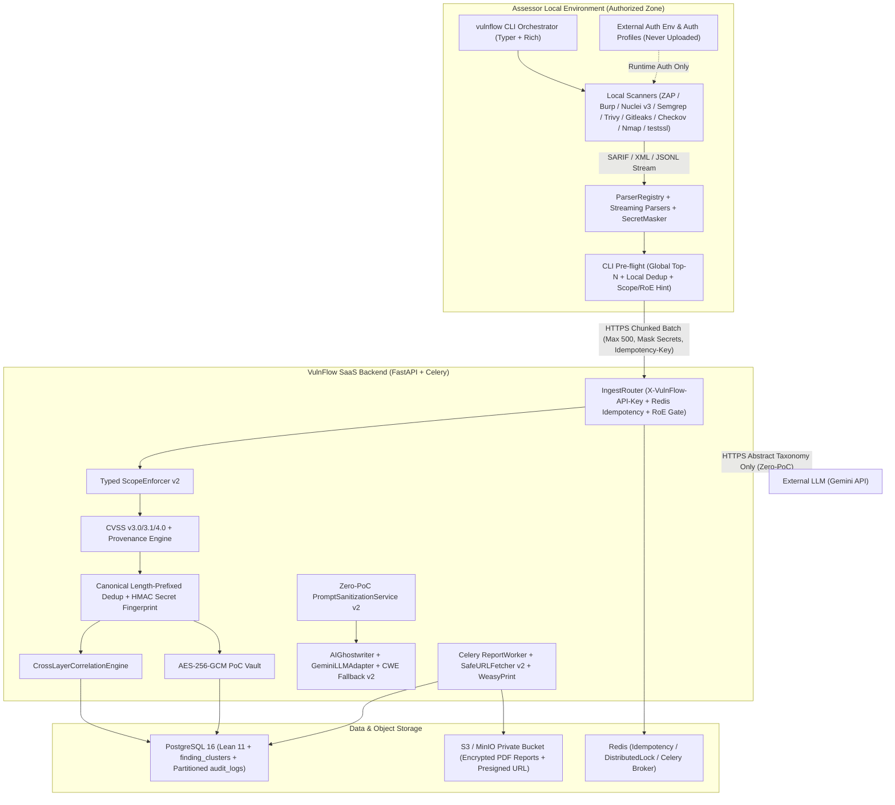
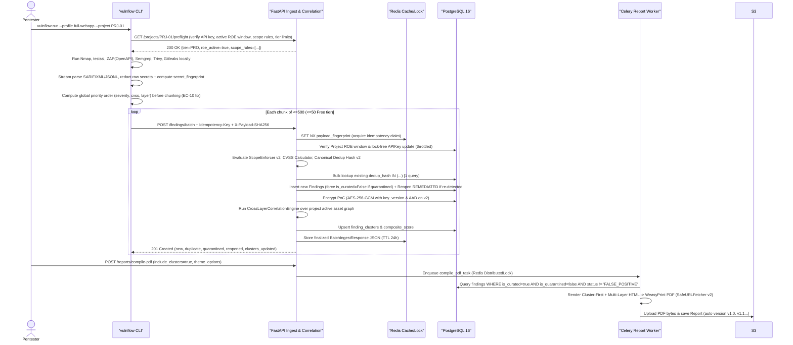

# RFC-001: Rancangan Teknis Arsitektur Multi-Layer Security Assessment, Correlation & Reporting Platform (`VulnFlow AI v2.0`)

**Status:** Draft Teknikal untuk Review Arsitektur  
**Lingkup Repositori:** `vulnflow-ai` (`packages/contracts`, `apps/api`, `apps/cli`, `apps/web`)  
**Baseline Terverifikasi:** FASE 0–7 selesai (`DOCS/PLAN.md`, 361 unit/resilience tests, Alembic head `e5b8f2a04c91`)  

> [!IMPORTANT]
> **Prinsip & Batas Keselamatan Sistem (Authorization-First Architecture)**  
> Perluasan ini merancang VulnFlow AI sebagai **Authorized Multi-Layer Assessment Orchestration, Ingestion, Correlation, & Triage Platform** — **bukan** kerangka kerja eksploitasi otonom atau generator payload destruktif. Seluruh pemindaian aktif (DAST/TLS/Network) dijalankan secara lokal di sisi *assessor CLI* pada target yang secara eksplisit diotorisasi melalui *Rules of Engagement (ROE)* & *Typed Target Scope*, menggunakan *authentication profile* eksternal yang **tidak pernah meninggalkan mesin assessor**, serta memblokir penyimpanan kredensial sensitif mentah (*plaintext secrets*) di SaaS.

---

## Daftar Isi

1. [Ringkasan Eksekutif & Audit Baseline Kode Eksisting](#1-ringkasan-eksekutif--audit-baseline-kode-eksisting)
2. [Ekosistem Layer, Tooling & Canonical Field Mapping](#2-ekosistem-layer-tooling--canonical-field-mapping)
3. [Arsitektur End-to-End & Alur Data Multi-Layer](#3-arsitektur-end-to-end--alur-data-multi-layer)
4. [Evolusi Kontrak Data (`packages/contracts`)](#4-evolusi-kontrak-data-packagescontracts)
5. [Desain Skema Database, Indexing & Migrasi Alembic (`apps/api`)](#5-desain-skema-database-indexing--migrasi-alembic-appsapi)
6. [Spesifikasi Matematis, Logika Deterministik & Perhitungan Kompleks](#6-spesifikasi-matematis-logika-deterministik--perhitungan-kompleks)
7. [Arsitektur Local CLI Orchestrator & Streaming Parsers (`apps/cli`)](#7-arsitektur-local-cli-orchestrator--streaming-parsers-appscli)
8. [Keamanan, Kepatuhan Scope/ROE, Privasi & Zero-PoC-to-AI v2](#8-keamanan-kepatuhan-scoperoe-privasi--zero-poc-to-ai-v2)
9. [Matriks Edge Case & Resilience (`EC-01..EC-18` Audit + `EC-19..EC-30` Baru)](#9-matriks-edge-case--resilience-ec-01ec-18-audit--ec-19ec-30-baru)
10. [Alignment Reporting Engine, Frontend (`apps/web`) & Roadmap Implementasi TDD](#10-alignment-reporting-engine-frontend-appsweb--roadmap-implementasi-tdd)

---

## 1. Ringkasan Eksekutif & Audit Baseline Kode Eksisting

### 1.1 Perbandingan Kapabilitas: Surface-Only (`v1.0`) vs Multi-Layer (`v2.0`)

Saat ini (`v1.0`), VulnFlow AI hanya memproses 3 sumber (`SourceTool`: `nmap`, `nuclei`, `manual`) yang menghasilkan visibilitas permukaan (*external attack surface*). Ekspansi `v2.0` menghubungkan **8 Lapisan Asesmen** (*Assessment Layers*) ke dalam satu *correlation graph* terpadu:

| Dimensi                           | Baseline Saat Ini (`v1.0`)                                                 | Target Arsitektur Multi-Layer (`v2.0`)                                                                                         |
|:--------------------------------- |:-------------------------------------------------------------------------- |:------------------------------------------------------------------------------------------------------------------------------ |
| **Lapisan Asesmen**               | Surface Network (`nmap`) + Surface HTTP (`nuclei`) + `manual`              | **8 Layer:** `NETWORK`, `TLS`, `DAST`, `SAST`, `SCA`, `SECRETS`, `IAC`, `MANUAL`                                               |
| **Kedalaman Web / API**           | Unauthenticated signature scan (`nuclei`)                                  | Spec-driven & Authenticated DAST (**OWASP ZAP** OpenAPI/GraphQL + **Burp Pro XML** + **Nuclei v3** + **OWASP WSTG** checklist) |
| **Kedalaman Code & Supply Chain** | Tidak ada (`target_port` nullable belum dimanfaatkan)                      | Universal **SARIF v2.1.0**: **Semgrep** (SAST), **Trivy/Grype** (SCA/Container), **Gitleaks** (Secrets), **Checkov** (IaC)     |
| **Kriptografi & Layanan**         | Nmap `<port>` hanya membaca 1 `<script>` pertama; `INFO` / `MEDIUM` statis | **testssl.sh / sslyze** JSON (TLS cipher, sertifikat, HSTS, downgrade) + multi-`<script>` Nmap NSE + CPE 2.3                   |
| **Korelasi Temuan**               | Flat list per `(project_id, cwe, host, port, path)`                        | **Cross-Layer Correlation Engine**: menautkan *Network Exposure ↔ DAST Route ↔ SAST Sink ↔ SCA Library ↔ Secrets ↔ IaC*        |
| **Kalkulasi Risiko**              | Raw `cvss_score` (default `0.0` jika vektor kosong); daftar linear         | Multi-version CVSS (`3.0`/`3.1`/`4.0`) + provenance + **Bounded Composite Cluster Score** + Asset Posture Index                |
| **Privasi Kredensial**            | PoC dienkripsi AES-256-GCM; tidak ada masking secret pre-ingest            | **Client-side Secret Masking + Keyed HMAC Fingerprint** (plaintext secret klien tidak pernah menyentuh SaaS)                   |

---

### 1.2 Audit Realitas Baseline Kode (Temuan Kritis yang Wajib Diperbaiki Bersamaan)

Sebelum membangun fitur baru di atas fondasi `v1.0`, audit menyeluruh terhadap kode eksisting menemukan **14 cacat logika/implementasi nyata** yang harus diselesaikan agar tidak berlipat ganda pada arsitektur multi-layer:

| ID Audit  | Lokasi File & Baris                                                                                                                                                                                                                                                                                                | Masalah Terverifikasi pada Baseline                                                                                                                                                                                                                                                   | Dampak Jika Dibiarkan pada `v2.0`                                                                                                                                                                                |
|:--------- |:------------------------------------------------------------------------------------------------------------------------------------------------------------------------------------------------------------------------------------------------------------------------------------------------------------------ |:------------------------------------------------------------------------------------------------------------------------------------------------------------------------------------------------------------------------------------------------------------------------------------- |:---------------------------------------------------------------------------------------------------------------------------------------------------------------------------------------------------------------- |
| **BL-01** | [`scope.py#L27-L35`](file:///c:/Users/KaliCodeS3/Documents/Project/IPPL/vulnflow-ai/apps/api/app/domain/scope.py#L27-L35)                                                                                                                                                                                          | Setiap entry `target_scope` yang mengandung `"/"` langsung diarahkan ke `_matches_cidr()` saja                                                                                                                                                                                        | URL prefix (`https://app.com/v1`), repo slug (`org/service`), container image (`ghcr.io/org/app`), dan path IaC gagal `ip_network()` dan seluruh temuan SAST/SCA/IaC/Secrets dikarantina (`is_quarantined=True`) |
| **BL-02** | [`ingest.py#L149-L164`](file:///c:/Users/KaliCodeS3/Documents/Project/IPPL/vulnflow-ai/apps/api/app/routers/ingest.py#L149-L164) & [`report_worker.py#L69-L72`](file:///c:/Users/KaliCodeS3/Documents/Project/IPPL/vulnflow-ai/apps/api/app/workers/report_worker.py#L69-L72)                                      | `Finding.is_curated_for_report` default `True` saat `is_quarantined=True`; `compile_report()` hanya memfilter `is_curated_for_report=True` tanpa `is_quarantined=False` & `status != 'FALSE_POSITIVE'`                                                                                | **Quarantine Leak:** Temuan di luar kontrak ROE bocor ke laporan PDF klien                                                                                                                                       |
| **BL-03** | [`ingest.py#L106-L195`](file:///c:/Users/KaliCodeS3/Documents/Project/IPPL/vulnflow-ai/apps/api/app/routers/ingest.py#L106-L195)                                                                                                                                                                                   | `roe_start_date` dan `roe_end_date` pada [`Project`](file:///c:/Users/KaliCodeS3/Documents/Project/IPPL/vulnflow-ai/apps/api/app/models/project.py#L34-L36) divalidasi saat `POST /projects`, tetapi **tidak pernah dicek** saat `ingest_batch` maupun `create_manual_finding`        | Pelanggaran **EC-05**: CLI dapat terus mengunggah temuan setelah masa kontrak ROE berakhir                                                                                                                       |
| **BL-04** | [`finding_schemas.py#L18-L20,L66,L111`](file:///c:/Users/KaliCodeS3/Documents/Project/IPPL/vulnflow-ai/packages/contracts/vulnflow_contracts/finding_schemas.py#L18-L20) & [`test_schemas.py#L458-L474`](file:///c:/Users/KaliCodeS3/Documents/Project/IPPL/vulnflow-ai/tests/contracts/test_schemas.py#L458-L474) | `CVSSVersion` mendeklarasikan `V4_0 = "4.0"`, namun regex `cvss_vector` memaksa `^CVSS:3\.1/...` dan unit test menolak `CVSS:4.0/...`                                                                                                                                                 | Scanner modern (Trivy, Grype, Nuclei v3, NVD API 2.0) yang mengirim vektor CVSS v4.0 atau v3.0 akan **silent-skipped** oleh CLI                                                                                  |
| **BL-05** | [`deduplication.py#L6-L13`](file:///c:/Users/KaliCodeS3/Documents/Project/IPPL/vulnflow-ai/apps/api/app/domain/deduplication.py#L6-L13)                                                                                                                                                                            | `SHA256(project_id:cwe_id:host:port:endpoint_path)` memakai pemisah `:` polos dan mengabaikan `rule_id`, `method`, `package/cve`, dan `line`                                                                                                                                          | **Over-deduplication fatal:** 10 CVE berbeda di `package-lock.json` atau 5 rule SAST `CWE-79` di 1 file runtuh menjadi 1 temuan; plus *delimiter collision* pada IPv6/PURL/`C:\`                                 |
| **BL-06** | [`ingest.py#L154-L156`](file:///c:/Users/KaliCodeS3/Documents/Project/IPPL/vulnflow-ai/apps/api/app/routers/ingest.py#L154-L156)                                                                                                                                                                                   | Jika `cvss_score` dan `cvss_vector` sama-sama `None`, disimpan `cvss_score=0.0, cvss_vector=""`                                                                                                                                                                                       | Temuan `CRITICAL`/`HIGH` dari Semgrep/Gitleaks/Checkov/Nmap tanpa vektor CVSS mendapat skor `0.0`, merusak ranking risiko & SLA                                                                                  |
| **BL-07** | [`ingest.py#L121-L188`](file:///c:/Users/KaliCodeS3/Documents/Project/IPPL/vulnflow-ai/apps/api/app/routers/ingest.py#L121-L188)                                                                                                                                                                                   | 1 `SELECT` + 1 nested savepoint per item (hingga 1.000 roundtrip DB per batch 500); `quarantined_count` ditambah sebelum `IntegrityError`; `/manual` (`L254-L305`) tidak menangkap `IntegrityError` (500 alih-alih 409)                                                               | Bottleneck throughput pada batch besar SARIF/DAST, salah hitung karantina saat race condition, dan HTTP 500 pada duplikasi entri manual                                                                          |
| **BL-08** | [`ingest.py#L129-L135`](file:///c:/Users/KaliCodeS3/Documents/Project/IPPL/vulnflow-ai/apps/api/app/routers/ingest.py#L129-L135)                                                                                                                                                                                   | Saat scan ulang menemukan kembali temuan yang sebelumnya berstatus `REMEDIATED`, server hanya mencatat `duplicate_count += 1`                                                                                                                                                         | Status `REOPENED` pada `FindingStatus` tidak pernah terpicu otomatis saat terjadi regresi antar-layer (UC-09)                                                                                                    |
| **BL-09** | [`main.py#L176-L213`](file:///c:/Users/KaliCodeS3/Documents/Project/IPPL/vulnflow-ai/apps/cli/vulnflow/main.py#L176-L213)                                                                                                                                                                                          | **Bug EC-10:** `chunk_findings()` membagi 500 lebih dulu sebelum konfirmasi Free-tier Top-50, lalu hanya memotong Top-50 dari chunk 0 sementara chunk 1..N tetap dikirim                                                                                                              | Pada >500 temuan di Free tier, hasil bukan Top-50 global melainkan Top-50 parsial + gagal/inkonsisten di chunk berikutnya                                                                                        |
| **BL-10** | [`nmap_parser.py#L58,L87`](file:///c:/Users/KaliCodeS3/Documents/Project/IPPL/vulnflow-ai/apps/cli/vulnflow/parsers/nmap_parser.py#L58) & [`nuclei_parser.py#L31-L48`](file:///c:/Users/KaliCodeS3/Documents/Project/IPPL/vulnflow-ai/apps/cli/vulnflow/parsers/nuclei_parser.py#L31-L48)                          | `nmap_parser` hanya memanggil `.find("script")` (menghilangkan skrip ke-2..N), memaksa protokol non-TCP menjadi `UDP`, dan memuat DOM penuh; `nuclei_parser` memanggil `f.read().strip().splitlines()` (~2.5x RAM)                                                                    | Hilangnya NSE vuln flags, salah klasifikasi `sctp`, dan lonjakan OOM pada artefak XML/SARIF 50–250 MB (melanggar NFR-PERF-003)                                                                                   |
| **BL-11** | [`sanitizer.py#L41-L58`](file:///c:/Users/KaliCodeS3/Documents/Project/IPPL/vulnflow-ai/apps/api/app/domain/sanitizer.py#L41-L58)                                                                                                                                                                                  | `_looks_like_hostname()` menyensor **semua** token bertitik dengan akhiran alfabet `>=2` huruf (`auth.py`, `package.json`, `Node.js`, `main.tf`), namun **tidak mendeteksi** token rahasia (`AKIA...`, `ghp_...`, JWT), path lokal (`/home/...`, `C:\Users\...`), atau injeksi `\r\n` | Kualitas narasi AI turun drastis karena nama framework/ekstensi terhapus, sementara raw secret atau path developer bisa bocor jika muncul di `title`                                                             |
| **BL-12** | [`cwe_catalog.json#L1-L42`](file:///c:/Users/KaliCodeS3/Documents/Project/IPPL/vulnflow-ai/apps/api/app/data/cwe_catalog.json#L1-L42)                                                                                                                                                                              | Katalog fallback offline hanya berisi **8 entri** (`CWE-89, 79, 22, 287, 200, 538, 502, UNKNOWN`)                                                                                                                                                                                     | Hampir seluruh temuan SAST/SCA/Secrets/IaC/TLS saat **EC-14** (LLM fallback) akan jatuh ke narasi generik `UNKNOWN`                                                                                              |
| **BL-13** | [`reports.py#L101-L119`](file:///c:/Users/KaliCodeS3/Documents/Project/IPPL/vulnflow-ai/apps/api/app/routers/reports.py#L101-L119) & [`report_worker.py#L77-L106`](file:///c:/Users/KaliCodeS3/Documents/Project/IPPL/vulnflow-ai/apps/api/app/workers/report_worker.py#L77-L106)                                  | Route `GET .../reports/jobs/{job_id}` (`status_url`) belum ada; `theme_options` & `Workspace.brand_*` diabaikan; `Report.version` selalu `"v1.0"`; `safe_fetcher` hanya IPv4 tanpa batas ukuran byte                                                                                  | Kontrak PDF polling buntu, fitur White-Labeling ThemeStudio tidak muncul di PDF, dan risiko memory-exhaustion saat WeasyPrint mengambil aset gambar eksternal besar                                              |
| **BL-14** | [`apps/web/src/services/api.ts#L15-L22,L124-L162`](file:///c:/Users/KaliCodeS3/Documents/Project/IPPL/vulnflow-ai/apps/web/src/services/api.ts#L15-L22)                                                                                                                                                            | Frontend memanggil field `primary_color_hex`/`accent_color_hex` & route `GET /workspaces`, `GET .../findings`, `GET .../poc` yang berbeda nama atau belum tersedia di router FastAPI                                                                                                  | Integrasi API–UI penuh pada FASE 6 gagal jika tidak disinkronkan kontraknya                                                                                                                                      |

---

## 2. Ekosistem Layer, Tooling & Canonical Field Mapping

### 2.1 Taksonomi 8 Layer Asesmen

VulnFlow AI `v2.0` mengelompokkan setiap temuan pada `AssessmentLayer` yang tegas agar kebijakan *scope*, *deduplication*, *scoring*, *correlation*, dan *AI sanitization* tidak mencampuradukkan konsep jaringan dengan kode sumber atau dependensi:

1. **`NETWORK`**: Port terbuka, servis banner, konfigurasi layanan infrastruktur, CPE layanan (`nmap` XML multi-script, `masscan`/`naabu` opsional).
2. **`TLS`**: Versi protokol TLS/SSL, cipher suite lemah, rantai sertifikat X.509, OCSP/HSTS/CT, kerentanan kriptografi transport (`testssl.sh` JSON, `sslyze` JSON).
3. **`DAST`**: Pengujian dinamis HTTP/API terautentikasi & berbasis spesifikasi OpenAPI/GraphQL (**OWASP ZAP** Automation JSON/XML, **Burp Suite Pro** XML, **Nuclei v3** HTTP/Headless).
4. **`SAST`**: Analisis statis source code, dataflow/taint sink (`Semgrep` SARIF, `Bandit` SARIF, `CodeQL` SARIF).
5. **`SCA`**: Kerentanan dependensi pustaka pihak ketiga, OS package container image, SBOM CVE (`Trivy` SARIF/JSON, `Grype` SARIF, `pip-audit`/`npm audit` terkonversi).
6. **`SECRETS`**: Deteksi kredensial/token/kunci privat hard-coded di repo, konfigurasi, atau image layer (`Gitleaks` SARIF/JSON, `Trivy` secret mode, `TruffleHog`).
7. **`IAC`**: Miskonfigurasi Infrastructure-as-Code & Cloud manifest: Terraform, Kubernetes YAML, Dockerfile, Helm (`Checkov` SARIF, `Trivy` config SARIF).
8. **`MANUAL`**: Verifikasi terpandu oleh pentester untuk *business logic*, *authorization bypass*, *race condition*, dan temuan konfirmasi (`POST /findings/manual` + template OWASP WSTG v4.2 / ASVS v4.0.3).

### 2.2 Pertimbangan Pemilihan Format Standar: Mengapa SARIF v2.1.0 + Spec-Driven Parsers?

| Opsi Integrasi Tool                                                                            | Kelebihan                                                                                                                                                                                                                               | Kekurangan                                                                                                                                                                 | Keputusan Desain                                                                                                                                             |
|:---------------------------------------------------------------------------------------------- |:--------------------------------------------------------------------------------------------------------------------------------------------------------------------------------------------------------------------------------------- |:-------------------------------------------------------------------------------------------------------------------------------------------------------------------------- |:------------------------------------------------------------------------------------------------------------------------------------------------------------ |
| **Parser Native per Tool (Semgrep JSON + Checkov JSON + Gitleaks JSON + Trivy JSON terpisah)** | Menangkap 100% field proprietary tiap vendor                                                                                                                                                                                            | Biaya perawatan $O(T)$ parser; setiap update minor CLI scanner mematahkan skema                                                                                            | Tolak sebagai jalur utama untuk static tools                                                                                                                 |
| **Universal SARIF v2.1.0 (OASIS Standard) + Tool Adapters Ringan untuk DAST/TLS/Network**      | **1 parser SARIF** langsung mendukung Semgrep, Trivy, Grype, Gitleaks, Checkov, Bandit, CodeQL; skema standar ISO/OASIS stabil; sudah membawa `ruleId`, `artifactLocation`, `region`, `partialFingerprints`, `cwe`, `security-severity` | Sebagian kecil field khusus (mis. PURL/installedVersion pada Trivy/Grype) berada di `properties` atau `relatedLocations`; ZAP/Burp/Nmap/testssl.sh memakai XML/JSON khusus | **PILIH:** Universal `SarifParser` (`SAST`, `SCA`, `SECRETS`, `IAC`) + Parser khusus untuk `Nmap`, `Nuclei v3`, `OWASP ZAP`, `Burp XML`, `testssl.sh/sslyze` |

---

### 2.3 Tabel Pemetaan Kanonis Tool Output → `UnifiedVulnerabilityFinding v2`

#### A. DAST Terautentikasi & Spec-Driven (OWASP ZAP, Burp Suite Pro, Nuclei v3)

| Field Kontrak `v2`                 | OWASP ZAP (`report_json` / XML)                                                                                                                         | Burp Suite Pro (`XML Export`)                                                                               | Nuclei v3 (`JSONL`)                                                                                               |
|:---------------------------------- |:------------------------------------------------------------------------------------------------------------------------------------------------------- |:----------------------------------------------------------------------------------------------------------- |:----------------------------------------------------------------------------------------------------------------- |
| `layer`                            | `"DAST"`                                                                                                                                                | `"DAST"`                                                                                                    | `"DAST"` (atau `"TLS"`/`"NETWORK"` jika `type in {"ssl","network","tcp","dns"}`)                                  |
| `source_tool`                      | `"zap"`                                                                                                                                                 | `"burp"`                                                                                                    | `"nuclei"`                                                                                                        |
| `rule_id`                          | `pluginid` (mis. `"40018"`)                                                                                                                             | `type` (hex/int issue ID, mis. `"1049088"`)                                                                 | `template-id`                                                                                                     |
| `title`                            | `name` / `alert` (`[:255]`)                                                                                                                             | `name` (`[:255]`)                                                                                           | `info.name \|\| template-id`                                                                                      |
| `severity`                         | Map `riskcode`: `3→HIGH/CRITICAL*`, `2→MEDIUM`, `1→LOW`, `0→INFO`                                                                                       | Map `severity`: `High→HIGH`, `Medium→MEDIUM`, `Low→LOW`, `Information→INFO`                                 | `info.severity` (uppercase)                                                                                       |
| `cwe_id`                           | `f"CWE-{cweid}"` jika `cweid > 0` else `"UNKNOWN"`                                                                                                      | Ekstrak regex `CWE-(\d+)` dari `vulnerabilityClassifications` else `"UNKNOWN"`                              | `info.classification.cwe-id[0].upper()`                                                                           |
| `target_host`                      | `urlsplit(instance.uri).hostname` (dari `site.@host` fallback)                                                                                          | `<host>` text (`ip` attribute masuk ke `location.resolved_ip`)                                              | `urlsplit(matched-at).hostname`                                                                                   |
| `target_port`                      | `site.@port` / `urlsplit.port`                                                                                                                          | Ekstrak port dari `<host>` URL atau `<port>` (80/443 default by scheme)                                     | `urlsplit(matched-at).port`                                                                                       |
| `endpoint_path`                    | Path URI ternormalisasi (tanpa query string mentah; max 500 char)                                                                                       | `<path>` (tanpa query string; max 500 char)                                                                 | `urlsplit(matched-at).path`                                                                                       |
| `location` (`WebEndpointLocation`) | `method`, `normalized_path`, `query_param_keys` (sorted keys only), `auth_context` (`authenticated` / `anonymous`), `spec_operation_id`                 | `method`, `normalized_path`, `query_param_keys`, `confidence` (`Certain`/`Firm`/`Tentative`)                | `method` (dari `request` line 1 jika ada), `normalized_path`, `query_param_keys`, `matcher_name`                  |
| `proof_of_concept.raw_evidence`    | Truncated HTTP evidence (`attack`, `evidence`, sanitized `param`, HTTP req/resp head/tail ≤ 100 KB, header `Authorization`/`Cookie` di-redact opsional) | `<issueDetail>` + decoded `<request>` & `<response>` (Base64 decode + redact session tokens + cap ≤ 100 KB) | Truncated JSONL record (`request`/`response`/`extracted-results`, redact auth headers jika `--redact-auth` aktif) |

> *Catatan ZAP `CRITICAL`: ZAP native hanya memakai 4 level (`0..3`), sehingga rule dengan `cwe_id` berdampak RCE/SQLi/AuthBypass (`cvss >= 9.0` atau tag OWASP high-impact) dapat dipromosikan dari CVSS terhitung/referensi ke `CRITICAL` secara konsisten.

#### B. Universal SARIF v2.1.0 (Semgrep SAST, Trivy SCA/IaC/Secrets, Grype SCA, Gitleaks Secrets, Checkov IaC)

| Field Kontrak `v2`           | Resolusi di Struktur SARIF v2.1.0 (`runs[i].results[j]`)                                                                                                                                                                                                  |
|:---------------------------- |:--------------------------------------------------------------------------------------------------------------------------------------------------------------------------------------------------------------------------------------------------------- |
| `source_tool`                | Normalisasi `runs[i].tool.driver.name.lower()` (mis. `"semgrep"`, `"trivy"`, `"grype"`, `"gitleaks"`, `"checkov"`, `"bandit"`, `"codeql"`)                                                                                                                |
| `layer`                      | Ditentukan dari `driver.name` + kategori rule/properties: `gitleaks` / `trivy-secret` → `"SECRETS"`; `grype` / `trivy-vuln` (`vuln` tag/CVE) → `"SCA"`; `checkov` / `trivy-misconfig` → `"IAC"`; `semgrep` / `bandit` / `codeql` → `"SAST"`               |
| `rule_id`                    | `result.ruleId` (                                                                                                                                                                                                                                         |
| `title`                      | `rules[ruleIndex].shortDescription.text` atau kalimat pertama `result.message.text` (wajib bebas dari plaintext secret untuk layer `SECRETS`)                                                                                                             |
| `severity`                   | Prioritas: (1) `security-severity` score (`>=9.0 CRITICAL`, `>=7.0 HIGH`, `>=4.0 MEDIUM`, `>0 LOW`, `0 INFO`); (2) `result.properties.severity`; (3) map SARIF `level` (`error→HIGH`, `warning→MEDIUM`, `note→LOW`, `none→INFO`)                          |
| `cvss_score` / `cvss_vector` | Ekstrak dari `result.properties` / `rule.properties` (`cvssV4_vector`, `cvssV3_vector`, `cvss`, `security-severity`); jika tidak tersedia gunakan *Severity Baseline* (§6.2)                                                                              |
| `cwe_id`                     | Ekstrak dari `rule.properties.tags` (`cwe-89` / `CWE-089` → strip leading zero → `CWE-89`), `rule.relationships` (CWE taxonomy), atau regex pada `message.text`                                                                                           |
| `target_host`                | **Asset Identifier** ternormalisasi (bukan hanya hostname DNS): canonical repo slug (`github.com/org/repo`), container ref (`ghcr.io/org/api`), atau `workspace/project-asset` dari `vulnflow --asset` / `runs[].versionControlProvenance` (max 255 char) |
| `target_port`                | `None` (untuk `SAST`, `SCA`, `SECRETS`, `IAC`; memanfaatkan `Integer` nullable yang sudah ada di `Finding`)                                                                                                                                               |
| `protocol`                   | `Protocol.FILE` (untuk `SAST`/`SCA`/`SECRETS`) atau `Protocol.CLOUD` (untuk `IAC`)                                                                                                                                                                        |
| `endpoint_path`              | **Resource locator ringkas** untuk tampilan & backward-compat UI (`rel_path#L<startLine>` untuk SAST/IAC, `manifest_path#pkg@ver` untuk SCA, `rel_path#L<startLine>` untuk SECRETS — max 500 char, **tanpa** nilai secret)                                |
| `location` (Typed Union)     | `CodeLocation` (`SAST`), `PackageLocation` (`SCA`), `SecretLocation` (`SECRETS`), atau `CloudResourceLocation` (`IAC`) — lihat §4.2                                                                                                                       |

#### C. Deep Network & Cryptography (`testssl.sh`, `sslyze`, Enhanced `Nmap XML`)

| Field Kontrak `v2`             | Enhanced `Nmap XML`                                                                                                                                                                                            | `testssl.sh` JSON (`--jsonfile`)                                                                                                                                   |
|:------------------------------ |:-------------------------------------------------------------------------------------------------------------------------------------------------------------------------------------------------------------- |:------------------------------------------------------------------------------------------------------------------------------------------------------------------ |
| `layer`                        | `"NETWORK"` (atau `"TLS"` jika `script.@id` bertipe `ssl-*`)                                                                                                                                                   | `"TLS"`                                                                                                                                                            |
| `source_tool`                  | `"nmap"`                                                                                                                                                                                                       | `"testssl"`                                                                                                                                                        |
| `rule_id`                      | `script.@id` (mis. `"vulners"`, `"http-git"`) atau `"open-port"`                                                                                                                                               | `id` (mis. `"TLS1"`, `"BREACH"`, `"cert_expirationStatus"`, `"LUCKY13"`)                                                                                           |
| `severity`                     | NSE output + parser CVE/CVSS dari `vulners`/`vuln` script table: jika `<elem key="cvss">` ada, hitung severity dari skor tertinggi; jika hanya NSE script tanpa skor, `MEDIUM`; jika port tanpa script, `INFO` | Map `severity` testssl: `CRITICAL→CRITICAL`, `HIGH→HIGH`, `MEDIUM→MEDIUM`, `LOW→LOW`, `WARN→LOW`, `INFO/OK→INFO` (skip `OK` dengan flag `--include-info` opsional) |
| `protocol`                     | `"tcp"`, `"udp"`, `"sctp"`, `"icmp"` (perbaikan dari baseline yang memaksa non-TCP menjadi `UDP`)                                                                                                              | `"tls"` (`Protocol.TLS`)                                                                                                                                           |
| `cwe_id`                       | Ekstrak CWE dari output skrip jika ada, else `"UNKNOWN"`                                                                                                                                                       | Peta deterministik ID check → CWE (`TLS1/1_1 → CWE-326`, `RC4/DES/3DES → CWE-327`, `cert_* → CWE-295`, `HSTS → CWE-319`, `POODLE/BEAST → CWE-326`)                 |
| `location` (`NetworkLocation`) | `service_name`, `product`, `version`, `cpe23_list`, `script_ids`, `ip_version`                                                                                                                                 | `ip`, `port`, `tls_version`, `cipher_suite`, `cert_cn`, `cert_expiry_days`                                                                                         |

#### D. Manual Verification Workflows (OWASP WSTG v4.2 / ASVS Guided Checklists)

Automated tools tidak dapat memverifikasi logika bisnis atau konteks otorisasi antar peran (*BOLA/IDOR*, *Workflow State Skipping*, *Race Condition*, *Multi-Tenant Isolation*). VulnFlow menyediakan **Guided Verification Catalog** berisi 12–18 *WSTG verification playbooks*:

- Setiap item checklist berisi: `wstg_id` (mis. `WSTG-ATHZ-02`), `cwe_id` (`CWE-639`), template `cvss_vector` awal yang dapat disesuaikan di kalkulator interaktif, deskripsi langkah verifikasi non-destruktif untuk pentester manusia, dan form terstruktur yang tersimpan ke `POST /findings/manual`.

---

## 3. Arsitektur End-to-End & Alur Data Multi-Layer

### 3.1 C4 Container & Component Diagram (Target Arsitektur `v2.0`)



---

### 3.2 Sequence Diagram: Multi-Layer Ingestion → Correlation → Triage → Report



---

## 4. Evolusi Kontrak Data (`packages/contracts`)

Seluruh kontrak Pydantic V2 tetap menerapkan `ConfigDict(extra="forbid")` agar sejalan dengan `[tool.pydantic-mypy] init_forbid_extra = true` di [`pyproject.toml`](file:///c:/Users/KaliCodeS3/Documents/Project/IPPL/vulnflow-ai/pyproject.toml#L79-L82). Prinsip evolusi kontrak: **backward-compatible secara default** untuk klien lama (`v1.0` tanpa field baru tetap valid jika mengirim `source_tool="nmap"|"nuclei"|"manual"`).

### 4.1 Enum Baru & Perluasan Enum Eksisting

```python
class AssessmentLayer(StrEnum):
    NETWORK = "NETWORK"
    TLS = "TLS"
    DAST = "DAST"
    SAST = "SAST"
    SCA = "SCA"
    SECRETS = "SECRETS"
    IAC = "IAC"
    MANUAL = "MANUAL"


class Protocol(StrEnum):
    TCP = "tcp"
    UDP = "udp"
    HTTP = "http"
    HTTPS = "https"
    TLS = "tls"      # BARU: untuk testssl/sslyze/service TLS
    ICMP = "icmp"
    SCTP = "sctp"
    FILE = "file"    # BARU: untuk SAST/SCA/SECRETS berbasis file/repo
    CLOUD = "cloud"  # BARU: untuk IaC / manifest infrastruktur
    NONE = "none"    # BARU: untuk manual business logic / abstrak
    OTHER = "other"


class SourceTool(StrEnum):
    # v1.0 legacy
    NMAP = "nmap"
    NUCLEI = "nuclei"
    MANUAL = "manual"
    # v2.0 multi-layer
    ZAP = "zap"
    BURP = "burp"
    SEMGREP = "semgrep"
    TRIVY = "trivy"
    GRYPE = "grype"
    GITLEAKS = "gitleaks"
    CHECKOV = "checkov"
    TESTSSL = "testssl"
    SSLYZE = "sslyze"
    SARIF_GENERIC = "sarif"


class CVSSVersion(StrEnum):
    V3_0 = "3.0"     # BARU: masih sering muncul di output scanner / NVD
    V3_1 = "3.1"
    V4_0 = "4.0"


class CVSSSource(StrEnum):
    EXACT_VECTOR = "EXACT_VECTOR"           # Dihitung deterministik dari cvss_vector
    SCANNER_SCORE = "SCANNER_SCORE"         # Dipercaya dari skor scanner (tanpa vektor)
    CWE_DEFAULT = "CWE_DEFAULT"             # Estimasi katalog CWE (opsional)
    SEVERITY_BASELINE = "SEVERITY_BASELINE" # Fallback deterministik dari Severity


class CorrelationRuleType(StrEnum):
    DAST_SAST_TAINT = "DAST_SAST_TAINT"
    NETWORK_DAST_SURFACE = "NETWORK_DAST_SURFACE"
    RUNTIME_SCA_CVE = "RUNTIME_SCA_CVE"
    SECRET_IAC_ESCALATION = "SECRET_IAC_ESCALATION"
    IAC_TLS_DRIFT = "IAC_TLS_DRIFT"
    MULTI_TOOL_CONFIRMATION = "MULTI_TOOL_CONFIRMATION"
```

### 4.2 Discriminated Union `LocationMetadata` (Anti-Bloat & Type-Safe di Mypy `--strict`)

Daripada menaruh puluhan field opsional (`file_path`, `start_line`, `purl`, `http_method`, `cipher_suite`) secara datar di `UnifiedVulnerabilityFinding`, kita menggunakan Pydantic **Discriminated Union** (`Annotated[..., Field(discriminator="kind")]`) yang dipetakan ke kolom JSONB `findings.location_metadata`:

```python
class NetworkLocation(BaseModel):
    model_config = ConfigDict(extra="forbid")
    kind: Literal["network"] = "network"
    ip_address: str = Field(default="", max_length=64)
    service_name: str = Field(default="", max_length=100)
    product: str = Field(default="", max_length=150)
    version: str = Field(default="", max_length=100)
    cpe23_list: list[str] = Field(default_factory=list, max_length=20)
    script_ids: list[str] = Field(default_factory=list, max_length=30)


class TLSLocation(BaseModel):
    model_config = ConfigDict(extra="forbid")
    kind: Literal["tls"] = "tls"
    tls_version: str = Field(default="", max_length=32)
    cipher_suite: str = Field(default="", max_length=128)
    cert_subject: str = Field(default="", max_length=255)
    cert_expiry_days: int | None = None
    alpn_protocol: str = Field(default="", max_length=32)


class WebEndpointLocation(BaseModel):
    model_config = ConfigDict(extra="forbid")
    kind: Literal["web"] = "web"
    scheme: Literal["http", "https", "ws", "wss"] = "https"
    http_method: str = Field(default="GET", pattern=r"^[A-Z]{2,10}$")
    normalized_path: str = Field(default="/", max_length=500)
    query_param_keys: list[str] = Field(default_factory=list, max_length=50)
    auth_context: Literal["anonymous", "authenticated", "unknown"] = "unknown"
    spec_operation_id: str | None = Field(default=None, max_length=120)
    confidence: Literal["CERTAIN", "FIRM", "TENTATIVE", "UNKNOWN"] = "UNKNOWN"


class CodeLocation(BaseModel):
    model_config = ConfigDict(extra="forbid")
    kind: Literal["code"] = "code"
    repo_identifier: str = Field(max_length=255)
    file_path: str = Field(max_length=500)
    start_line: int = Field(ge=1)
    end_line: int | None = Field(default=None, ge=1)
    symbol_name: str | None = Field(default=None, max_length=255)
    git_commit_sha: str | None = Field(default=None, pattern=r"^[0-9a-fA-F]{7,64}$")
    line_fingerprint: str | None = Field(default=None, max_length=128)


class PackageLocation(BaseModel):
    model_config = ConfigDict(extra="forbid")
    kind: Literal["package"] = "package"
    ecosystem: str = Field(max_length=50)  # npm, pypi, golang, deb, alpine, maven
    package_name: str = Field(max_length=255)
    installed_version: str = Field(max_length=100)
    fixed_version: str | None = Field(default=None, max_length=100)
    purl: str | None = Field(default=None, max_length=400)
    advisory_id: str = Field(max_length=64)  # CVE-2024-xxxx / GHSA-xxxx
    manifest_path: str = Field(default="", max_length=500)
    is_direct_dependency: bool | None = None


class SecretLocation(BaseModel):
    model_config = ConfigDict(extra="forbid")
    kind: Literal["secret"] = "secret"
    repo_identifier: str = Field(max_length=255)
    file_path: str = Field(max_length=500)
    start_line: int = Field(ge=1)
    secret_type: str = Field(max_length=100)  # aws-access-token, github-pat, private-key
    # SHA-256 hex digest dari secret match mentah yang dihitung di CLI sebelum masking.
    # SaaS melakukan HMAC-SHA256 lebih lanjut sebelum menyimpan ke dedup_hash;
    # nilai raw_secret DILARANG keras masuk ke field ini maupun raw_evidence unmasked.
    secret_fingerprint: str = Field(pattern=r"^[0-9a-f]{64}$")
    masked_preview: str = Field(default="****", max_length=64)
    verification_status: Literal["UNVERIFIED", "REVOKED_OR_INVALID", "ACTIVE"] = "UNVERIFIED"


class CloudResourceLocation(BaseModel):
    model_config = ConfigDict(extra="forbid")
    kind: Literal["iac"] = "iac"
    iac_framework: str = Field(max_length=50)  # terraform, kubernetes, dockerfile, cloudformation
    file_path: str = Field(max_length=500)
    start_line: int | None = Field(default=None, ge=1)
    resource_type: str = Field(default="", max_length=120)
    resource_address: str = Field(max_length=255)  # aws_s3_bucket.public_assets
    cloud_provider: str | None = Field(default=None, max_length=32)


LocationMetadata = Annotated[
    NetworkLocation
    | TLSLocation
    | WebEndpointLocation
    | CodeLocation
    | PackageLocation
    | SecretLocation
    | CloudResourceLocation,
    Field(discriminator="kind"),
]
```

### 4.3 Perbaikan Kontrak CVSS v3.0/3.1/4.0 (`UnifiedVulnerabilityFinding v2` & `ManualFindingRequest`)

Menyelesaikan kontradiksi **BL-04** (`CVSSVersion.V4_0` vs regex v3.1-only):

1. Hapus regex statis `^CVSS:3\.1/...` pada definisi `Field(pattern=...)`.
2. Tambahkan `@model_validator(mode="after")` yang memvalidasi **kecocokan silang** antara `cvss_version` dan prefiks serta struktur `cvss_vector`:
   - `CVSS:3.0/...` → validasi dengan parser CVSS v3.0 (`CVSSVersion.V3_0`).
   - `CVSS:3.1/...` → validasi dengan parser CVSS v3.1 (`CVSSVersion.V3_1`).
   - `CVSS:4.0/...` → validasi minimal seluruh metrik wajib Base v4.0 (`AV/AC/AT/PR/UI/VC/VI/VA/SC/SI/SA`, `max_length=200` karena vektor v4.0 lengkap dengan Supplemental/Threat metrics bisa melebihi 150 karakter; naikkan DB `findings.cvss_vector` menjadi `String(255)`!).
   - Jika `cvss_vector` dikirim tanpa `cvss_version` eksplisit, auto-infer `cvss_version` dari prefiks string vektor.
   - Tambahkan field opsional (default otomatis untuk backward compatibility):
     - `layer: AssessmentLayer | None = None` (jika `None`, di-infer dari `source_tool` — `nmap→NETWORK`, `nuclei→DAST`, `manual→MANUAL`).
     - `rule_id: str = Field(default="", max_length=128)` (ID template/rule scanner, mis. `semgrep.python.sql-injection`, `CVE-2024-3094`).
     - `cve_ids: list[str] = Field(default_factory=list, max_length=20)` (pattern `^CVE-\d{4}-\d{4,}$`).
     - `location: LocationMetadata | None = None`.
     - `asset_tags: dict[str, str] = Field(default_factory=dict, max_length=15)` (mis. `{"env": "prod", "service": "checkout"}`).
     - **Revisi `ManualFindingRequest`:** tambah `layer: AssessmentLayer = AssessmentLayer.MANUAL`, `wstg_ref: str | None = Field(default=None, max_length=64)`, `cvss_version: CVSSVersion = CVSSVersion.V3_1`, `location: LocationMetadata | None = None`, serta naikkan batas `cvss_vector` ke v3.1/v4.0 (*catatan uji*: update [`test_cvss_vector_rejects_cvss_v4_or_random_string`](file:///c:/Users/KaliCodeS3/Documents/Project/IPPL/vulnflow-ai/tests/contracts/test_schemas.py#L458-L474) menjadi menguji penolakan vektor `CVSS:2.0` / `random_junk` serta menerima `CVSS:4.0/...` bila `cvss_version="4.0"`!).

### 4.4 Kontrak Scope Proyek Terstruktur (`workspace_schemas.py`)

Agar `target_scope` tetap mendukung input string lama (UI lama / API lama) **dan** input multi-layer yang presisi tanpa ambiguitas CIDR vs URL vs Repo:

```python
class ScopeEntryType(StrEnum):
    DOMAIN = "domain"              # example.com, *.example.com
    CIDR = "cidr"                  # 203.0.113.0/24, 192.0.2.10
    URL_PREFIX = "url_prefix"      # https://api.example.com/v2/
    REPO_GIT = "repo_git"          # github.com/org/repo, org/repo
    CONTAINER_IMAGE = "image"      # ghcr.io/org/api:*
    CLOUD_ACCOUNT = "cloud"        # aws:123456789012, gcp:proj-prod


class TypedScopeRule(BaseModel):
    model_config = ConfigDict(extra="forbid")
    scope_type: ScopeEntryType
    pattern: str = Field(min_length=1, max_length=500)
    exclude: bool = False  # Dukungan explicit out-of-scope / exclusion rule (mis. /logout, test/**)
```

Pada `ProjectCreateRequest`:

- Tetap menerima `target_scope: list[str] = Field(min_length=1)` **plus** `typed_scope: list[TypedScopeRule] = Field(default_factory=list)`. Jika hanya `target_scope` string dikirim, server melakukan **prefixed auto-classification** aman (`cidr:` / valid IP network → `CIDR`, `http://`/`https://` → `URL_PREFIX`, `git:` / `github.com/` / `gitlab.com/` → `REPO_GIT`, lainnya → `DOMAIN`), bukan sekadar `"/" in entry`!
- Tambahkan `ScanMetadata.scanner_profile: str = Field(default="standard", max_length=64)` dan `ScanMetadata.assessment_timestamp: datetime | None = None` serta memperluas `BatchIngestResponse` dengan `reopened_findings_count: int = Field(default=0, ge=0)` dan `clusters_updated_count: int = Field(default=0, ge=0)`.

---

## 5. Desain Skema Database, Indexing & Migrasi Alembic (`apps/api`)

### 5.1 Analisis Trade-Off Arsitektur Skema: "Lean 11" vs Ekspansi Tabel Baru

| Pendekatan Desain Skema                                                                                                     | Pro                                                                                                                                                                                         | Kontra                                                                                                                                                                                                  | Keputusan Objektif                                                                                 |
|:--------------------------------------------------------------------------------------------------------------------------- |:------------------------------------------------------------------------------------------------------------------------------------------------------------------------------------------- |:------------------------------------------------------------------------------------------------------------------------------------------------------------------------------------------------------- |:-------------------------------------------------------------------------------------------------- |
| **Opsi A: Zero New Tables** (hanya tambah kolom JSONB di `findings`)                                                        | Zero relasi baru; jumlah tabel tetap 11                                                                                                                                                     | Tidak ada entity terpusat untuk status triase klaster, `composite_score`, `correlation_reason`, maupun optimistic lock klaster; PDF compiler kesulitan query klaster tanpa full-scan & aggregasi Python | Ditolak — korelasi terasa seperti "tempelan UI", bukan domain model kelas satu                     |
| **Opsi B: Full Asset Graph (5+ tabel baru: `assets`, `scan_runs`, `findings`, `clusters`, `cluster_members`, `tool_runs`)** | Normalisasi akademis tinggi (3NF ketat)                                                                                                                                                     | Merombak terlalu banyak join/query pada 11 tabel awal; risiko drift `test_postgres_semantics.py` dan memaksa perubahan masif di seluruh router                                                          | Berlebihan (*over-engineering*) untuk fase `v2.0`                                                  |
| **Opsi C: "Lean 11 + 1 Correlation Cluster Table" (`finding_clusters`) + Additive Columns**                                 | Relasi bersih (`Project 1──N FindingCluster 1──N Finding`), mendukung composite risk score & cluster summary di PDF/UI, tetap 12 tabel sederhana, **zero breaking change** pada data `v1.0` | Membutuhkan 1 tabel tambahan & 1 FK nullable (`findings.cluster_id`)                                                                                                                                    | **DIPILIH:** Keseimbangan optimal antara kekuatan analitik multi-layer & kesederhanaan operasional |

### 5.2 Detail Perubahan Model SQLAlchemy (`apps/api/app/models/`)

Semua perubahan mematuhi aturan ketat [`test_postgres_semantics.py`](file:///c:/Users/KaliCodeS3/Documents/Project/IPPL/vulnflow-ai/tests/models/test_postgres_semantics.py#L269-L303) dan [`models/base.py`](file:///c:/Users/KaliCodeS3/Documents/Project/IPPL/vulnflow-ai/apps/api/app/models/base.py#L35-L46):

1. **Tidak ada index btree duplikat** (`unique=True` di `UniqueConstraint` TIDAK boleh digabung dengan `index=True` pada kolom yang sama).
2. **Semua `CheckConstraint` diberi nama eksplisit `"ck_..."`** karena `NAMING_CONVENTION` sengaja mengecualikan `ck`.
3. **Seluruh datetime memakai `DateTime(timezone=True)`** (`TIMESTAMPTZ` di Postgres) dan tipe dinamis memakai `JSONVariant`.
4. **`audit_logs` tetap terpartisi RANGE bulanan tanpa FK ke `workspaces`.**

#### 1. Tabel Baru: `finding_clusters` (Tabel ke-12)

```text
finding_clusters
├── id                  UUID PK
├── project_id          UUID NOT NULL FK -> projects.id ON DELETE CASCADE (index=True)
├── cluster_key         VARCHAR(64) NOT NULL   -- SHA256 deterministik dari canonical asset/root-cause key
├── title               VARCHAR(255) NOT NULL  -- Mis: "Chain: SQLi on /api/v1/orders (DAST + SAST)"
├── primary_cwe_id      VARCHAR(20) NOT NULL
├── rule_type           VARCHAR(40) NOT NULL   -- ck_cluster_rule_type (DAST_SAST_TAINT, dll)
├── layers_involved     JSONVariant NOT NULL   -- ["DAST", "SAST", "NETWORK"]
├── composite_score     NUMERIC(3, 1) NOT NULL -- Bounded [0.0, 10.0], ck_cluster_score
├── composite_severity  VARCHAR(20) NOT NULL   -- ck_cluster_severity
├── confidence_score    NUMERIC(3, 2) NOT NULL -- [0.00, 1.00]
├── rationale           TEXT NOT NULL          -- Ringkasan deterministik keterkaitan antar-layer
├── finding_count       INTEGER NOT NULL DEFAULT 1
├── is_curated          BOOLEAN NOT NULL DEFAULT TRUE
├── version             INTEGER NOT NULL DEFAULT 1 (optimistic lock)
├── created_at          TIMESTAMPTZ server_default now()
└── updated_at          TIMESTAMPTZ server_default now()
Constraints:
- UniqueConstraint("project_id", "cluster_key", name="uq_cluster_project_key")
```

*Catatan Indeks:* `UniqueConstraint("project_id", "cluster_key")` membuat composite index `(project_id, cluster_key)` yang sudah melayani filter `WHERE project_id = ? AND cluster_key = ?`. Meskipun `project_id` memiliki single-column index dari FK, kombinasi 2 kolom `(project_id, cluster_key)` berbeda dengan 1 kolom `(project_id)` sehingga lolos `test_no_redundant_duplicate_indexes`!

#### 2. Penambahan Kolom Backward-Compatible pada `findings`

```text
Kolom tambahan di `findings`:
├── assessment_layer    VARCHAR(20) NOT NULL DEFAULT 'DAST'  -- ck_finding_layer IN ('NETWORK','TLS','DAST','SAST','SCA','SECRETS','IAC','MANUAL')
├── rule_id             VARCHAR(128) NOT NULL DEFAULT ''
├── dedup_version       SMALLINT NOT NULL DEFAULT 1          -- 1 = v1.0 legacy hash, 2 = v2.0 canonical length-prefixed
├── cvss_source         VARCHAR(30) NOT NULL DEFAULT 'EXACT_VECTOR' -- ck_finding_cvss_source
├── cvss_vector         Perluasan VARCHAR(150) -> VARCHAR(255) (muat vektor CVSS v4.0 lengkap)
├── source_tool         Perluasan Check/validasi atau tetap VARCHAR(50) (aman, sudah VARCHAR(50))
├── quarantine_reason   VARCHAR(50) NULL                     -- 'OUT_OF_SCOPE' | 'ROE_EXPIRED' | NULL
├── location_metadata   JSONVariant NULL                     -- Payload discriminated LocationMetadata
├── cve_ids             JSONVariant NULL                     -- Array ["CVE-2024-..."]
├── cluster_id          UUID NULL FK -> finding_clusters.id ON DELETE SET NULL (index=True)
├── last_seen_at        TIMESTAMPTZ NOT NULL server_default now()
└── remediated_at       TIMESTAMPTZ NULL
```

*Catatan Penting Constraint:* Perhatikan [`finding.py#L25`](file:///c:/Users/KaliCodeS3/Documents/Project/IPPL/vulnflow-ai/apps/api/app/models/finding.py#L25) memiliki `UniqueConstraint("dedup_hash", name="uq_finding_dedup")`. Karena `dedup_hash` v2 sudah memasukkan `project_id` di payload SHA-256-nya, sifat global-unique pada `dedup_hash` tetap valid dan **tidak perlu diubah**.

#### 3. Penambahan Kolom pada `projects` & `proofs_of_concept`

- **`projects`:**
  - `typed_scope_rules: Mapped[list[dict[str, Any]] | None] = mapped_column(JSONVariant)` (menyimpan daftar `TypedScopeRule` terstruktur; `target_scope` Text tetap dipertahankan untuk kompatibilitas v1.0).
  - `roe_enforcement_mode: Mapped[str] = mapped_column(String(20), default="STRICT_REJECT", nullable=False)` dengan `CheckConstraint("roe_enforcement_mode IN ('STRICT_REJECT', 'QUARANTINE', 'ARCHIVE_IMPORT')", name="ck_project_roe_mode")`.
- **`proofs_of_concept`:**
  - Pertahankan `key_version` (`default=1`). Mulai `key_version=2`, enkripsi AES-256-GCM **wajib** mengikat `associated_data = f"{project_id}:{finding_id}".encode("utf-8")` (**AAD binding**) untuk mencegah *ciphertext swapping* antar-project atau antar-finding di database, sementara row `key_version=1` tetap didekripsi dengan `associated_data=None`!
- **`reports`:**
  - Tambah `layers_summary: Mapped[dict[str, Any] | None] = mapped_column(JSONVariant)` dan `clusters_included: Mapped[int] = mapped_column(Integer, default=0, nullable=False)` untuk metadata laporan cepat tanpa re-render PDF.

### 5.3 Rencana Migrasi Alembic (Turunan dari `e5b8f2a04c91`)

Sesuai aturan keras dari [`e5b8f2a04c91_allow_deny_payment_status.py`](file:///c:/Users/KaliCodeS3/Documents/Project/IPPL/vulnflow-ai/apps/api/migrations/versions/e5b8f2a04c91_allow_deny_payment_status.py#L13-L20), **dilarang mengedit migrasi lama** (`ca8160ec24d8`, `d4a7f1c93b28`, `e5b8f2a04c91`). Buat 1 migrasi maju bersih: `f6c9a3b15d02_add_multilayer_assessment_and_clusters.py` (`down_revision = "e5b8f2a04c91"`).

Aturan eksekusi di dalam `upgrade()`:

1. `op.create_table("finding_clusters", ...)` dengan `sa.Numeric(3, 1)` untuk `composite_score`, `sa.Numeric(3, 2)` untuk `confidence_score`, `CheckConstraint` bernama eksplisit (`ck_cluster_*`), dan `UniqueConstraint("project_id", "cluster_key", name="uq_cluster_project_key")`.
2. `op.add_column(...)` pada `findings` menggunakan `server_default` sementara untuk kolom `NOT NULL` (`assessment_layer='DAST'`, `rule_id=''`, `dedup_version='1'`, `cvss_source='EXACT_VECTOR'`, `last_seen_at=sa.text('now()')`), kemudian jalankan **backfill aman** pada baris eksisting:
   - `UPDATE findings SET assessment_layer = 'NETWORK' WHERE source_tool = 'nmap';`
   - `UPDATE findings SET assessment_layer = 'MANUAL' WHERE source_tool = 'manual';`
   - `UPDATE findings SET is_curated_for_report = false, quarantine_reason = 'OUT_OF_SCOPE' WHERE is_quarantined = true;` (**menutup BL-02 pada data eksisting!**).
3. Drop `server_default` pada kolom yang tidak memakai `server_default` di model ORM agar `alembic.autogenerate.compare_metadata` (`test_schema_matches_models_after_migration`) mengembalikan `[]` (*zero drift*).
4. `op.alter_column("findings", "cvss_vector", type_=sa.String(255), existing_type=sa.String(150))`.
5. `downgrade()` mengembalikan secara simetris (`drop_constraint` FK, `drop_column` berurutan, `drop_table("finding_clusters")`, `alter_column` `cvss_vector` kembali ke `String(150)` dengan truncation guard atau pre-check panjang).

---

## 6. Spesifikasi Matematis, Logika Deterministik & Perhitungan Kompleks

Bagian ini mendefinisikan setiap formula, pembulatan, batas domain, dan pembuktian edge case tanpa ada yang ambigu.

### 6.1 Deduplication Hash `v2` (Canonical Length-Prefixed Hashing & Keamanan Secrets)

#### Kelemahan Formula `v1.0` (`deduplication.py`)

`SHA256(f"{project_id}:{cwe_id}:{host}:{port}:{endpoint_path}")` gagal karena:

1. Pemisah `:` bertabrakan dengan nilai yang mengandung titik dua (IPv6 `2001:db8::1`, Windows `C:\src\app.py`, Package URL `pkg:pypi/django@4.2`).
2. Tidak membedakan multi-CVE di manifest yang sama, multi-rule di file yang sama, atau metode HTTP berbeda (`GET /api/user` vs `DELETE /api/user`).

#### Solusi `v2.0`: Length-Prefixed Binary Encoding

Untuk sembarang tuple komponen string $(x_1, x_2, \dots, x_k)$ (dengan karakter tervalidasi UTF-8):

$$\operatorname{CanonicalBytes}(x_1, \dots, x_k) = \text{"VF2\x00"} \parallel \bigparallel_{i=1}^{k} \left( \operatorname{uint32be}\big(\operatorname{len}(u_i)\big) \parallel u_i \right), \quad u_i = \operatorname{UTF8}(x_i)$$

**Bukti Bebas Tabrakan:** Karena panjang byte tiap komponen dikodekan tepat sebagai 4-byte *big-endian unsigned integer* sebelum isi komponennya, fungsi pemetaan $(x_1, \dots, x_k) \mapsto \operatorname{CanonicalBytes}(x_1, \dots, x_k)$ bersifat **injektif sempurna** untuk string arbitrer (termasuk `:`, `\x00`, newline, IPv6, dan path Windows).

#### Komponen Kanonis per Lapisan Asesmen

| Layer         | Canonical Components $(x_1, \dots, x_k)$                                                            | Normalisasi Wajib Sebelum Hash                                                                                                                                                                                                       |
|:------------- |:--------------------------------------------------------------------------------------------------- |:------------------------------------------------------------------------------------------------------------------------------------------------------------------------------------------------------------------------------------ |
| **`NETWORK`** | `(pid, "NETWORK", norm_host, port_str, proto, cwe, rule_id)`                                        | `norm_host = host.strip().lower().rstrip(".")`; `rule_id` = `script_id` atau `"open-port"`                                                                                                                                           |
| **`TLS`**     | `(pid, "TLS", norm_host, port_str, proto, cwe, check_id)`                                           | `check_id` = ID check testssl/sslyze (mis. `"TLS1_1"`, `"RC4"`)                                                                                                                                                                      |
| **`DAST`**    | `(pid, "DAST", norm_host, port_str, http_method, norm_path, sorted_param_keys, cwe, rule_id)`       | `norm_path`: hapus trailing `/` (kecuali `/`), normalisasi segmen angka/UUID? *(JANGAN auto-ganti angka jika rule spesifik IDOR, pakai path apa adanya tanpa nilai query!)*; `sorted_param_keys = ",".join(sorted(set(param_keys)))` |
| **`SAST`**    | `(pid, "SAST", norm_repo, norm_file, symbol_or_empty, line_anchor, rule_id, cwe)`                   | `norm_file`: backslash `\` → `/`, strip `./` dan `file://` URI prefix; `line_anchor`: `line_fingerprint` (jika ada dari SARIF `partialFingerprints["primaryLocationLineHash"]`) atau `str(start_line // 1)`                          |
| **`SCA`**     | `(pid, "SCA", norm_asset, ecosystem, norm_pkg_name, installed_version, advisory_id, norm_manifest)` | `advisory_id` = `CVE-...` / `GHSA-...` (uppercase); `norm_pkg_name` lowercase (`_`/`-` dinormalisasi pada PyPI PEP 503)                                                                                                              |
| **`IAC`**     | `(pid, "IAC", norm_asset, iac_framework, norm_file, resource_address, rule_id)`                     | `resource_address` unik di Terraform/K8s (mis. `module.vpc.aws_security_group.web` atau `Deployment/default/api`)                                                                                                                    |
| **`SECRETS`** | `(pid, "SECRETS", norm_repo, norm_file, str(start_line), rule_id, hmac_secret_tag)`                 | **Kunci Keamanan:** `hmac_secret_tag = HMAC_SHA256(key=POC_HASH_PEPPER, msg=f"{pid}:{secret_fingerprint}").hexdigest()` — secret plaintext klien **tidak pernah** menjadi input hash langsung maupun tersimpan di `dedup_hash`       |
| **`MANUAL`**  | `(pid, "MANUAL", norm_host, port_str, norm_path, cwe, normalized_title_slug)`                       | Memungkinkan pentester mencatat 2 temuan manual berbeda di endpoint sama jika judul/konteksnya berbeda (mis. IDOR vs Business Logic Skip)                                                                                            |

#### Strategi Kompatibilitas Data Lama (`dedup_version = 1` vs `2`)

Untuk mencegah temuan `nmap`/`nuclei`/`manual` yang sudah tersimpan (`dedup_version=1`) terduplikasi ulang ketika di-scan ulang dengan parser `v2`:

- Saat `ingest_batch` memproses item baru dari `nmap`, `nuclei`, atau `manual`:
  1. Hitung `hash_v2` (selalu menjadi hash utama untuk insert baru dengan `dedup_version=2`).
  2. Hitung `hash_v1 = compute_dedup_hash_v1(...)` **hanya** sebagai kandidat lookup sekunder jika item termasuk kategori legacy (`source_tool in {"nmap", "nuclei", "manual"}`).
  3. Query bulk: `WHERE project_id = :pid AND dedup_hash IN (:all_v2_and_v1_hashes)`.
  4. Jika ditemukan cocok di `hash_v1`, anggap **duplikat/sudah ada** (update `last_seen_at = now()`, cek aturan auto-reopen jika status sebelumnya `REMEDIATED`), **tanpa** menyisipkan baris duplikat baru! Hasilnya: migrasi 0 downtime, 0 false-duplicate.

---

### 6.2 Kalkulasi CVSS v3.0, CVSS v3.1, CVSS v4.0 & Deterministic Provenance Fallback

#### A. Perbaikan CVSS v3.1 & Dukungan v3.0 + Temporal Metrics

Di [`cvss.py`](file:///c:/Users/KaliCodeS3/Documents/Project/IPPL/vulnflow-ai/apps/api/app/domain/cvss.py#L49-L51), setiap metrik di luar 8 metrik dasar (`AV, AC, PR, UI, S, C, I, A`) langsung melempar `ValueError`. Scanner seperti Nuclei/ZAP/NVD sering menyertakan metrik Temporal/Threat (`E`, `RL`, `RC`) atau Environmental.

- **Aturan Baru `calculate_v3_score(vector)`:**
  - Izinkan prefiks `CVSS:3.0/` dan `CVSS:3.1/`.
  - Pisahkan *Base Metrics* (wajib ke-8 metrik) dan *Optional Temporal Metrics* (`E`, `RL`, `RC`).
  - Hitung `BaseScore`:
    - `ISS` $= 1 - [(1 - C)(1 - I)(1 - A)]$
    - Jika `S == "U"`: `Impact` $= 6.42 \times \text{ISS}$
    - Jika `S == "C"`: `Impact` $= 7.52 \times (\text{ISS} - 0.029) - 3.25 \times (\text{ISS} - 0.02)^{15}$
    - Untuk v3.0 saja: konstanta eksponen Scope Changed sedikit berbeda pada kasus edge-case tertentu (`3.25 * (ISS - 0.02)**15` sama dengan v3.1; perbedaan v3.0 vs v3.1 di spesifikasi FIRST ada pada fungsi `Roundup` integer/float dan koefisien `PR` serta definisi kualitatif, dan pada v3.1 beberapa edge rounding distabilkan; implementasi memakai integer-scaled `Decimal` agar tidak terkena IEEE-754 float drift).
    - Jika Temporal Metrics (`E`, `RL`, `RC`) tersedia:
      $$\text{TemporalScore} = \operatorname{Roundup}\big(\text{BaseScore} \times w_E \times w_{RL} \times w_{RC}\big)$$
      dengan tabel bobot FIRST: `E` (`X=1.0, H=1.0, F=0.97, P=0.94, U=0.91`), `RL` (`X=1.0, U=1.0, W=0.97, T=0.96, O=0.95`), `RC` (`X=1.0, C=1.0, R=0.96, U=0.92`). Jika metrik Environmental hadir (`CR, IR, AR, MAV...`), validasi sintaks lalu simpan atau evaluasi jika lengkap; untuk fase awal **simpan BaseScore** sebagai `cvss_score` standar industri (kecuali flag `use_temporal=True`).
- **Tangani Vektor Malformed Aman:** Bungkus `ValueError` dari parser vektor menjadi `ValidationFailedError` (422) pada `/manual`, dan pada `/batch` turunkan secara aman ke *fallback* `SCANNER_SCORE` / `SEVERITY_BASELINE` dengan pencatatan warning di `Quarantine/Warning` agar 1 vektor cacat dari scanner pihak ketiga tidak melempar HTTP 500 seluruh batch 500 item!

#### B. Strategi Dukungan CVSS v4.0 (Trade-Off & Rumus FIRST)

CVSS v4.0 menggunakan 11 Base Metrics (`AV, AC, AT, PR, UI, VC, VI, VA, SC, SI, SA`) dan 6 kelas ekuivalensi (*MacroVector*: $EQ_1 \dots EQ_6$) yang dipetakan ke tabel lookup resmi FIRST (270+ MacroVector *score* dasar) ditambah koreksi jarak *Mean Severity Distance*:

$$S_{\text{v4}} = \operatorname{clamp}_{[0.0, 10.0]}\Big(\operatorname{round}_1\big( \operatorname{Lookup}(EQ_1..EQ_6) - \operatorname{mean}_{k \in \text{available}}(d_k) \big)\Big)$$

**Evaluasi 2 Opsi Implementasi untuk `vulnflow-ai`:**

- **Opsi 1 — Menambah paket PyPI `cvss` (`>=3.2`):** Cepat, tetapi menambah dependensi eksternal baru yang wajib diaudit oleh `pip-audit`, tidak memiliki *type stubs* (`mypy --strict` butuh override baru di `pyproject.toml`), dan berisiko kompatibilitas lisensi/maintenance.
- **Opsi 2 — Bundled Pure-Python `cvss4_calculator.py` + `cvss4_lookup.json` (data tabel resmi FIRST CVSS v4.0):** 100% pure Python standar, zero third-party runtime dependency, 100% strict-typed (`mypy --strict`), aman dari CVE dependensi (`pip-audit`), dan deterministik penuh di CI/offline.
- **Rekomendasi:** **Pilih Opsi 2** (mengikuti pola yang sudah terbukti di [`cwe_catalog.json`](file:///c:/Users/KaliCodeS3/Documents/Project/IPPL/vulnflow-ai/apps/api/app/data/cwe_catalog.json) dan [`cvss.py`](file:///c:/Users/KaliCodeS3/Documents/Project/IPPL/vulnflow-ai/apps/api/app/domain/cvss.py)).

#### C. Hierarki Penentuan Skor & `CVSSSource` (Menutup Bug Skor `0.0` BL-06)

Saat `ingest_batch` memproses temuan:

1. Jika `cvss_vector` valid ada → hitung `score = calculate_cvss_score(vector)`, set `cvss_source = EXACT_VECTOR`. *(Jika klien juga mengirim `cvss_score` yang berbeda > 0.1 dari vektor resmi, skor hasil kalkulasi server-side dari vektor yang dimenangkan demi integritas audit).*
2. Else jika `cvss_score` numerik dari scanner ada (`item.cvss_score is not None` dan valid `0.0..10.0`) → pakai `item.cvss_score`, set `cvss_source = SCANNER_SCORE`.
3. Else → pakai **Deterministic Severity Baseline** (`SEVERITY_BASELINE`), sehingga temuan `CRITICAL`/`HIGH` tanpa vektor dari Semgrep/Gitleaks/Checkov/Nmap **tidak pernah** bernilai `0.0`:

| `Severity` Input | Skor Baseline (`cvss_score`) | `cvss_source`       | Rentang CVSS Resmi FIRST |
|:---------------- |:---------------------------- |:------------------- |:------------------------ |
| `CRITICAL`       | `9.0`                        | `SEVERITY_BASELINE` | `9.0 – 10.0`             |
| `HIGH`           | `7.5`                        | `SEVERITY_BASELINE` | `7.0 – 8.9`              |
| `MEDIUM`         | `5.0`                        | `SEVERITY_BASELINE` | `4.0 – 6.9`              |
| `LOW`            | `2.5`                        | `SEVERITY_BASELINE` | `0.1 – 3.9`              |
| `INFO`           | `0.0`                        | `SEVERITY_BASELINE` | `0.0`                    |

*(Jika temuan berstatus `INFO` namun datang dengan vektor valid bernilai `0.0`, tetap `EXACT_VECTOR` `0.0`.)*

---

### 6.3 Cross-Layer Correlation Engine & Bounded Composite Risk Score

#### A. Peta Ekuivalensi Taksonomi CWE (`_CWE_FAMILIES`)

Korelasi antar-layer tidak bisa membandingkan `cwe_id == cwe_id` secara kaku (misal ZAP melaporkan `CWE-89` sedangkan Semgrep melaporkan `CWE-564` Hibernate Injection atau `CWE-943`). Kita definisikan kelompok keluarga kelemahan deterministik:

- `SQLI_FAMILY`: `{"CWE-89", "CWE-564", "CWE-943"}`
- `XSS_FAMILY`: `{"CWE-79", "CWE-80", "CWE-81", "CWE-83"}`
- `PATH_TRAVERSAL_FAMILY`: `{"CWE-22", "CWE-23", "CWE-36", "CWE-73"}`
- `CMDI_FAMILY`: `{"CWE-77", "CWE-78", "CWE-94"}`
- `AUTHZ_IDOR_FAMILY`: `{"CWE-284", "CWE-285", "CWE-639", "CWE-862", "CWE-863"}`
- `AUTHN_FAMILY`: `{"CWE-287", "CWE-306", "CWE-384", "CWE-613", "CWE-798"}`
- `SSRF_FAMILY`: `{"CWE-918"}`
- `CRYPTO_TLS_FAMILY`: `{"CWE-295", "CWE-319", "CWE-326", "CWE-327", "CWE-523"}`
- `EXPOSURE_MISCONFIG_FAMILY`: `{"CWE-16", "CWE-200", "CWE-538", "CWE-693", "CWE-732", "CWE-942"}`

#### B. Aturan Korelasi Deterministik ($R_1 \dots R_5$)

Engine dijalankan **hanya pada temuan non-quarantined (`is_quarantined = False`) dan non-FALSE_POSITIVE**, secara sinkron per proyek setelah commit batch (kompleksitas $O(N_{\text{project}})$ dengan indeks terpartisi di memori per aset/keluarga CWE, < 15 ms untuk 2.000 temuan) atau di-defer ke Celery worker jika temuan proyek $> 2.500$:

1. **`R1 — DAST_SAST_TAINT` (Konfirmasi Grey-Box End-to-End):**
   - Cocokkan temuan `DAST` dan `SAST` dalam 1 proyek jika `family(f_dast.cwe) == family(f_sast.cwe)` **AND** koefisien kemiripan token rute-ke-handler melebihi ambang $\tau \ge 0.50$:
     $\text{Sim}_{\text{route}}(f_{\text{dast}}, f_{\text{sast}}) = \frac{|\operatorname{Tokens}(path_{\text{dast}}) \cap \operatorname{Tokens}(file_{\text{sast}}, symbol_{\text{sast}})|}{|\operatorname{Tokens}(path_{\text{dast}})|}$
     di mana `Tokens` membuang stopword (`api`, `v1`, `v2`, `src`, `app`, `controllers`, `routes`, `py`, `ts`, `js`). Contoh: `/api/v1/orders/export` → `{"orders", "export"}`; `src/controllers/orders_controller.py::export_orders` → `{"orders", "export"}` → \text{Sim}_{\text{route}} = 1.0 \ge 0.50$.
2. **`R2 — RUNTIME_SCA_CVE` (Pembuktian Eksposur Dependensi Rentan):**
   - Cocokkan temuan `NETWORK`/`DAST` yang membawa `cve_ids` atau `cpe23_list` (`product`, `version`) dengan temuan `SCA` (`advisory_id`, `package_name`, `installed_version`):
     - **Match Kuat ($\alpha = 1.00$):** Irisan `cve_ids` non-kosong (`f_net.cve ∩ f_sca.cve != ∅`).
     - **Match Sedang ($\alpha = 0.75$):** `cpe_product` cocok dengan `package_name` (case-insensitive) DAN `cpe_version == installed_version`.
3. **`R3 — SECRET_IAC_ESCALATION` (Rantai Kredensial + Infrastruktur Terbuka):**
   - Cocokkan temuan `SECRETS` (`secret_type` mengandung `aws|gcp|azure|postgres|mysql|redis|jwt`) dengan temuan `IAC` atau `NETWORK`/`DAST` pada proyek yang sama yang membuka akses publik ke tipe layanan sepadan (mis. `aws` secret + IaC `aws_iam_*`/`aws_s3_bucket` permisif; `postgres` secret + Network port `5432` terbuka).
4. **`R4 — NETWORK_DAST_SURFACE` (Surface-to-Web Context Binding):**
   - Cocokkan `NETWORK`/`TLS` (`host`, `port`) dengan `DAST` (`host`, `port`) hanya jika ada sinyal kerentanan relevan (`DAST severity >= HIGH` atau `TLS severity >= MEDIUM` pada pasangan `(host, port)` yang sama) agar semua web endpoint normal tidak membludak dengan port `443` `INFO`.
5. **`R5 — IAC_TLS_DRIFT` (Drift Konfigurasi IaC vs Runtime TLS/Header):**
   - Cocokkan `IAC` (mis. Checkov `CKV_AWS_103` minimal TLS version / HSTS / CORS wildcard) dengan `TLS` atau `DAST` (`CWE-326`, `CWE-693`, `CWE-942`) pada aset terkait.

#### C. Formula Composite Cluster Risk Score (Terbukti Terbatas $[0.0, 10.0]$)

Misalkan sebuah klaster $C$ menggabungkan himpunan temuan $\{f_1, \dots, f_m\}$ yang berasal dari $k = |\{\text{layer}(f_i)\}|$ lapisan asesmen **berbeda** ($k \ge 1$). Definisikan:

- $S_{\max}(C) = \max_{f \in C} \operatorname{cvss\_score}(f) \in [0.0, 10.0]$
- $\alpha(C) \in [0.0, 1.0]$ adalah rata-rata tertimbang *confidence* pencocokan aturan ($\alpha = 1.0$ untuk kecocokan eksak CVE / Route+CWE $\text{Sim} \ge 0.8$; $\alpha = 0.7$ untuk kecocokan sedang; $\alpha = 0.0$ untuk klaster 1 layer).
- $\beta(R) \in (0, 1]$ adalah bobot dampak rantai per tipe korelasi:

| Rule Type               | Bobot Eskalasi $\beta(R)$ | Alasan Domain AppSec                                                                         |
|:----------------------- |:------------------------- |:-------------------------------------------------------------------------------------------- |
| `SECRET_IAC_ESCALATION` | `0.85`                    | Kredensial bocor + infrastruktur terbuka = eskalasi langsung tanpa butuh eksploitasi rumit   |
| `DAST_SAST_TAINT`       | `0.75`                    | Terbukti *reachable* secara dinamis sekaligus terkonfirmasi *root-cause sink* di kode sumber |
| `RUNTIME_SCA_CVE`       | `0.70`                    | Library rentan terbukti terpasang DAN aktif terekspose pada layanan hidup                    |
| `IAC_TLS_DRIFT`         | `0.45`                    | Miskonfigurasi sistemik dari kode infrastruktur hingga runtime                               |
| `NETWORK_DAST_SURFACE`  | `0.35`                    | Konteks permukaan jaringan memperkuat tingkat keterjangkauan                                 |

- Konstanta saturasi layer $\gamma = 0.55$.

Maka **Composite Cluster Risk Score** didefinisikan sebagai:

$\Delta_{\text{chain}}(C) = \begin{cases} 0, & \text{jika } k \le 1 \text{ atau } S_{\max}(C) = 0 \\ \alpha(C) \cdot \beta(R) \cdot \big(10.0 - S_{\max}(C)\big) \cdot \left(1 - e^{-0.55(k - 1)}\right), & \text{jika } k \ge 2 \text{ dan } S_{\max}(C) > 0 \end{cases}$

$S_{\text{composite}}(C) = \operatorname{round}_1\Big(\min\big(10.0,\; S_{\max}(C) + \Delta_{\text{chain}}(C)\big)\Big)$

**Properti Matematis yang Terbukti:**

1. **Bounded Strictly on $[0.0, 10.0]$:** Karena $\alpha \le 1$, $\beta < 1$, dan $0 \le (1 - e^{-0.55(k-1)}) < 1$, maka $\Delta_{\text{chain}} < (10.0 - S_{\max})$, sehingga $S_{\max} + \Delta_{\text{chain}} < 10.0$ **selalu berlaku tanpa risiko melampaui `10.0`**!
2. **Diminishing Returns:** Tambahan dari layer ke-2 ($1 - e^{-0.55} \approx 0.423$) jauh lebih bermakna daripada tambahan layer ke-4 ($1 - e^{-1.65} \approx 0.808$, delta marginal $0.13$).
3. **Zero Amplification for Informational Noise:** Jika seluruh temuan bernilai `0.0` (`INFO`), $S_{\text{composite}}(C) = 0.0$.

#### Contoh Perhitungan Numerik Terperinci

**Contoh 1: Rantai `DAST_SAST_TAINT` (`k = 2` layer: DAST + SAST)**  

- Temuan 1 (`DAST` via ZAP): SQL Injection di `GET /api/v1/orders?status=open` (`CWE-89`, CVSS `8.6`).
- Temuan 2 (`SAST` via Semgrep): `python.lang.security.audit.formatted-sql-query` di `src/orders/repository.py#L44` (`CWE-89`, `SEVERITY_BASELINE` = `7.5`).
- Pencocokan: Sama-sama `SQLI_FAMILY`, token overlap `{"orders"}` $\rightarrow \text{Sim}_{\text{route}} = 1.0 \implies \alpha = 0.90$, $\beta = 0.75$, $S_{\max} = 8.6$, $k = 2$.
- Perhitungan:
  - $1 - e^{-0.55(2 - 1)} = 1 - 0.57695 = 0.42305$
  - $\Delta_{\text{chain}} = 0.90 \times 0.75 \times (10.0 - 8.6) \times 0.42305 = 0.675 \times 1.4 \times 0.42305 = 0.39978$
  - $S_{\text{composite}} = \operatorname{round}_1(8.6 + 0.400) = \mathbf{9.0}$ (`HIGH 8.6` naik menjadi `CRITICAL 9.0` karena terbukti terekspose **dan** terkonfirmasi *root-cause*-nya di kode!)

**Contoh 2: Rantai `SECRET_IAC_ESCALATION` + `NETWORK` (`k = 3` layer: SECRETS + IAC + NETWORK)**  

- Temuan 1 (`SECRETS` via Gitleaks): `aws-access-token` terdeteksi di `.env.prod#L12` (`CWE-798`, `HIGH` baseline `7.5`).
- Temuan 2 (`IAC` via Checkov): `CKV_AWS_20` S3 Bucket `prod-backups` mengizinkan ACL public-read (`CWE-732`, `HIGH` baseline `7.5`).
- Temuan 3 (`NETWORK` via Nmap): Subdomain bucket endpoint terdeteksi merespons HTTP (`CWE-200`, `MEDIUM` `5.0`).
- Pencocokan: $\alpha = 0.95$, $\beta = 0.85$, $S_{\max} = 7.5$, $k = 3$.
- Perhitungan:
  - $1 - e^{-0.55(3 - 1)} = 1 - e^{-1.10} = 1 - 0.33287 = 0.66713$
  - $\Delta_{\text{chain}} = 0.95 \times 0.85 \times (10.0 - 7.5) \times 0.66713 = 0.8075 \times 2.5 \times 0.66713 = 1.3468$
  - $S_{\text{composite}} = \operatorname{round}_1(7.5 + 1.347) = \mathbf{8.8}$ (atau jika $S_{\max}$ awal `9.0` untuk `CRITICAL` prod key, naik menjadi $\mathbf{9.5}$!).

**Contoh 3: Temuan Tunggal (`k = 1` layer, mis. 2 rule Semgrep berbeda pada file berbeda tanpa eksposur eksternal)**  

- $\Delta_{\text{chain}} = 0 \implies S_{\text{composite}} = S_{\max}$ (tidak ada inflasi skor buatan).

#### D. Asset Risk Posture Index ($P_{\text{score}} \in [0, 100]$, Grade A–F)

Dashboard tidak boleh memakai `mean(cvss_score)` karena menambah 200 temuan `INFO` akan membuat rata-rata CVSS tampak turun menjadi "aman". Gunakan metrik deduped-unit (1 unit = 1 `cluster` jika terklaster + 1 `standalone finding` non-quarantined & status $\in \{\text{OPEN, IN\_REVIEW, REOPENED}\}$):

$$R_{\text{raw}} = \sum_{u \in \text{ActiveUnits}} w(\operatorname{severity}(u)) \cdot \left(\frac{s(u)}{10.0}\right)$$

dengan bobot eksponensial $w(\text{CRITICAL})=12.0,\; w(\text{HIGH})=6.0,\; w(\text{MEDIUM})=2.0,\; w(\text{LOW})=0.5,\; w(\text{INFO})=0.0$, dinormalisasi dengan fungsi saturasi hiperbolik terhadap baseline toleransi risiko $K_0 = 25.0$:

$$\text{RiskIndex} = \operatorname{round}_0\left(100 \cdot \frac{R_{\text{raw}}}{R_{\text{raw}} + K_0}\right), \quad \text{PostureGrade} = \begin{cases} \text{A} & \text{Index} \le 15 \\ \text{B} & 16 \le \text{Index} \le 35 \\ \text{C} & 36 \le \text{Index} \le 60 \\ \text{D} & 61 \le \text{Index} \le 80 \\ \text{F} & \text{Index} > 80 \end{cases}$$

---

### 6.4 Kalkulasi Performa, Memori, Batching & Kontras Tema PDF

#### A. Anggaran Memori & Streaming Parser (Menutup BL-10, Memenuhi NFR-PERF-003)

- **Masalah `nuclei_parser.py` & `nmap_parser.py` saat ini:** Untuk file hasil scan 100 MB (SARIF Semgrep/Trivy atau Burp XML dengan Base64 HTTP response), `f.read().splitlines()` + `json.loads()` atau full-DOM `ElementTree.parse()` mengalokasikan **350–600 MB RAM** sekaligus, mudah memicu OOM di kontainer kecil.
- **Desain Streaming `v2` ($O(1)$ Heap Steady-State):**
  - **XML (`nmap`, `zap xml`, `burp xml`):** Gunakan `defusedxml.ElementTree.iterparse(stream, events=("end",))` dan panggil `elem.clear()` tepat setelah tiap node `<host>`, `<alertitem>`, atau `<issue>` selesai di-yield.
  - **JSONL (`nuclei`):** Baca baris per baris dengan `for raw_line in f:` (tanpa `f.read()`!). Jika byte pertama non-whitespace adalah `[`, gunakan streaming JSON array reader (`ijson` opsional atau incremental `json.JSONDecoder().raw_decode()` atas buffer chunk 64 KB) sehingga array 200 MB tetap diproses dengan RAM konstan $\le 16\text{ MB}$!
  - **SARIF v2.1.0:** Muat hanya `runs[i].tool.driver.rules` ke dict lookup ringkas (~1–2 MB), lalu stream `runs[i].results.item` secara inkremental (atau drop `tool.driver.rules` non-aktif) serta potong `snippet`/`evidence` langsung di titik parsing ke batas `100_000` char sebelum masuk list.

#### B. Perhitungan Kueri DB pada `ingest_batch` (Menutup BL-07)

- **Baseline:** 500 temuan $\rightarrow$ 1 `COMMIT` untuk `APIKey.last_used_at` + 1 query project + 1 query subscription + 500 `SELECT Finding` + 500 `SAVEPOINT`/`INSERT Finding` + 500 `INSERT ProofOfConcept` = **~1.503 statement DB**.
- **Desain Bulk-Aware `v2`:**
  1. **APIKey Touch Throttling:** Update `api_key.last_used_at` hanya jika `now() - last_used_at > timedelta(minutes=5)` atau simpan di Redis TTL agar 20 chunk paralel dari CLI tidak saling mengunci baris `api_keys` yang sama (`RowExclusiveLock` contention).
  2. **Bulk Dedup Lookup:** Hitung semua `dedup_hash` di memori lalu 1 query `SELECT id, dedup_hash, status, version FROM findings WHERE project_id = :pid AND dedup_hash IN :hashes`.
  3. **Bulk Re-open Detection:** Kumpulkan ID yang `status == 'REMEDIATED'` lalu lakukan 1 batch update ke `'REOPENED'` + 1 batch `AuditLog` (`FINDING_AUTO_REOPENED`).
  4. **Bulk Insert + Conflict Fallback:** Susun array ORM untuk temuan baru; coba flush dalam 1 grup (`db.add_all`) di dalam 1 `SAVEPOINT`. Hanya jika terjadi `IntegrityError` (karena race condition antar-worker paralel pada batch yang sama), rollback savepoint tersebut dan fallback ke per-item savepoint! Hasil rata-rata: **5–8 query per 500 temuan** (**reduksi ~200x** jumlah kueri DB!).

#### C. Perbaikan Global EC-10 (Free-Tier Top-N Sorting Sebelum Chunking)

Pada `apps/cli/vulnflow/main.py`:

- **Urutan salah `v1`:** `chunks = chunk_findings(findings)` $\rightarrow$ prompt Top-50 per chunk.
- **Urutan benar `v2`:** Hitung prioritas global seluruh `findings`:
  $$\text{PriorityKey}(f) = \big(\text{SeverityRank}(f.\text{severity}),\; -s(f),\; \text{LayerRank}(f.\text{layer}),\; f.\text{target\_host},\; f.\text{title}\big)$$
  dengan `LayerRank`: `SECRETS(0) < DAST(1) < SAST(2) < SCA(3) < IAC(4) < TLS(5) < NETWORK(6) < MANUAL(7)`.
- Jika `preflight` atau respons `413 FreeTierBatchLimitError` diterima:
  1. Sort seluruh `findings` lokal dengan `PriorityKey`.
  2. Ambil `findings[:FREE_TIER_TOP_N]` (**50 terbaik secara global**, mis. gabungan kritis dari ZAP + Gitleaks + Semgrep).
  3. Kirim tepat **1 batch** dengan `idempotency_key = f"{file_hash}:global-top50"` dan hentikan loop agar tidak ada chunk ke-2..N yang tetap dikirim!

#### D. Formula Kontras WCAG 2.1 AA untuk White-Label PDF (UC-13 E2 / ThemeStudio)

Agar warna `brand_primary_color` (`#RRGGBB`) yang dipilih user di [`ThemeStudio.vue`](file:///c:/Users/KaliCodeS3/Documents/Project/IPPL/vulnflow-ai/apps/web/src/pages/app/ThemeStudio.vue#L42-L57) tidak membuat judul putih di sampul PDF menjadi tak terbaca pada warna terang (mis. `#FACC15`):

$$C_{\text{lin}}(c) = \begin{cases} c / 12.92 & \text{jika } c \le 0.03928 \\ \left(\frac{c + 0.055}{1.055}\right)^{2.4} & \text{lainnya} \end{cases}, \quad c \in \left\{\frac{R}{255}, \frac{G}{255}, \frac{B}{255}\right\}$$

$$L = 0.2126 \cdot R_{\text{lin}} + 0.7152 \cdot G_{\text{lin}} + 0.0722 \cdot B_{\text{lin}}$$

$$\text{Contrast}(\text{bg}, \text{fg}) = \frac{\max(L_{\text{bg}}, L_{\text{fg}}) + 0.05}{\min(L_{\text{bg}}, L_{\text{fg}}) + 0.05}$$

`report_renderer.py` memilih `#FFFFFF` sebagai warna teks header jika $\text{Contrast}(\text{bg}, \text{\#FFFFFF}) \ge 4.5$, jika tidak maka memilih `#0F172A` (*slate-900*).

---

## 7. Arsitektur Local CLI Orchestrator & Streaming Parsers (`apps/cli`)

### 7.1 Strategy Pattern + Registry (Memenuhi SDD §2.2.4 yang Terlewat)

Ganti `if/elif` pada [`apps/cli/vulnflow/main.py#L124-L145`](file:///c:/Users/KaliCodeS3/Documents/Project/IPPL/vulnflow-ai/apps/cli/vulnflow/main.py#L124-L145) dengan antarmuka eksplisit:

```python
class BaseScannerParser(Protocol):
    tool_id: str
    default_layer: AssessmentLayer

    def can_parse(self, head_bytes: bytes, file_path: Path) -> bool: ...
    def iter_findings(
        self, file_path: Path, *, options: ParserOptions
    ) -> Iterator[ParsedRecord]: ...
```

**`ParserRegistry` (`--type auto`):**

- Memeriksa 4 KB pertama file (`head_bytes`) secara aman:
  - XML root `<nmaprun` → `NmapXMLParser`
  - XML root `<issues` (Burp DTD/structure) → `BurpXMLParser`
  - XML root `<OWASPZAPReport` atau JSON key `"site"` + `"alerts"` → `ZapReportParser`
  - JSON key `"$schema"` mengandung `sarif-schema` atau `"version": "2.1.0"` + `"runs"` → `SarifUniversalParser`
  - JSON array/object dengan key `"scanResult"` / `"finding"` (`testssl`) → `TestsslParser`
  - JSON/JSONL dengan `"template-id"` + `"matched-at"` → `NucleiStreamParser`
- `ParserOptions` membawa: `asset_id` (default dari `--asset` atau `versionControlProvenance` atau nama folder repo), `redact_secrets: bool = True`, `redact_auth_headers: bool = True`, `max_raw_evidence_chars: int = 100_000`.

### 7.2 `vulnflow.yaml` Assessment Profile & Multi-Tool Orchestration

Untuk mempermudah pengguna tanpa harus menghafal flag puluhan scanner, CLI menyediakan deklarasi profil opsional (dan `vulnflow run --profile <name> --project <id>`):

| Profil CLI    | Alat yang Dijalankan Secara Berurutan (Lokal, `shell=False`)                                                 | Output yang Dihasilkan & Diunggah                    |
|:------------- |:------------------------------------------------------------------------------------------------------------ |:---------------------------------------------------- |
| `surface`     | `nmap` (`-sV --script ssl-cert,vulners` atau safe NSE) + `testssl.sh` + `nuclei`                             | `NETWORK`, `TLS`, `DAST`                             |
| `webapp-auth` | `nuclei -H` (auth env) + **OWASP ZAP** (`zap.yaml` Automation Framework + OpenAPI/GraphQL) + `testssl.sh`    | `DAST` (authenticated + spec-driven), `TLS`          |
| `code-sec`    | `semgrep --sarif` + `trivy fs --format sarif` + `gitleaks detect --report-format sarif` + `checkov -o sarif` | `SAST`, `SCA`, `SECRETS`, `IAC`                      |
| `full-stack`  | Gabungan `surface` + `webapp-auth` + `code-sec` → *Client-side Secret Masking* → *Cross-Layer Push*          | Seluruh 7 layer otomatis + prompt checklist `MANUAL` |

**Aturan Ketat Eksekusi Subprocess (`scanner.py`):**

1. **Selalu `shell=False`** (kompatibel dengan Bandit `B404/B602/B603`).
2. **Pre-flight API check wajib** sebelum memicu scan panjang: verifikasi `project` aktif, `roe_start <= now <= roe_end`, dan target CLI masuk dalam `project.target_scope` **sebelum** 1 paket pun dikirim ke target!
3. **Flag Allowlist / Sanitasi Argumen:** Parameter tambahan user hanya boleh melewati flag yang tidak mengeksekusi skrip OS arbitrer (mis. memblokir `--exec`, `-command`, atau skrip ZAP tidak bertanda tangan kecuali mode eksplisit terotorisasi).
4. **Ephemeral Auth Isolation:** Jika ZAP/Nuclei membutuhkan bearer token atau session cookie target, token dibaca dari environment variable lokal (mis. `VULNFLOW_TARGET_AUTH_HEADER`) atau file sementara mode `0600` yang di-`unlink(missing_ok=True)` di blok `finally:`. Token auth target **tidak pernah** dikirim ke endpoint `/ingest` maupun ditulis ke `ScanMetadata` atau log!

### 7.3 Pengamanan `tool_provisioner.py` (Menutup Finding `F5-LOW-01`)

Saat ini [`tool_provisioner.py#L70-L97`](file:///c:/Users/KaliCodeS3/Documents/Project/IPPL/vulnflow-ai/apps/cli/vulnflow/tool_provisioner.py#L70-L97) mengunduh binary Nuclei ke RAM tanpa verifikasi checksum atau batas ukuran:

1. **Manifest SHA-256 Terverifikasi:** Untuk binary Go mandiri (`nuclei`, `gitleaks`, `trivy`), unduh `checksums.txt` dari rilis GitHub resmi yang sama, parse hash SHA-256 untuk nama arsip persis `env.archive_name`, streaming-download ke file sementara dengan batas `MAX_TOOL_ARCHIVE_BYTES = 250 * 1024 * 1024`, dan verifikasi `hashlib.sha256` sebelum mengekstrak member yang diizinkan.
2. **Dukungan Hybrid Binary + Container Runner:** Tool berat berbasis JVM/Python (`OWASP ZAP`, `Semgrep`, `Checkov`, `testssl.sh`) dideteksi lewat `shutil.which(...)` terlebih dahulu, dengan fallback opsional **Container Sidecar** (`docker run --rm --read-only --cap-drop=ALL -v ...` dengan image tag yang di-pin digest atau tag rilis resmi) — tetap sepenuhnya opsional agar CLI dapat mem-parse file output SARIF/XML dari CI/CD (GitHub Actions / GitLab CI) tanpa harus menginstal semua scanner di laptop!

---

## 8. Keamanan, Kepatuhan Scope/ROE, Privasi & Zero-PoC-to-AI v2

### 8.1 ScopeEnforcer `v2` & Penegakan ROE Window Live (Menutup BL-01, BL-02, BL-03)

#### Perbaikan Bug Pencocokan Scope

[`scope.py#L27-L35`](file:///c:/Users/KaliCodeS3/Documents/Project/IPPL/vulnflow-ai/apps/api/app/domain/scope.py#L27-L35) sebelumnya memakai `if "/" in entry` yang salah merutekan `org/repo` atau URL ke CIDR. Aturan baru di `evaluate_scope(finding, project)`:

1. Cek semua `exclude=True` rule terlebih dahulu (explicit out-of-scope selalu menang → `is_quarantined=True`, `quarantine_reason="EXCLUDED_BY_SCOPE"`).
2. Evaluasi berdasarkan `layer`:
   - Layer `NETWORK` / `TLS` / `DAST` / `MANUAL` (aset jaringan/URL):
     - Cek `CIDR` (jika `target_host` atau `location.ip_address` valid IP dalam network).
     - Cek `URL_PREFIX` (harus cocok **scheme + host exact/wildcard + port jika diset + prefix segmen path**; mis. `https://api.klien.com/v1` tidak boleh cocok dengan `https://api.klien.com/v10`).
     - Cek `DOMAIN` (exact match atau `target.endswith("." + base)` **hanya** jika `target` valid hostname DNS tanpa `/`, sehingga `src/api.klien.com` tidak pernah lolos!).
   - Layer `SAST` / `SECRETS`: cocokkan `location.repo_identifier` atau `target_host` terhadap rule `REPO_GIT` (mendukung glob repo seperti `github.com/klien-org/*` dengan normalisasi `.git` dan `https://`/`ssh://` prefix).
   - Layer `SCA` / `IAC`: cocokkan terhadap `REPO_GIT`, `CONTAINER_IMAGE` (glob tag/registry seperti `ghcr.io/klien-org/*`), atau `CLOUD_ACCOUNT`.
3. Jika cocok $\rightarrow$ `is_quarantined = False`; jika tidak cocok $\rightarrow$ `is_quarantined = True`, `is_curated_for_report = False` (**wajib dipaksa server-side!**), `quarantine_reason = "OUT_OF_SCOPE"`.

#### Penegakan ROE Window (`roe_start_date`..`roe_end_date`, EC-05)

Menutup cacat **BL-03**:

- Saat `POST /findings/batch` atau `POST /findings/manual` dipanggil, bandingkan `now_utc = datetime.now(UTC)` terhadap `project.roe_start_date` dan `project.roe_end_date` (keduanya `TIMESTAMPTZ` sadar-zona-waktu).
- Tentukan kebijakan berbasis `project.roe_enforcement_mode`:
  - `STRICT_REJECT` *(Default Proyek Aktif)*: Jika `now_utc < roe_start_date` atau `now_utc > roe_end_date` (atau `project.status == "ARCHIVED"`), tolak seluruh batch dengan **HTTP 403 (`PERMISSION_DENIED`)** + pesan terlokalisasi lengkap mengacu timezone proyek (`ZoneInfo(project.timezone)`), dan catat di `AuditLog` (`INGEST_BLOCKED_ROE_EXPIRED`).
  - `QUARANTINE` *(Untuk CI/CD non-blocking)*: Terima batch tetapi tandai semua temuan baru `is_quarantined=True, is_curated_for_report=False, quarantine_reason="ROE_OUT_OF_WINDOW"`.
  - `ARCHIVE_IMPORT` *(Untuk migrasi hasil audit lampau)*: Izinkan jika `ScanMetadata.assessment_timestamp` berada di dalam `[roe_start_date, roe_end_date]`.

### 8.2 Perlindungan Kredensial pada Layer `SECRETS` & `DAST`

Menyimpan plaintext API key/password klien hasil scan Gitleaks ke dalam kolom SaaS menciptakan risiko **"Single Point of Breach"** berbahaya. Protokol pertahanan 3 lapis:

1. **CLI-Side Secret Masking (Default ON):** Sebelum JSON dikirim lewat HTTPS ke API, `SecretMasker` mengganti setiap raw match $s$ dengan panjang $L$:
   - Jika $L > 10$: simpan maksimal 3 karakter awal + `"****"` + 2 karakter akhir (mis. `AKIA****8X`).
   - Jika $L \le 10$: ganti seluruhnya menjadi `"[REDACTED_SECRET]"`.
   - Sebelum masking, hitung `secret_fingerprint = sha256(s.encode("utf-8")).hexdigest()` untuk dikirim di `SecretLocation.secret_fingerprint` sehingga dedup dan verifikasi tetap bekerja tanpa raw secret.
2. **Server-Side Safety Reject / Sanitize Guard (`ingest.py`):** Jika ada klien/scanner pihak ketiga tetap mengirim pola high-entropy secret (`AKIA[0-9A-Z]{16}`, `-----BEGIN .* PRIVATE KEY-----`, `ghp_[A-Za-z0-9]{36}`) di `findings.title`, `findings.endpoint_path`, atau `reproduction_steps` (kolom unencrypted!), server **otomatis me-redact** sebelum menyimpan ke DB dan memaksa masking pada `raw_evidence` untuk `layer == "SECRETS"` jika belum termask.
3. **Cryptographic AAD Binding (`key_version >= 2`):** `ProofOfConcept` untuk `key_version=2` mengenkripsi `raw_evidence` dengan `associated_data = f"{project_id}:{finding_id}".encode("utf-8")` sehingga ciphertext tidak bisa dipindah baris oleh penyerang dengan akses DB sebagian.

### 8.3 Zero-PoC-to-AI v2 & Perbaikan Katalog Fallback (Menutup BL-11 & BL-12)

#### Perbaikan `PromptSanitizationService` (`sanitizer.py`)

1. **Hentikan False-Redaction Ekstensi Kode & Framework (Menutup BL-11):**
   Perbaiki `_looks_like_hostname(candidate)` di [`sanitizer.py#L41-L45`](file:///c:/Users/KaliCodeS3/Documents/Project/IPPL/vulnflow-ai/apps/api/app/domain/sanitizer.py#L41-L45) dengan mempertahankan daftar ekstensi file/teknologi terkenal (`_NON_HOST_TLDS = {"py","js","ts","tsx","jsx","go","rb","rs","java","cs","php","json","yaml","yml","toml","xml","tf","hcl","sql","md","txt","sh","lock","env","conf","cfg","ini","vue","css","html"}`) **dan** nama produk bertitik (`node.js`, `next.js`, `asp.net`, `vue.js`, `v3.1`). Token seperti `auth.py` atau `package.json` **tetap utuh** (`_HOSTNAME_CANDIDATE_PATTERN` tetap $O(n)$ flat anti-ReDoS!). Hanya kombinasi multi-label yang tidak berakhir di `_NON_HOST_TLDS` (atau mengandung subdomain/TLD valid DNS seperti `.com`, `.id`, `.internal`, `.corp`, `.local`) yang di-redact menjadi `[REDACTED_HOST]`.
2. **Perluas Pola Sanitizer Linier $O(n)$:**
   - Redact kredensial & token: AWS key (`\b(?:AKIA|ASIA)[0-9A-Z]{16}\b`), GitHub token (`\bgh[pousr]_[A-Za-z0-9_]{20,}\b`), JWT (`\beyJ[A-Za-z0-9_-]{10,}\.[A-Za-z0-9_-]{10,}\.[A-Za-z0-9_-]{5,}\b`), PEM headers (`-----BEGIN [A-Z0-9 ]+-----[\s\S]*?-----END [A-Z0-9 ]+-----` atau line-based marker), HTTP Auth headers (`(?i)(authorization|cookie|set-cookie|x-api-key)\s*[:=]\s*\S+`).
   - Redact path developer & git remote: `C:\\Users\\[^\s\\]+` / `/home/[^\s/]+` / `/Users/[^\s/]+` → `[REDACTED_PATH]`, serta `git@[^:\s]+:\S+` → `[REDACTED_REPO]`.
   - **Anti-Prompt-Injection Whitespace:** Normalisasi `\r`, `\n`, `\t` di dalam `title` menjadi spasi tunggal sehingga judul temuan hasil rekayasa target tidak dapat menyelipkan instruksi baris baru ke prompt Gemini.
3. **Isolasi `systemInstruction` & Struktur Abstrak Multi-Layer (`gemini_adapter.py` & `ai.py`):**
   - Pindahkan instruksi format & peran sistem ke payload resmi Gemini API `systemInstruction: {"parts": [{"text": _SYSTEM_INSTRUCTIONS}]}` terpisah dari `contents` data JSON temuan abstrak!
   - Perluas `whitelist_finding_metadata` secara **sangat ketat** hanya ke metadata abstrak aman: `["finding_ref", "assessment_layer", "title", "cwe_id", "cvss_score", "severity", "cluster_archetype"]`. `target_host`, `endpoint_path`, `location_metadata`, dan `raw_evidence` **tetap dilarang 100%** keluar dari batas DB SaaS!
   - Perbaiki [`ai.py#L28-L35,L63`](file:///c:/Users/KaliCodeS3/Documents/Project/IPPL/vulnflow-ai/apps/api/app/routers/ai.py#L28-L35):
     - Gunakan `httpx.Client` singleton terkelola di FastAPI lifespan (bukan membuat klien baru yang tidak pernah di-`close()` per request).
     - Deduplikasi `unique_ids = list(dict.fromkeys(finding_ids))` dan bandingkan `len(findings) != len(unique_ids)`, serta tolak `is_quarantined == True` agar temuan karantina tidak ikut dibuatkan narasi AI.
4. **Ekspansi `cwe_catalog.json` (Menutup BL-12):**
   Perluas dari **8 entri → minimal 38 entri CWE multi-layer** mencakup:
   - *Injection & Web:* `CWE-78`, `CWE-79`, `CWE-89`, `CWE-94`, `CWE-352`, `CWE-601`, `CWE-611`, `CWE-918`, `CWE-942`, `CWE-943`, `CWE-1321`.
   - *Auth & Access Control:* `CWE-284`, `CWE-285`, `CWE-287`, `CWE-306`, `CWE-384`, `CWE-613`, `CWE-639`, `CWE-862`, `CWE-863`, `CWE-915`.
   - *Crypto & TLS:* `CWE-295`, `CWE-319`, `CWE-326`, `CWE-327`, `CWE-328`, `CWE-523`.
   - *Secrets & Data Exposure:* `CWE-200`, `CWE-312`, `CWE-532`, `CWE-538`, `CWE-798`.
   - *Supply Chain & IaC:* `CWE-250`, `CWE-732`, `CWE-778`, `CWE-1104`, `CWE-1395`.
   - *Logic & Concurrency:* `CWE-362`, `CWE-400`, `CWE-502`, `CWE-840`.

---

## 9. Matriks Edge Case & Resilience (`EC-01..EC-18` Audit + `EC-19..EC-30` Baru)

### 9.1 Audit Dampak & Perbaikan pada `EC-01..EC-18` Eksisting

| EC ID        | Perilaku Baseline                          | Dampak & Penyesuaian Wajib di Arsitektur Multi-Layer (`v2.0`)                                                                                                                                                                                                  |
|:------------ |:------------------------------------------ |:-------------------------------------------------------------------------------------------------------------------------------------------------------------------------------------------------------------------------------------------------------------- |
| **EC-04**    | Scope nested subdomain (`*.klien.com`)     | Diperluas ke `TypedScopeRule` (`domain`, `cidr`, `url_prefix`, `repo_git`, `image`, `cloud`) + `exclude=True`; memblokir bug `"/"` dan memaksa `is_curated_for_report=False` saat `is_quarantined=True`                                                        |
| **EC-05**    | Validasi ROE timezone & expiry             | Menegakkan pengecekan live `roe_start_date <= now <= roe_end_date` di `ingest_batch`, `create_manual_finding`, dan CLI preflight (`ZoneInfo` aware)                                                                                                            |
| **EC-06**    | File Nuclei terpotong di baris akhir       | Dipertahankan untuk JSONL; diperluas ke **SARIF/XML terpotong**: deteksi tag penutup belum lengkap (`SyntaxError` pada trailing `<issue>`/`<host>`) tetap menyelamatkan seluruh temuan valid sebelumnya tanpa melempar error seluruh file                      |
| **EC-07**    | `Idempotency-Key` pada retry jaringan      | Binding payload SHA-256 ke `Idempotency-Key` (jika key sama dikirim dengan body berbeda → **409 Conflict**); tambah TTL pending lebih pendek (`60s` claim, `24h` completed JSON) + atomic Lua `compare-and-delete` agar crash worker tidak mengunci key 24 jam |
| **EC-08**    | Dedup hash antar-endpoint                  | Diupgrade ke **Length-Prefixed Canonical Hashing v2** per layer + lookup backward-compatible `v1` untuk scanner lama                                                                                                                                           |
| **EC-09**    | `target_port` nullable untuk non-network   | Dimanfaatkan penuh oleh `SAST`, `SCA`, `SECRETS`, `IAC`, `MANUAL` (`target_port=None`, `protocol="file"                                                                                                                                                        |
| **EC-10**    | Free tier > 50 findings konfirmasi Top-50  | Memperbaiki bug **BL-09**: sorting prioritas global **sebelum** pemotongan chunk & pembatasan tepat 1 batch upload                                                                                                                                             |
| **EC-11**    | Optimistic locking pada `PATCH /status`    | Ditambahkan juga pada `finding_clusters.version` saat pentester men-triage/mengkurasi status klaster korelasi                                                                                                                                                  |
| **EC-12**    | `FALSE_POSITIVE` auto-uncheck curation     | Jika temuan berstatus `FALSE_POSITIVE`, keluarkan dari perhitungan `composite_score` klaster dan re-compute klaster; jika seluruh anak klaster `FALSE_POSITIVE`, auto-set `cluster.is_curated = False`                                                         |
| **EC-13**    | Zero-PoC sanitizer & anti-ReDoS            | Diperkuat agar `auth.py`/`package.json` tidak ter-redact, sementara AWS/GitHub/JWT/path developer & newline injection disterilkan dengan kompleksitas $O(n)$ linier                                                                                            |
| **EC-14**    | Deterministic fallback saat LLM down       | Katalog CWE diperluas dari 8 menjadi ≥38 CWE multi-layer                                                                                                                                                                                                       |
| **EC-15/16** | Distributed lock & WeasyPrint OOM/PDF bomb | `SafeURLFetcher` ditambah streaming limit 5 MB + filter IPv6 `getaddrinfo` + SVG sanitizer; report pagination cap ditingkatkan dengan ranking deterministik                                                                                                    |

### 9.2 Katalog Edge Case Baru Multi-Layer (`EC-19..EC-30`)

| EC ID     | Skenario Edge Case Kritis                                                                                             | Strategi Penanganan Deterministik                                                                                                                                                                                                                                                                                                                                                                                                                                                                                                                           |
|:--------- |:--------------------------------------------------------------------------------------------------------------------- |:----------------------------------------------------------------------------------------------------------------------------------------------------------------------------------------------------------------------------------------------------------------------------------------------------------------------------------------------------------------------------------------------------------------------------------------------------------------------------------------------------------------------------------------------------------- |
| **EC-19** | **Path Portability Lintas OS di SARIF (`Windows` `C:\repo\src\a.py` vs `Linux` `file:///github/workspace/src/a.py`)** | Normalisasi jalur berurutan: hapus URI scheme `file://`, hapus prefix root runner CI terkenal (`/github/workspace/`, `/builds/[^/]+/[^/]+/`), konversi `\` → `/`, hapus leading `./` sebelum hash dedup & korelasi; jika gagal, temuan yang sama di CI Linux dan laptop Windows pentester akan mengganda                                                                                                                                                                                                                                                    |
| **EC-20** | **Plaintext Secret Exposure via Judul/Path/AI/Exception Log**                                                         | Masking wajib di CLI (`--redact-secrets` default ON), server-side fallback secret regex redaction sebelum DB write pada field tidak terenkripsi (`title`, `endpoint_path`, `reproduction_steps`), dan HMAC-SHA256 keyed fingerprint untuk `dedup_hash`                                                                                                                                                                                                                                                                                                      |
| **EC-21** | **CVSS v4.0, v3.0, & Vektor Malformed dari Scanner Eksternal**                                                        | Validasi silang versi di kontrak; parser CVSS v3.0/v3.1/v4.0 terpadu; vektor cacat di `/batch` **tidak boleh** melempar HTTP 500 — jatuh secara deterministik ke `SCANNER_SCORE` / `SEVERITY_BASELINE` dengan `cvss_source` tercatat                                                                                                                                                                                                                                                                                                                        |
| **EC-22** | **File Artefak Masif (150–250 MB Burp XML / Trivy Image SARIF)**                                                      | Parser XML `defusedxml.iterparse` + `elem.clear()`; streaming JSON array reader; CLI menolak file > 500 MB dengan pesan eksplisit atau membatasi `raw_evidence` ≤ 100 KB (`head 70% + "\n...[TRUNCATED]...\n" + tail 30%`)                                                                                                                                                                                                                                                                                                                                  |
| **EC-23** | **XML Entity Expansion / XXE pada Burp Pro XML & ZAP XML**                                                            | Semua parser XML (`nmap`, `burp`, `zap`) wajib memakai `defusedxml` (`forbid_dtd=True`, `forbid_entities=True`, `forbid_external=True`); Bandit & unit test wajib menguji payload Billion Laughs pada ketiga parser                                                                                                                                                                                                                                                                                                                                         |
| **EC-24** | **Partial Failure pada Multi-Tool Profile (`vulnflow run`)**                                                          | Jika 1 dari 4 scanner (mis. `testssl.sh` timeout pada target, sementara `semgrep`, `trivy`, `zap` sukses), CLI menyimpan seluruh output yang berhasil, tetap mengunggah layer yang tersedia, mencatat status parsial `PARTIAL_SUCCESS` di ringkasan, dan keluar dengan exit code non-zero spesifik (`exit code 2`) agar CI tahu ada alat yang gagal                                                                                                                                                                                                         |
| **EC-25** | **Cross-Layer Regression Auto-Reopen (`REMEDIATED` → `REOPENED`)**                                                    | Jika temuan dengan `dedup_hash` identik dan status saat ini `REMEDIATED` kembali terdeteksi pada scan berikutnya (`last_seen_at` diperbarui), server otomatis mengubah status ke `REOPENED`, increment `version`, mencatat `AuditLog` (`FINDING_AUTO_REOPENED`), memulihkan `is_curated_for_report=True` (bila non-quarantined), dan menghitung ulang klaster korelasi                                                                                                                                                                                      |
| **EC-26** | **Concurrent Multi-Chunk Correlation Race Condition**                                                                 | Saat CLI mengunggah 4 chunk secara berurutan atau paralel (mis. chunk 1 berisi DAST, chunk 2 berisi SAST), pembaruan `finding_clusters` per proyek menggunakan **per-project advisory lock / Redis lock singkat** (`lock:correlate:{project_id}`) atau `UPSERT ON CONFLICT (project_id, cluster_key) DO UPDATE` dengan `version` increment sehingga tidak memicu `UniqueViolation` maupun skor klaster usang (*stale composite score*)                                                                                                                      |
| **EC-27** | **ZAP / Burp / Nuclei Dynamic Query Parameter Explosion**                                                             | Endpoint `/search?q=1&sort=asc&page=2` dan `/search?q=2&sort=desc&page=5` akan membuat ribuan duplikat jika query value dimasukkan ke `endpoint_path`. Normalizer DAST **membuang nilai query string** dari `endpoint_path`, hanya menyimpan **himpunan kunci parameter terurut** (`["page","q","sort"]`) di `WebEndpointLocation.query_param_keys`                                                                                                                                                                                                         |
| **EC-28** | **Semgrep Line-Shift Churn Saat Refactor Kode (Baris Berubah tanpa Bug Berubah)**                                     | Jika baris fungsi bergeser +5 baris karena penambahan *import*, hash berbasis `start_line` mentah akan menciptakan temuan baru setiap commit. Parser SARIF memprioritaskan `partialFingerprints["primaryLocationLineHash"]` / `line_content_hash` + `symbol_name` di `dedup_hash` SAST, baru jatuh ke `start_line` jika fingerprint tidak disediakan scanner                                                                                                                                                                                                |
| **EC-29** | **Report Compilation > 500 Temuan (Silent Truncation Risk di `report_worker.py:77`)**                                 | Hapus pemotongan `.limit(500)` yang buta tanpa pengurutan: (1) urutkan query berdasarkan `(composite_score / cvss_score DESC, severity_rank ASC, created_at ASC)`, (2) masukkan seluruh temuan kritikal/klaster + ringkasan tabel lampiran terpaginasi, dan (3) tampilkan banner eksplisit *"Appendix truncated to top 500 prioritized findings out of N"* bila > 500                                                                                                                                                                                       |
| **EC-30** | **SVG Injection & IPv6 DNS Bypass di `SafeURLFetcher` (`safe_fetcher.py`)**                                           | (1) Ganti `socket.gethostbyname` (IPv4-only) dengan `socket.getaddrinfo(hostname, port, type=socket.SOCK_STREAM)` lalu validasi **setiap IP yang dikembalikan** (IPv4 & IPv6), (2) batasi respons download aset logo max `5 * 1024 * 1024` bytes via streaming `client.stream`, dan (3) pada `_fetch_data_uri`, izinkan hanya MIME gambar aman (`image/png`, `image/jpeg`, `image/webp`, `image/svg+xml`) — untuk `svg+xml` bersihkan tag `<script>`, `onload=`, `<foreignObject>`, dan external `<image href="http...">` sebelum diserahkan ke WeasyPrint! |

---

## 10. Alignment Reporting Engine, Frontend (`apps/web`) & Roadmap Implementasi TDD

### 10.1 Peningkatan Reporting Engine & API Endpoints yang Hilang (Menutup BL-13 & BL-14)

#### Endpoint Baru & Perbaikan Kontrak API

1. **Report Job Polling (`GET /api/v1/workspaces/{workspace_id}/reports/jobs/{job_id}`):** Mengimplementasikan endpoint yang sudah direferensikan oleh `status_url` di [`reports.py#L118`](file:///c:/Users/KaliCodeS3/Documents/Project/IPPL/vulnflow-ai/apps/api/app/routers/reports.py#L118) menggunakan `ReportJobStatusResponse` yang sudah siap di [`report_schemas.py#L44-L57`](file:///c:/Users/KaliCodeS3/Documents/Project/IPPL/vulnflow-ai/packages/contracts/vulnflow_contracts/report_schemas.py#L44-L57) + validasi kepemilikan `workspace_id` pada metadata job Redis (anti-IDOR antar workspace!).
2. **Findings Query, Pagination & Cluster Read Endpoints:**
   - `GET .../findings` (filter by `layer`, `severity`, `status`, `is_quarantined`, `cluster_id`, cursor/offset pagination).
   - `GET .../findings/{finding_id}/poc` (dekripsi server-side `AES-256-GCM` dengan AAD sesuai `key_version`, hanya untuk role `MANAGER` & `PENTESTER`, **tercatat wajib ke `AuditLog`** `POC_DECRYPTED`).
   - `GET .../clusters` & `PATCH .../clusters/{cluster_id}` (kurasi klaster korelasi + optimistic locking `version`).
   - `POST .../projects/{project_id}/correlate` (trigger manual re-correlation jika ada perubahan manual finding atau mark `FALSE_POSITIVE`).
3. **Report Versioning & Branding (`report_worker.py` & `report_renderer.py`):**
   - Hitung `version = f"v1.{existing_reports_count}"` (atau `v1.0, v1.1, ...`) bukan hardcoded `"v1.0"`.
   - Salurkan `Workspace.brand_primary_color`, `Workspace.brand_secondary_color`, `Workspace.custom_logo_url`, `Workspace.confidentiality_text`, serta override `CompilePDFRequest.theme_options` ke template HTML WeasyPrint dengan kontras warna WCAG AA otomatis (§6.4.D).
   - **Struktur PDF Multi-Layer baru:**
     1. Sampul & Confidentiality Notice (dengan watermark `FREE TIER PREVIEW` jika `FREE`).
     2. Executive Posture Card (`RiskIndex`, `PostureGrade`, cakupan 8 Layer Coverage Badge).
     3. **Attack Chain & Correlation Highlights** (daftar `finding_clusters` bernilai tertinggi dengan penjelasan lintas-layer).
     4. Ringkasan Eksekutif & Dampak Bisnis (Zero-PoC AI atau CWE Catalog v2 fallback).
     5. Daftar Temuan Terkurasi dikelompokkan per Layer (menggunakan CSS Paged Media `break-inside: avoid` pada blok temuan agar tabel tidak terpotong buruk antar halaman PDF).

### 10.2 Alignment Minimal & High-Impact pada `apps/web` (FASE 6 UI)

Tanpa merombak desain tema `shadcn-vue` yang sudah lulus:

- **`Projects.vue`:** Tambah builder **Typed Scope Rules** (pilihan tipe `Domain / CIDR / URL Prefix / Git Repo / Container / Cloud Account` + toggle `Exclude`) dan selector **ROE Enforcement Mode**, plus tampilan badge status ROE real-time (`TIMESTAMPTZ`).
- **`Triage.vue`:**
  - Tambah **Layer Filter Pills** (`ALL`, `NETWORK`, `TLS`, `DAST`, `SAST`, `SCA`, `SECRETS`, `IAC`, `MANUAL`) & toggle **"Cluster View / Flat View"**.
  - Pada baris terklaster, tampilkan *Correlation Chain Badge* (mis. `DAST + SAST • Composite 9.0`) dan laci detail bukti antar-layer.
  - Tambah drawer **"Tambah Temuan Manual (WSTG Checklist)"** terhubung ke `POST /findings/manual` + kalkulator CVSS v3.1/v4.0.
- **`Dashboard.vue`:** Tambah kartu **Asset Risk Posture Index (Grade A–F)** dan matriks **8-Layer Assessment Coverage** menggantikan angka statis placeholder.
- **`api.ts` & `workspaces.py`:** Sinkronkan properti tema (`brand_primary_color`, `brand_secondary_color`) dan lengkapi endpoint `GET /workspaces`, `GET .../findings`, `GET .../findings/{id}/poc`, `GET .../reports/jobs/{job_id}` agar tidak ada lagi fallback ke `mockData.ts`.

---

### 10.3 Roadmap Implementasi Bertahap (TDD & Zero-Regression terhadap `check_quality.py --final`)

Setiap fase dirancang agar **Ruff, `mypy --strict`, Bandit (`skips=[]`), Pytest (>=85% branch coverage), `pip-audit`, dan `test_postgres_semantics.py`** tetap hijau di setiap akhir fase:

| Fase                                                            | Fokus Pekerjaan & Deliverables                                                                                                                                                                                                                                                                                                                                                                                           | Verifikasi Mutu Wajib (Gate)                                                                                                                          |
|:--------------------------------------------------------------- |:------------------------------------------------------------------------------------------------------------------------------------------------------------------------------------------------------------------------------------------------------------------------------------------------------------------------------------------------------------------------------------------------------------------------ |:----------------------------------------------------------------------------------------------------------------------------------------------------- |
| **Phase A: Baseline Hardening & Core Contracts**                | Fix **BL-01..BL-13** kritis yang menjadi prasyarat multi-layer: perbaikan `scope.py` (typed scope + host-boundary), enforce `is_curated_for_report=False` saat karantina + filter `report_worker`, enforce ROE di `ingest.py`, update `packages/contracts` (`AssessmentLayer`, `LocationMetadata` union, CVSS v3.0/3.1/4.0 model validator, `TypedScopeRule`), perluas `cwe_catalog.json` (38+ CWE) & `sanitizer.py` v2  | Update `tests/contracts/test_schemas.py`; uji seluruh `EC-01..EC-18` eksisting lulus 100% tanpa regresi                                               |
| **Phase B: Schema Evolution, Dedup v2 & CVSS Engine**           | Migrasi Alembic `f6c9a3b15d02` (tabel `finding_clusters` + kolom tambahan `findings`/`projects`/`reports` + backfill karantina), `compute_dedup_hash` v2 length-prefixed + HMAC secrets + dual-lookup `v1`, CVSS v4.0 pure-Python lookup + `SEVERITY_BASELINE`, bulk ingest query optimization ($O(1)$ per chunk), auto-reopen `REMEDIATED -> REOPENED`, AAD binding `encrypt_poc` `key_version=2`                       | Jalankan `TEST_DATABASE_URL=... uv run pytest tests/models/test_postgres_semantics.py` (**zero drift, zero duplicate btree index, partition intact**) |
| **Phase C: CLI Streaming Parsers & Safe Orchestrator**          | Refactor `apps/cli` ke `BaseScannerParser` + `ParserRegistry` (`--type auto`), streaming `Nmap` (multi-script + CPE + `iterparse`), streaming `Nuclei v3`, `SarifUniversalParser` (Semgrep/Trivy/Grype/Gitleaks/Checkov), `ZapReportParser`, `BurpXMLParser` (`defusedxml`), `TestsslParser`, `SecretMasker`, fix global **EC-10** Top-N, SHA-256 `checksums.txt` di `tool_provisioner.py`, dan `vulnflow run --profile` | Uji fixture nyata & adversarial (`XXE/Billion Laughs`, file 50 MB benchmark < 5s, truncated SARIF/XML, path Windows vs Linux)                         |
| **Phase D: Cross-Layer Correlation, Reporting v2 & API Parity** | Implement `CrossLayerCorrelationEngine` ($R_1..R_5$ + bounded `composite_score` + concurrency lock), implement endpoint yang hilang (`GET .../jobs/{job_id}`, `GET .../findings`, `GET .../poc`, `GET .../clusters`), wire `ThemeOptions` + WCAG AA contrast + multi-layer PDF template + `SafeURLFetcher` IPv6 & SVG/size cap                                                                                           | Unit + integration test untuk seluruh formula komposit & batas $[0.0, 10.0]$, concurrency test `EC-26`, PDF rendering + `EC-19..EC-30` test suite     |
| **Phase E: Web UI Integration & Final Audit Sign-off**          | Sinkronkan `apps/web/src/services/api.ts` dengan API v2, upgrade `Projects.vue`, `Triage.vue` (Layer pills + Cluster drawer + WSTG manual checklist), `Dashboard.vue` (Posture Grade + Layer Coverage), `ThemeStudio.vue` (live polling `jobs/{job_id}`)                                                                                                                                                                 | Jalankan `uv run python scripts/check_quality.py --final` + test Postgres semantics + Vite production build & E2E verification                        |

---

## 11. Ringkasan Risiko & Trade-Off Arsitektur (Perspektif Objektif)

1. **Kompleksitas Korelasi vs Noise (False Link):** Korelasi rute DAST-to-SAST berbasis kesamaan token nama controller/endpoint bekerja sangat baik pada arsitektur konvensional (FastAPI/Express/Laravel/Spring), tetapi dapat menghasilkan *false miss* pada routing dinamis/RPC atau *false match* pada nama generik seperti `index`/`handler`. **Mitigasi:** Token stopword filtering ketat, syarat mutlak kecocokan `CWE_FAMILY` yang sama, ambang $\tau \ge 0.50$, dan tombol UI bagi pentester untuk memutus/menautkan manual (`unlink` / `pin` pada klaster).
2. **Ketergantungan Eksternal Scanner di Laptop Assessor:** Menjalankan ZAP/Semgrep/Checkov/testssl secara lokal membutuhkan runtime berat (JVM/Python/Docker) dibanding biner Go tunggal (`nuclei`/`gitleaks`). **Mitigasi:** Pisahkan tanggung jawab — **ingestion SARIF/XML adalah jalur kelas satu** (user bisa menjalankan scanner di CI/CD GitHub Actions/GitLab atau Docker lalu cukup `vulnflow push --type auto`), sedangkan `vulnflow run` adalah orkestrator kenyamanan opsional.
3. **Risiko Regresi pada Skema & Kontrak Ketat:** `vulnflow-ai` menerapkan `mypy --strict`, `extra="forbid"`, `test_no_redundant_duplicate_indexes`, dan `compare_metadata == []`. Memecah perubahan dalam 5 fase inkremental (Phase A–E) memastikan kualitas kode tetap 100% terjaga tanpa tumpukan utang teknis.
