# SOFTWARE DESIGN DESCRIPTION (SDD)
## Platform SaaS Vulnerability Management: Integrasi Pemindai Kerentanan Terdistribusi dan Asisten AI untuk Pelaporan Pentester (VulnFlow AI)

---

**Mata Kuliah:** Implementasi Perancangan Perangkat Lunak (IPPL)  
**Standar Deskripsi Desain:** IEEE Std 1016:2009 *(Standard for Information Technology — Systems Design — Software Design Descriptions)* & ISO/IEC/IEEE 42010:2011 *(Systems and software engineering — Architecture description)*  
**Model Notasi Desain:** C4 Model (Context, Container, Component, Code), UML 2.5 (Activity, State Machine, Sequence Diagrams), & Relational ERD  
**Versi Dokumen:** 1.6.0 (Section 2.6 Heading/ToC Repair Edition)  
**Status Dokumen:** Disetujui untuk Implementasi Arsitektur  
**Tanggal Rilis:** 27 September 2026  
**Dokumen Induk Kebutuhan:** [Software Requirements Specification (SRS) v3.5.0](file:///c:/Users/KaliCodeS3/Documents/Project/IPPL/DOCS/SRS.md)  

---

### Riwayat Perubahan Dokumen (Revision History)

| Versi | Tanggal | Deskripsi Perubahan | Penulis / Kontributor |
| :--- | :--- | :--- | :--- |
| 1.0.0 | 26 September 2026 | Inisialisasi dokumen formal SDD mengacu pada standar IEEE 1016:2009: Desain Arsitektur C4 Model lengkap (Level 1 Context, Level 2 Container, Level 3 Component, Level 4 Code & Design Patterns), 3 Activity Diagrams pipeline teknis, 1 State Machine Diagram daur hidup kerentanan, Relational ERD & Kamus Data 10 tabel, Analisis Ancaman STRIDE & Pengerasan Jaringan, Spesifikasi Kontrak API & JSON Schemas, 3 Diagram Sekuensial terdekomposisi (`alt/else`), serta Desain Antarmuka Pengguna UI/UX (CLI UX & Web Dashboard Wireframes). | Tim Rekayasa Perangkat Lunak IPPL |
| 1.1.0 | 27 September 2026 | Penyelarasan komprehensif cetak biru teknis untuk metodologi Spec-Driven Development: Pemetaan keterlacakan use case eksplisit pada seluruh Activity Diagrams; penambahan Activity Diagram ke-4 (AD-04 Swimlane: Onboarding, Multi-Tenancy, Midtrans Snap, & API Key Provisioning); integrasi field payment gateway Midtrans pada ERD dan Kamus Data tabel `subscriptions`; penambahan spesifikasi kontrak REST API Checkout & Webhook Midtrans; penambahan Sequence Diagram ke-4 (SD-04: Transaksi Pembayaran Midtrans Snap & Webhook Callback Asinkron); serta pembaruan Wireframe 5 dengan Pop-up Modal Midtrans Snap. | Tim Rekayasa Perangkat Lunak IPPL |
| 1.3.0 | 20 Oktober 2026 | Patch konsistensi hasil review pra-implementasi: (1) Koreksi C4 Container Diagram §2.2.1 yang masih menyebut Python 3.11 agar sinkron dengan baseline aktual PLAN.md (Python 3.12+); (2) Perluasan kontrak endpoint ingesti CLI §2.6.1.2 untuk mendefinisikan `Idempotency-Key` per-fragmen (`file_hash:chunk_index`) pada skenario *chunked streaming*, serta penegasan bahwa header ini bukan mekanisme deduplikasi data (tugas itu tetap milik `dedup_hash` per-temuan/EC-08); (3) Update baris EC-07 pada matriks §2.7.1 agar konsisten dengan poin (2). | Tim Rekayasa Perangkat Lunak IPPL |
| 1.4.0 | 20 Oktober 2026 | Penyatuan stack frontend web: seluruh rujukan React pada C4 Container Diagram (§2.2.2), Swimlane AD-02, Sequence Diagram SD-02/SD-04, dan §4.2 diganti menjadi **Vue 3 (Composition API) + Vue Router**, dengan komponen UI beralih dari shadcn/ui ke **shadcn-vue** (port Vue berbasis Radix Vue, mewarisi desain token yang sama) — menyatukan basis kode web dengan rubrik wajib mata kuliah Desain Web. Tidak ada perubahan pada C4 Component/Code level backend, ERD, kontrak REST API, maupun STRIDE threat model. | Tim Rekayasa Perangkat Lunak IPPL |
| 1.5.0 | 20 Oktober 2026 | §4.2 kini menegaskan pemisahan rute Publik (tanpa login, 5 halaman wajib Desweb) vs rute Terautentikasi `/app/*` (Wireframe 1–5, dijaga navigation guard JWT) dalam satu router Vue yang sama — merujuk Desweb docx untuk spesifikasi UI/UX halaman publik alih-alih menduplikasinya, serta SRS Bab 4.10 (FR-PUB) untuk keterlacakan kebutuhan fungsional. | Tim Rekayasa Perangkat Lunak IPPL |
| 1.6.0 | 20 Oktober 2026 | Perbaikan struktur heading §2.6: kontrak Midtrans Billing (sebelumnya `##### 2.6.4`, salah bertingkat di bawah `2.6.2 Antarmuka AI LLM`, dengan `2.6.3` yang hilang) dipindah ke level yang benar sebagai `#### 2.6.3`, dan `Antarmuka Perangkat Lunak dan Jaringan` (sebelumnya `### 2.6.5`) dikoreksi menjadi `#### 2.6.4`. Daftar Isi §2.6 ditulis ulang total agar tautannya mengarah ke heading yang benar (sebelumnya menunjuk ke struktur penomoran lama yang sudah tidak berlaku). Tidak ada perubahan pada isi kontrak JSON itu sendiri. | Tim Rekayasa Perangkat Lunak IPPL |

---

## DAFTAR ISI

1. [Bab 1: Pendahuluan Desain Perangkat Lunak](#bab-1-pendahuluan-desain-perangkat-lunak)
   - 1.1 [Tujuan Dokumen SDD](#11-tujuan-dokumen-sdd)
   - 1.2 [Cakupan Desain & Keterkaitan dengan SRS](#12-cakupan-desain--keterkaitan-dengan-srs)
   - 1.3 [Prinsip & Filosofi Arsitektur](#13-prinsip--filosofi-arsitektur)
   - 1.4 [Definisi, Akronim, dan Glosarium Desain](#14-definisi-akronim-dan-glosarium-desain)
   - 1.5 [Referensi Teknis & Standar Desain](#15-referensi-teknis--standar-desain)
2. [Bab 2: Desain Arsitektur Sistem (Architectural Design - AD)](#bab-2-desain-arsitektur-sistem-architectural-design---ad)
   - 2.1 [Topologi Deployment & Paradigma Hibrida](#21-topologi-deployment--paradigma-hibrida)
   - 2.2 [Arsitektur Sistem C4 Model Lengkap](#22-arsitektur-sistem-c4-model-lengkap)
     - 2.2.1 [C4 Level 1: System Context Diagram](#221-c4-level-1-system-context-diagram)
     - 2.2.2 [C4 Level 2: Container Diagram](#222-c4-level-2-container-diagram)
     - 2.2.3 [C4 Level 3: Component Diagram (Backend Core)](#223-c4-level-3-component-diagram-backend-core)
     - 2.2.4 [C4 Level 4: Code & Design Patterns](#224-c4-level-4-code--design-patterns)
   - 2.3 [Activity Diagrams & State Machine Diagrams (AD)](#23-activity-diagrams--state-machine-diagrams-ad)
     - 2.3.1 [Activity Diagram 1: Pipeline Ingesti Scanner Terdistribusi & Normalisasi Temuan](#231-activity-diagram-1-pipeline-ingesti-scanner-terdistribusi--normalisasi-temuan)
     - 2.3.2 [Activity Diagram 2: Pipeline Sanitasi Data (SoC), AI Ghostwriter, & Fallback Deterministik](#232-activity-diagram-2-pipeline-sanitasi-data-soc-ai-ghostwriter--fallback-deterministik)
     - 2.3.3 [Activity Diagram 3: Pipeline Kompilasi PDF Asinkron, Watermarking, & Presigned URL](#233-activity-diagram-3-pipeline-kompilasi-pdf-asinkron-watermarking--presigned-url)
     - 2.3.4 [Activity Diagram 4: Pipeline Onboarding, Multi-Tenancy, Pembayaran Midtrans Snap, & API Key](#234-activity-diagram-4-pipeline-onboarding-multi-tenancy-pembayaran-midtrans-snap--api-key-ad-04)
     - 2.3.5 [State Machine Diagram: Siklus Hidup Status Kerentanan](#235-state-machine-diagram-siklus-hidup-status-kerentanan)
   - 2.4 [Desain Arsitektur Basis Data (Database Design)](#24-desain-arsitektur-basis-data-database-design)
     - 2.4.1 [Entity-Relationship Diagram (ERD Relasional)](#241-entity-relationship-diagram-erd-relasional)
     - 2.4.2 [Kamus Data Teknis (Data Dictionary)](#242-kamus-data-teknis-data-dictionary)
     - 2.4.3 [Strategi Enkripsi Data At-Rest (AES-256-GCM)](#243-strategi-enkripsi-data-at-rest-aes-256-gcm)
     - 2.4.4 [Strategi Partisi Tabel Bulanan & Optimasi Kueri](#244-strategi-partisi-tabel-bulanan--optimasi-kueri)
   - 2.5 [Arsitektur Keamanan & Analisis Ancaman STRIDE](#25-arsitektur-keamanan--analisis-ancaman-stride)
     - 2.5.1 [Pemodelan Ancaman STRIDE & Matriks Kontrol Mitigasi](#251-pemodelan-ancaman-stride--matriks-kontrol-mitigasi)
     - 2.5.2 [Protokol Komunikasi Jaringan & Kontrol Pengerasan](#252-protokol-komunikasi-jaringan--kontrol-pengerasan)
     - 2.5.3 [Arsitektur Sanitasi Data & Filter PII/PoC (Guardrail AI)](#253-arsitektur-sanitasi-data--filter-piipoc-guardrail-ai)
     - 2.5.4 [Pengerasan Keamanan PDF Generator: Custom Safe URL Fetcher (Anti-SSRF)](#254-pengerasan-keamanan-pdf-generator-custom-safe-url-fetcher-anti-ssrf)
   - 2.6 [Desain Antarmuka Eksternal & Kontrak REST API](#26-desain-antarmuka-eksternal--kontrak-rest-api)
     - 2.6.0 [Ikhtisar Antarmuka](#260-ikhtisar-antarmuka)
     - 2.6.1 [Spesifikasi Kontrak REST API & JSON Schemas](#261-spesifikasi-kontrak-rest-api--json-schemas) (Ingesti CLI, AI Report Generation, Autentikasi, Kompilasi PDF, Entri Manual, Error Envelope)
     - 2.6.2 [Antarmuka AI LLM & Guardrail Prompt Engineering](#262-antarmuka-ai-llm--guardrail-prompt-engineering)
     - 2.6.3 [Spesifikasi Kontrak Endpoint Pembayaran Midtrans Snap](#263-spesifikasi-kontrak-endpoint-pembayaran-midtrans-snap-fr-sub--uc-16)
     - 2.6.4 [Antarmuka Perangkat Lunak dan Jaringan](#264-antarmuka-perangkat-lunak-dan-jaringan)
   - 2.7 [Arsitektur Ketahanan Sistem & Penanganan Kasus Batas (Edge Cases & Resilience)](#27-arsitektur-ketahanan-sistem--penanganan-kasus-batas-system-resilience--edge-case-mitigation-strategy)
     - 2.7.1 [Matriks 18 Kasus Batas Kritis Alur Kerja (EC-01 s.d. EC-18)](#271-matriks-18-kasus-batas-kritis-alur-kerja-ec-01-sd-ec-18)
     - 2.7.2 [Pola Pertahanan Arsitektur: Zero Data Loss & Graceful Degradation](#272-pola-pertahanan-arsitektur-zero-data-loss--graceful-degradation)
3. [Bab 3: Diagram Sekuensial Sistem (Sequence Diagrams - SD)](#bab-3-diagram-sekuensial-sistem-sequence-diagrams---sd)
   - 3.1 [SD-01: Alur Pemindaian Lokal & Ingesti Data Terdistribusi](#31-sd-01-alur-pemindaian-lokal--ingesti-data-terdistribusi)
   - 3.2 [SD-02: Pembangkitan Narasi AI dengan Prinsip SoC & Fallback](#32-sd-02-pembangkitan-narasi-ai-dengan-prinsip-soc--fallback)
   - 3.3 [SD-03: Kompilasi Dokumen Laporan & Ekspor PDF White-Labeling](#33-sd-03-kompilasi-dokumen-laporan--ekspor-pdf-white-labeling)
   - 3.4 [SD-04: Transaksi Pembayaran Midtrans Snap & Pembaruan Kuota Asinkron via Webhook](#34-sd-04-transaksi-pembayaran-midtrans-snap--pembaruan-kuota-asinkron-via-webhook)
4. [Bab 4: Desain Antarmuka Pengguna (UI/UX Design)](#bab-4-desain-antarmuka-pengguna-uiux-design)
   - 4.1 [CLI User Experience (CLI UX)](#41-cli-user-experience-cli-ux)
     - 4.1.1 [Struktur Perintah Baris Perintah & Argumen](#411-struktur-perintah-baris-perintah--argumen)
     - 4.1.2 [Tampilan Terminal & Indikator Progres ASCII](#412-tampilan-terminal--indikator-progres-ascii)
     - 4.1.3 [Standardisasi Kode Keluar (Exit Codes) & Diagnostik](#413-standardisasi-kode-keluar-exit-codes--diagnostik)
   - 4.2 [Web Dashboard UI/UX Wireframes & User Flows](#42-web-dashboard-uiux-wireframes--user-flows)
     - 4.2.1 [Wireframe 1: Dasbor Utama & Sebaran Metrik CVSS](#421-wireframe-1-dasbor-utama--sebaran-metrik-cvss)
     - 4.2.2 [Wireframe 2: Papan Triase & Dekripsi Bukti Teknis PoC](#422-wireframe-2-papan-triase--dekripsi-bukti-teknis-poc)
     - 4.2.3 [Wireframe 3: Editor Interaktif Tinjauan Narasi AI (WYSIWYG)](#423-wireframe-3-editor-interaktif-tinjauan-narasi-ai-wysiwyg)
     - 4.2.4 [Wireframe 4: Pengaturan White-labeling & Live Preview Sampul](#424-wireframe-4-pengaturan-white-labeling--live-preview-sampul)
     - 4.2.5 [Wireframe 5: Meteran Kuota Real-time & Modal Upgrade](#425-wireframe-5-meteran-kuota-real-time--modal-upgrade)
   - 4.3 [Design System, Desain Token & Aksesibilitas](#43-design-system-desain-token--aksesibilitas)
     - 4.3.1 [Hierarki Tipografi (Inter & JetBrains Mono)](#431-hierarki-tipografi-inter--jetbrains-mono)
     - 4.3.2 [Sistem Palet Warna Semantik & Kode Heksadesimal CVSS](#432-sistem-palet-warna-semantik--kode-heksadesimal-cvss)
     - 4.3.3 [Kepatuhan Aksesibilitas WCAG 2.1 Level AA](#433-kepatuhan-aksesibilitas-wcag-21-level-aa)
5. [Bab 5: Matriks Keterlacakan Desain Sistem (Design Traceability Matrix - DTM)](#bab-5-matriks-keterlacakan-desain-sistem-design-traceability-matrix---dtm)
6. [Bab 6: Penutup & Lembar Pengesahan Desain Teknis](#bab-6-penutup--lembar-pengesahan-desain-teknis)

---


## BAB 1: PENDAHULUAN DESAIN PERANGKAT LUNAK

### 1.1 Tujuan Dokumen SDD
Dokumen *Software Design Description* (SDD) ini dirumuskan sebagai spesifikasi cetak biru arsitektur teknis dan detail perancangan sistem bagi para insinyur perangkat lunak (*software engineers*), arsitek sistem, dan pengembang backend/frontend untuk mengimplementasikan platform **VulnFlow AI**.

Penyusunan dokumen ini mengacu pada standar internasional **IEEE Std 1016:2009** (*Standard for Information Technology — Systems Design — Software Design Descriptions*) dan **ISO/IEC/IEEE 42010:2011** guna menjamin konsistensi antara kebutuhan fungsional/kualitas yang tertuang dalam dokumen spesifikasi kebutuhan dengan keputusan desain arsitektural.

### 1.2 Cakupan Desain & Keterkaitan dengan SRS
Dokumen SDD ini merupakan turunan langsung (*direct realization*) dari dokumen **[Software Requirements Specification (SRS) v3.5.0](file:///c:/Users/KaliCodeS3/Documents/Project/IPPL/DOCS/SRS.md)**. Jika SRS berfokus pada **"APA" (*WHAT*)** yang dibutuhkan oleh pengguna dan domain bisnis, maka SDD ini merinci secara presisi **"BAGAIMANA" (*HOW*)** arsitektur perangkat lunak, struktur data relasional, antarmuka pemrograman (API), diagram sekuensial, dan antarmuka pengguna direkayasa untuk memenuhi kebutuhan tersebut.

### 1.3 Prinsip & Filosofi Arsitektur
Arsitektur VulnFlow AI dirancang dengan memegang 4 prinsip fundamental rekayasa perangkat lunak:
1. **Separation of Concerns (SoC) pada Ekosistem AI:** Memisahkan secara tegas antara data teknis sensitif target audit (IP, port, kredensial, payload mentah PoC) dengan metadata taksonomi abstrak (CWE ID, CVSS, Nama Kerentanan umum). Data sensitif disimpan di basis data internal berenkripsi kuat, sedangkan kecerdasan buatan hanya menerima metadata bersih demi mencegah kebocoran data rahasia (*Data Leakage Prevention*) dan penolakan model (*AI Refusal Avoidance*).
2. **Defensive Architecture & Zero Trust Data Ingestion:** Seluruh masukan dari mesin lokal, baik berupa log XML Nmap maupun JSON Nuclei, diperlakukan sebagai data yang belum terpercaya (*untrusted input*). Validasi skema tipe data ketat dilakukan di tingkat klien (Pydantic) dan diverifikasi ulang di tingkat Gateway sebelum menyentuh lapisan persistensi.
3. **Extensibility via Strategy & Adapter Patterns:** Mendukung penambahan mesin pemindai baru (seperti ZAP, Nikto, Burp Suite) dan penyedia model AI (Google Gemini, OpenAI, Claude, Local Ollama) tanpa merombak logika inti aplikasi (*Open-Closed Principle*).
4. **Resilience & Graceful Degradation:** Penerapan *Circuit Breaker* dan *Deterministic Fallback Engine* menjamin bahwa kegagalan pihak ketiga (seperti pemadaman API cloud LLM atau limitasi kuota) tidak pernah menghentikan pembuatan laporan resmi pentester (*Zero-Downtime Guarantee*).

### 1.4 Definisi, Akronim, dan Glosarium Desain
- **C4 Model:** Model notasi arsitektur bertingkat yang terdiri dari *Context, Container, Component*, dan *Code*.
- **RESTful API:** Arsitektur antarmuka berbasis protokol HTTP/HTTPS dengan format pertukaran data JSON.
- **Pydantic:** Pustaka pemodelan dan validasi data berbasis Python Type Hints yang menegakkan integritas skema data saat runtime.
- **WeasyPrint:** Mesin kompilasi berbasis HTML5 dan CSS Paged Media (ISO 32000-1) untuk menghasilkan dokumen PDF berkualitas cetak tinggi secara deterministik.
- **Argon2id:** Algoritma fungsi hash kata sandi pemenang *Password Hashing Competition (PHC)* yang tahan terhadap serangan GPU/ASIC dan *side-channel*.
- **AES-256-GCM:** *Advanced Encryption Standard* mode Galois/Counter dengan panjang kunci 256 bit yang menyediakan enkripsi terotentikasi (*Authenticated Encryption with Associated Data - AEAD*).

### 1.5 Referensi Teknis & Standar Desain
- IEEE Std 1016:2009 — *IEEE Standard for Information Technology — Systems Design — Software Design Descriptions*.
- ISO/IEC/IEEE 42010:2011 — *Systems and software engineering — Architecture description*.
- C4 Model for Software Architecture (Simon Brown, c4model.com).
- The Twelve-Factor App Methodology (12factor.net).
- W3C Web Content Accessibility Guidelines (WCAG) 2.1 Level AA.
- FIRST Common Vulnerability Scoring System (CVSS) Specification Guide v3.1 & v4.0.


---

## BAB 2: DESKRIPSI ARSITEKTUR SISTEM (ARCHITECTURAL DESIGN - AD)

### 2.1 Topologi Deployment & Paradigma Hibrida
Sistem VulnFlow AI mengadopsi topologi hibrida terdistribusi yang memadukan eksekusi lokal klien (*Local CLI Agent*) pada sistem operasi Kali Linux dengan backend komputasi awan (*Cloud SaaS Platform*) yang diwadahi oleh kontainer Docker di atas infrastruktur cloud.

### 2.2 Arsitektur Sistem C4 Model Lengkap

Sesuai standar pemodelan arsitektur perangkat lunak, arsitektur VulnFlow AI direpresentasikan melalui 4 tingkatan C4 Model:

#### 2.2.1 C4 Level 1: System Context Diagram
Diagram ini memetakan batasan sistem VulnFlow AI terhadap pengguna manusia dan sistem eksternal di sekitarnya. Server SaaS mematuhi batasan etika dan keamanan di mana pemindaian ofensif aktif dilaksanakan secara eksklusif dari mesin lokal pentester, bukan dari server cloud SaaS:

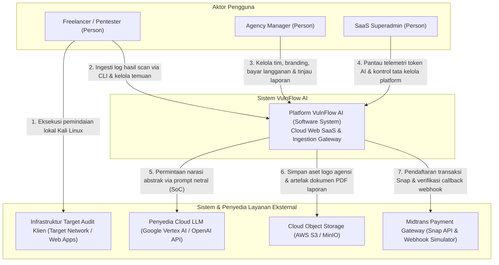

#### 2.2.2 C4 Level 2: Container Diagram
Diagram kontainer menguraikan unit-unit eksekusi mandiri, lingkungan runtime, serta protokol komunikasi yang membangun VulnFlow AI:

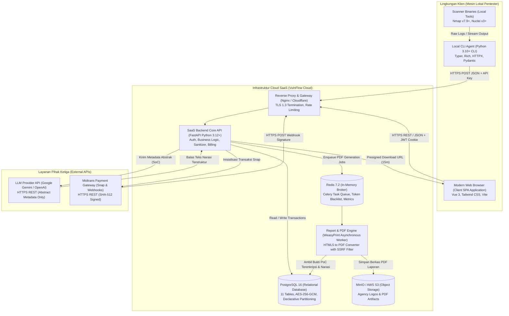

#### 2.2.3 C4 Level 3: Component Diagram (Backend Core)
Diagram komponen menjabarkan struktur internal modul perangkat lunak di dalam kontainer **SaaS Backend API** dengan mengadopsi arsitektur berlapis (*Layered / Hexagonal Architecture*) untuk memastikan isolasi aturan bisnis dari dependensi teknis:

```mermaid
flowchart TD
    subgraph PresentationLayer["Lapisan Antarmuka & Kontrol (Controllers / Routers)"]
        AuthCtrl["Auth & Sesi Controller"]
        IngestCtrl["Ingestion & API Key Controller"]
        ProjectCtrl["Project & Scope Controller"]
        TriageCtrl["Triage & Lifecycle Controller"]
        ReportCtrl["Report & Export Controller"]
        BillingCtrl["Billing & Midtrans Controller"]
        AdminCtrl["Admin & Telemetry Controller"]
    end

    subgraph DomainServiceLayer["Lapisan Logika Bisnis & Domain (Domain Services)"]
        RBACService["RBAC & Multi-tenant Enforcer"]
        ScopeValidator["Scope ROE Compliance Guard"]
        DeduplicationEngine["Deduplication & Triage Service"]
        SanitizerService["Data Sanitizer (Zero-PoC SoC)"]
        AIGhostwriterService["AI Ghostwriter Orchestrator"]
        CWEFallbackService["Deterministic CWE Knowledge Engine"]
        ReportCompilerService["Report Templating Service"]
        QuotaGuardService["Subscription & Quota Guard"]
    end

    subgraph PersistenceGatewayLayer["Lapisan Akses Data & Integrasi Eksternal (Adapters)"]
        DBRepo["PostgreSQL Repositories (SQLAlchemy 2.0)"]
        RedisAdapter["Redis Task Queue & Cache Client"]
        S3StorageAdapter["S3 / MinIO Object Storage Adapter"]
        LLMAdapter["LLM Provider Client (Gemini / OpenAI)"]
        MidtransAdapter["Midtrans Snap API & Signature Client"]
    end

    %% Hubungan Controller ke Service
    AuthCtrl --> RBACService
    IngestCtrl --> ScopeValidator
    IngestCtrl --> QuotaGuardService
    ProjectCtrl --> ScopeValidator
    TriageCtrl --> DeduplicationEngine
    ReportCtrl --> SanitizerService
    ReportCtrl --> AIGhostwriterService
    ReportCtrl --> ReportCompilerService
    ReportCtrl --> QuotaGuardService
    BillingCtrl --> QuotaGuardService
    AdminCtrl --> RBACService

    %% Hubungan Service ke Service
    AIGhostwriterService --> SanitizerService
    AIGhostwriterService --> CWEFallbackService
    ReportCompilerService --> QuotaGuardService

    %% Hubungan Service ke Lapisan Persistensi & Gateway
    RBACService --> DBRepo
    ScopeValidator --> DBRepo
    DeduplicationEngine --> DBRepo
    CWEFallbackService --> DBRepo
    QuotaGuardService --> DBRepo
    ReportCompilerService --> RedisAdapter
    ReportCompilerService --> S3StorageAdapter
    AIGhostwriterService --> LLMAdapter
    BillingCtrl --> MidtransAdapter
    QuotaGuardService --> DBRepo
```

---

#### 2.2.4 C4 Level 4: Code & Design Patterns (Komponen Ingestion & AI)

Untuk menjamin skalabilitas, kemudahan pengujian unit (*testability*), dan pemeliharaan jangka panjang (*maintainability*), komponen inti backend mengadopsi pola perancangan perangkat lunak (*design patterns*) terbukti:

1. **Strategy Pattern untuk Ingestion Parsers:**
   Menghindari struktur logika kondisional `if-else` raksasa saat mem-parsing log alat pemindai yang heterogen. Kelas abstrak `BaseScannerParser` mendefinisikan antarmuka seragam `parse(file_content) -> List[UnifiedFinding]`. Subkelas konkret mencakup `NmapXmlParser` dan `NucleiJsonParser`. Penambahan alat pemindai baru (misal ZAP atau Burp Suite) cukup dengan mengimplementasikan subkelas parser baru tanpa mengubah pipeline ingesti inti.

   ```python
   # Pola Strategy pada CLI Ingestion Engine
   from abc import ABC, abstractmethod
   from typing import List
   from pydantic import BaseModel


   class BaseScannerParser(ABC):
       @abstractmethod
       def parse(self, raw_content: bytes) -> List[BaseModel]:
           """Transformasi log mentah ke Unified Vulnerability Schema"""
           pass


   class NmapXmlParser(BaseScannerParser):
       def parse(self, raw_content: bytes) -> List[BaseModel]:
           # Ekstraksi berbasis SAX XML parsing hemat memori
           return parsed_findings


   class NucleiJsonParser(BaseScannerParser):
       def parse(self, raw_content: bytes) -> List[BaseModel]:
           # Ekstraksi stream JSON per-baris
           return parsed_findings
   ```

2. **Factory & Adapter Pattern untuk AI LLM Providers:**
   Mengisolasi kode backend dari *vendor lock-in* penyedia AI komersial. Kelas `LLMProviderFactory` bertugas memproduksi instance antarmuka `ILLMAdapter` (seperti `VertexGeminiAdapter`, `OpenAIAdapter`, atau `LocalOllamaAdapter`) sesuai variabel lingkungan aktif.
3. **Repository Pattern untuk Lapangan Persistensi Basis Data:**
   Memisahkan aturan bisnis (*business domain logic*) dari mekanisme kueri SQL SQLAlchemy / SQLModel, mempermudah pembuatan *Mock Unit Tests* tanpa memerlukan koneksi basis data aktif.

---

### 2.3 Activity Diagrams & State Machine Diagrams (AD)

Sesuai dengan standar formal **Unified Modeling Language (UML 2.5)**, pemodelan alur kerja sistem (*business & technical process flows*) pada tingkat operasional direpresentasikan menggunakan **Activity Diagrams** yang dilengkapi dengan **Partisi Aktivitas (Activity Partitions / Swimlanes)**.

Penerapan *swimlane* ini bertujuan memetakan secara eksplisit batasan tanggung jawab (*responsibility boundary*) dan distribusi eksekusi komputasi antar entitas yang terlibat dalam sistem hibrida terdistribusi VulnFlow AI, yang terbagi ke dalam empat jalur partisi:
1. **Aktor Pengguna Klien:** Interaksi langsung pentester pada terminal Kali Linux atau peninjauan auditor pada antarmuka Web SPA.
2. **Klien / Agen Lokal:** Komponen eksekusi lokal (*VulnFlow CLI Agent*) yang memproses parsing dan komputasi hash sebelum data dikirim ke luar mesin lokal.
3. **Cloud Gateway & Application Core:** Lapangan logika bisnis backend FastAPI yang memvalidasi otentikasi, otorisasi RBAC, ruang lingkup audit (*Rules of Engagement*), orkestrasi AI, dan kontrol kuota.
4. **Penyedia Pihak Ketiga & Lapisan Persistensi:** Pemrosesan eksternal oleh penyedia AI Cloud LLM, antrean tugas asinkron Redis/WeasyPrint, serta basis data PostgreSQL dan Object Storage S3/MinIO.

Di samping tiga Activity Diagram ber-swimlane tersebut, disertakan pula satu **State Machine Diagram** yang memodelkan siklus hidup kerentanan (*vulnerability lifecycle*).

---

#### 2.3.1 Activity Diagram 1: Pipeline Ingesti Scanner Terdistribusi & Normalisasi Temuan (AD-01)
**Mencakup Use Case:** `UC-03` (Manajemen Personal API Key), `UC-07` (Ingesti Otomatis Log via CLI Agent), `UC-07a` (Verifikasi API Key CLI), `UC-07b` (Parse Nmap XML / Nuclei JSON), `UC-07c` (Blokir Pelanggaran Kuota Batch), `UC-07d` (Karantina Temuan Out-of-Scope), `UC-08` (Entri Temuan Manual & Kalkulasi CVSS), `UC-08a` (Unggah Bukti PoC), `UC-10` (Deduplikasi Temuan).

Diagram aktivitas ber-swimlane ini memodelkan seluruh rantai proses ingesti temuan: mulai dari eksekusi scanner di lingkungan lokal Kali Linux, parsing dan normalisasi oleh CLI Agent lokal, transmisi batch via TLS 1.3, verifikasi otentikasi dan scope audit oleh Cloud Gateway, hingga persistensi atomik serta enkripsi bukti teknis (PoC) pada PostgreSQL:

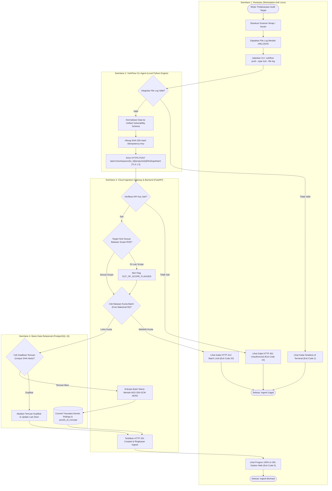

---

#### 2.3.2 Activity Diagram 2: Pipeline Sanitasi Data (SoC), AI Ghostwriter, & Fallback Deterministik (AD-02)
**Mencakup Use Case:** `UC-10` (Deduplikasi & Kurasi Temuan Laporan), `UC-11` (Pembangkitan Narasi Laporan via AI Ghostwriter), `UC-11a` (Sanitasi Data - Pemisahan PoC & PII), `UC-11b` (Pemicuan Fallback Template Lokal CWE), `UC-12` (Review & Sunting Teks Narasi AI - Human-in-the-Loop).

Diagram aktivitas ber-swimlane ini memodelkan penegakan prinsip isolasi data sensitif (*Separation of Concerns*), pembersihan data bukti eksploitasi sebelum ditransmisikan ke penyedia AI, eksekusi inferensi cloud LLM, orkestrasi modul *Deterministic In-Memory CWE Fallback Engine* saat terjadi gangguan/limitasi kuota pihak ketiga, hingga persetujuan narasi oleh auditor (*Human-in-the-Loop*):

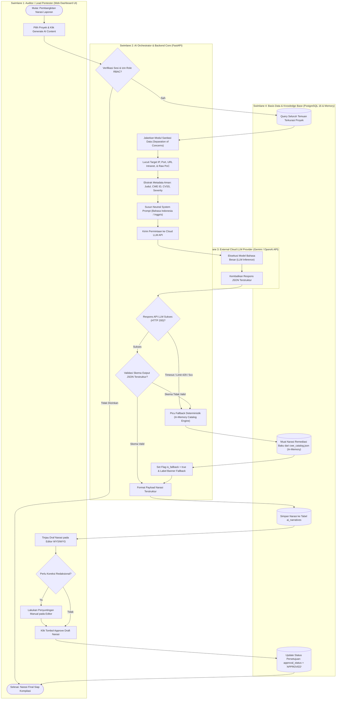

---

#### 2.3.3 Activity Diagram 3: Pipeline Kompilasi PDF Asinkron, Watermarking, & Presigned URL (AD-03)
**Mencakup Use Case:** `UC-13` (Konfigurasi White-labeling Agensi), `UC-14` (Kompilasi & Ekspor Laporan Akhir PDF), `UC-14a` (Verifikasi Kuota Laporan Bulanan), `UC-14b` (Terapkan White-label Bebas Watermark), `UC-14c` (Sematkan Watermark Free Tier), `UC-14d` (Antrean Asinkron Render Dokumen Besar), `UC-15` (Pemantauan Kuota Laporan Real-Time).

Diagram aktivitas ber-swimlane ini memodelkan seluruh rantai pembuatan artefak dokumen PDF formal berstandar ISO 32000-1: mulai dari pemicuan ekspor di browser, validasi saldo kuota laporan bulanan, pendelegasian antrean latar belakang WeasyPrint Worker secara 100% asinkron (mencegah blocking pada server API), pemfilteran SSRF pada aset gambar eksternal, injeksi branding kustom vs diagonal watermark paket gratis, penyimpanan artefak ke Object Storage S3, hingga penyampaian tautan unduh berwaktu (*presigned URL*):

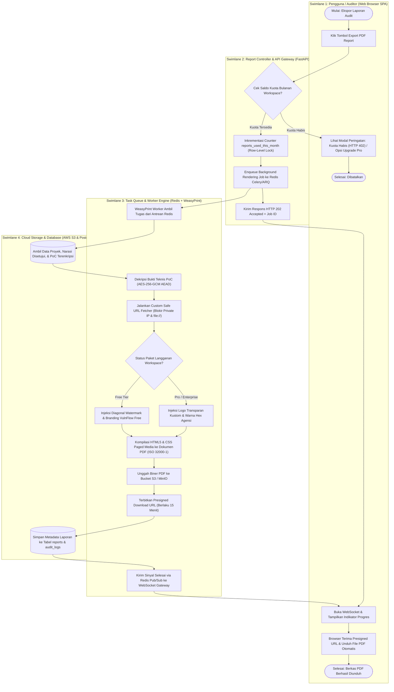

---

#### 2.3.4 Activity Diagram 4: Pipeline Onboarding, Multi-Tenancy, Pembayaran Midtrans Snap, & API Key (AD-04)
**Mencakup Use Case:** `UC-01` (Registrasi Akun Baru), `UC-02` (Autentikasi & Manajemen Sesi), `UC-02a` (Pemulihan Sandi), `UC-04` (Kelola Ruang Kerja Multi-Tenant), `UC-05` (Kelola Anggota Tim & RBAC), `UC-06` (Kelola Proyek Audit & Target Scope), `UC-06a` (Tugaskan Pentester ke Proyek), `UC-15` (Pemantauan Kuota Laporan Real-Time), `UC-16` (Transaksi Upgrade Langganan via Midtrans Snap).

Diagram aktivitas ber-swimlane ini memodelkan siklus hulu sistem: mulai dari pendaftaran akun pengguna baru, inisialisasi ruang kerja agensi, transaksi pembayaran upgrade paket Pro melalui gateway perbankan **Midtrans Snap** (metode QRIS dan Virtual Account), verifikasi tanda tangan kriptografis webhook, pembaruan kuota instan, hingga penerbitan token API Key kriptografis untuk agen CLI lokal:

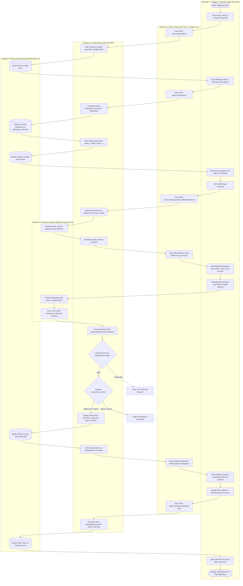

---

#### 2.3.5 State Machine Diagram: Siklus Hidup Status Kerentanan
Diagram State Machine berikut merepresentasikan transisi status siklus hidup kerentanan (*vulnerability lifecycle*) yang diatur pada **UC-09** dan **UC-09a**, termasuk deteksi regresi pengujian ulang (*retesting scan*):

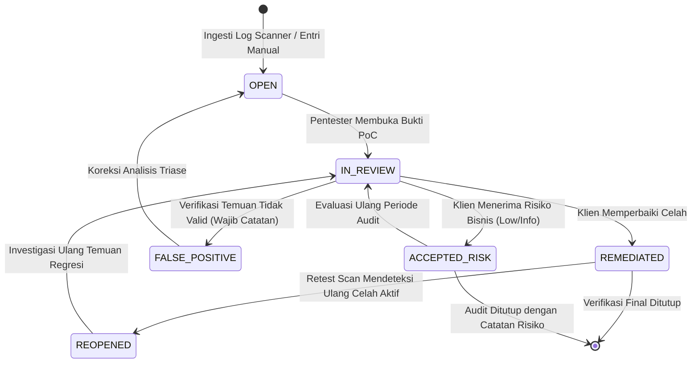

---

### 2.4 Desain Arsitektur Basis Data (Database Design)

#### 2.4.1 Entity-Relationship Diagram (ERD Relasional - The Lean 11 Tables)

Sistem basis data PostgreSQL VulnFlow AI mengadopsi arsitektur ramping dan pragmatis **The Lean 11 Tables**. Skema ini secara komprehensif mendukung seluruh 19 Use Case, multi-tenancy, penegakan kuota, dan jejak audit tanpa tabel-tabel redundan (*Zero Over-Engineering*):

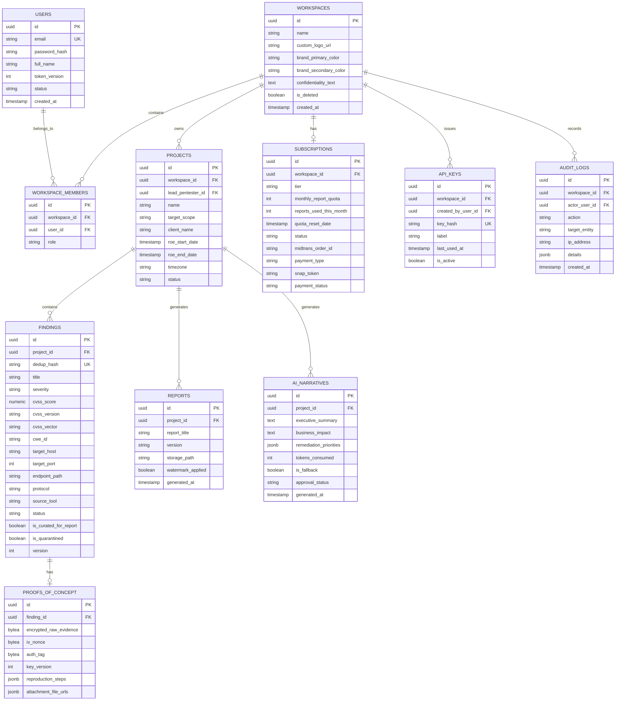

---

#### 2.4.2 Kamus Data Teknis (Data Dictionary - The Lean 11 Tables)

Sistem basis data PostgreSQL VulnFlow AI mengimplementasikan **11 entitas tabel inti** dengan spesifikasi tipe data dan batasan integritas relasional berikut:

1. **Tabel `users`:** Menyimpan akun terdaftar lintas organisasi.
   - `id` (UUID, Primary Key, Default: `gen_random_uuid()`)
   - `email` (VARCHAR(255), Unique, Not Null, Index)
   - `password_hash` (VARCHAR(255), Not Null, Hash Argon2id)
   - `full_name` (VARCHAR(100), Not Null)
   - `token_version` (INTEGER, Default: 1, Not Null) — Untuk pembatalan sesi instan
   - `status` (VARCHAR(20), Default: 'ACTIVE') — Enum: 'ACTIVE', 'SUSPENDED'
   - `created_at` (TIMESTAMPTZ, Default: `NOW()`)

2. **Tabel `workspaces`:** Entitas ruang kerja multi-tenant untuk isolasi data.
   - `id` (UUID, Primary Key)
   - `name` (VARCHAR(150), Not Null)
   - `custom_logo_url` (VARCHAR(500), Nullable) — Tautan aset logo di S3
   - `brand_primary_color` (VARCHAR(7), Default: '#0F172A') — Hex code
   - `brand_secondary_color` (VARCHAR(7), Default: '#3B82F6') — Hex code
   - `confidentiality_text` (TEXT, Nullable) — Klausul NDA kustom
   - `is_deleted` (BOOLEAN, Default: false) — Soft delete
   - `created_at` (TIMESTAMPTZ, Default: `NOW()`)

3. **Tabel `workspace_members`:** Asosiasi keanggotaan pengguna dan peran RBAC.
   - `id` (UUID, Primary Key)
   - `workspace_id` (UUID, Foreign Key ke `workspaces.id` ON DELETE CASCADE, Index)
   - `user_id` (UUID, Foreign Key ke `users.id` ON DELETE CASCADE, Index)
   - `role` (VARCHAR(20), Not Null) — Enum: 'MANAGER', 'PENTESTER', 'VIEWER'
   - `UNIQUE(workspace_id, user_id)`

4. **Tabel `subscriptions`:** Status lisensi komersial, integrasi pembayaran Midtrans Snap, dan penegakan kuota laporan.
   - `id` (UUID, Primary Key)
   - `workspace_id` (UUID, Foreign Key ke `workspaces.id` ON DELETE CASCADE, Unique, Index)
   - `tier` (VARCHAR(20), Default: 'FREE') — Enum: 'FREE', 'PRO', 'ENTERPRISE'
   - `monthly_report_quota` (INTEGER, Default: 3) — Kuota Free: 3, Pro: 30
   - `reports_used_this_month` (INTEGER, Default: 0)
   - `quota_reset_date` (TIMESTAMPTZ, Not Null)
   - `status` (VARCHAR(20), Default: 'ACTIVE') — Enum: 'ACTIVE', 'INACTIVE'
   - `midtrans_order_id` (VARCHAR(100), Nullable, Index) — Kode referensi order unik Midtrans
   - `payment_type` (VARCHAR(50), Nullable) — Metode bayar: 'qris', 'bank_transfer', 'gopay'
   - `snap_token` (VARCHAR(255), Nullable) — Token transaksi aktif sesi Midtrans Snap
   - `payment_status` (VARCHAR(30), Default: 'PENDING') — Enum: 'PENDING', 'SETTLEMENT', 'EXPIRE', 'CANCEL', 'DENY'

5. **Tabel `api_keys`:** Kunci token untuk otentikasi CLI Agent lokal.
   - `id` (UUID, Primary Key)
   - `workspace_id` (UUID, Foreign Key ke `workspaces.id` ON DELETE CASCADE, Index)
   - `created_by_user_id` (UUID, Foreign Key ke `users.id`, Index)
   - `key_hash` (VARCHAR(64), Unique, Not Null, Index) — Hash SHA-256
   - `label` (VARCHAR(100), Not Null) — Nama workstation mesin
   - `last_used_at` (TIMESTAMPTZ, Nullable)
   - `is_active` (BOOLEAN, Default: true)

6. **Tabel `projects`:** Proyek uji penetrasi dengan batasan cakupan target ROE dan kolaborator.
   - `id` (UUID, Primary Key)
   - `workspace_id` (UUID, Foreign Key ke `workspaces.id` ON DELETE CASCADE, Index)
   - `lead_pentester_id` (UUID, Nullable, Foreign Key ke `users.id`, Index) — PIC Audit
   - `name` (VARCHAR(150), Not Null)
   - `client_name` (VARCHAR(150), Not Null)
   - `target_scope` (TEXT, Not Null) — Daftar domain dan CIDR
   - `roe_start_date` (TIMESTAMPTZ, Not Null) — Mulai berlaku Rules of Engagement
   - `roe_end_date` (TIMESTAMPTZ, Not Null) — Batas akhir ROE (EC-05)
   - `timezone` (VARCHAR(50), Default: 'UTC') — Zona waktu lokal klien untuk evaluasi kedaluwarsa ROE (EC-05)
   - `status` (VARCHAR(20), Default: 'ACTIVE') — Enum: 'ACTIVE', 'ARCHIVED'

7. **Tabel `findings`:** Kerentanan ternormalisasi hasil ingesti dan manual dengan deduplikasi atomik.
   - `id` (UUID, Primary Key)
   - `project_id` (UUID, Foreign Key ke `projects.id` ON DELETE CASCADE, Index)
   - `dedup_hash` (VARCHAR(64), Not Null, Index) — SHA-256(project_id + cwe_id + host + port + endpoint_path), lihat EC-08 §5.2
   - `title` (VARCHAR(255), Not Null)
   - `severity` (VARCHAR(20), Not Null) — Enum: 'CRITICAL', 'HIGH', 'MEDIUM', 'LOW', 'INFO'
   - `cvss_score` (NUMERIC(3,1), Not Null)
   - `cvss_version` (VARCHAR(10), Default: '3.1') — '3.1' atau '4.0'
   - `cvss_vector` (VARCHAR(150), Not Null)
   - `cwe_id` (VARCHAR(20), Not Null) — Contoh: 'CWE-89' atau 'UNKNOWN'
   - `target_host` (VARCHAR(255), Not Null)
   - `target_port` (INTEGER, Nullable)
   - `endpoint_path` (VARCHAR(500), Default: '') — Komponen `dedup_hash`, cegah over-deduplikasi (EC-08)
   - `protocol` (VARCHAR(10), Default: 'tcp')
   - `source_tool` (VARCHAR(50), Not Null) — 'nmap', 'nuclei', 'manual'
   - `status` (VARCHAR(20), Default: 'OPEN') — Enum: 'OPEN', 'IN_REVIEW', 'REMEDIATED', 'REOPENED', 'FALSE_POSITIVE', 'ACCEPTED_RISK'
   - `is_curated_for_report` (BOOLEAN, Default: true)
   - `is_quarantined` (BOOLEAN, Default: false) — Target di luar `target_scope` proyek (UC-07d / EC-04)
   - `version` (INTEGER, Default: 1) — Optimistic locking counter
   - `CONSTRAINT uq_finding_dedup UNIQUE (dedup_hash)`

8. **Tabel `proofs_of_concept`:** Bukti teknis mentah terenkripsi aplikasi AES-256-GCM.
   - `id` (UUID, Primary Key)
   - `finding_id` (UUID, Foreign Key ke `findings.id` ON DELETE CASCADE, Unique, Index)
   - `encrypted_raw_evidence` (BYTEA, Not Null) — Ciphertext AES-256-GCM
   - `iv_nonce` (BYTEA, Not Null) — 12-byte initialization vector
   - `auth_tag` (BYTEA, Not Null) — 16-byte authentication tag
   - `key_version` (INTEGER, Default: 1, Not Null) — Dukungan rotasi kunci master kriptografi
   - `reproduction_steps` (JSONB, Nullable)
   - `attachment_file_urls` (JSONB, Nullable) — Array URL lampiran S3 privat

9. **Tabel `ai_narratives`:** Narasi teks yang dihasilkan oleh AI Ghostwriter per proyek audit.
   - `id` (UUID, Primary Key)
   - `project_id` (UUID, Foreign Key ke `projects.id` ON DELETE CASCADE, Index)
   - `executive_summary` (TEXT, Not Null)
   - `business_impact` (TEXT, Not Null)
   - `remediation_priorities` (JSONB, Not Null)
   - `tokens_consumed` (INTEGER, Default: 0)
   - `is_fallback` (BOOLEAN, Default: false)
   - `approval_status` (VARCHAR(20), Default: 'DRAFT') — 'DRAFT', 'APPROVED'
   - `generated_at` (TIMESTAMPTZ, Default: `NOW()`)

10. **Tabel `reports`:** Berkas artefak PDF resmi yang telah dikompilasi.
    - `id` (UUID, Primary Key)
    - `project_id` (UUID, Foreign Key ke `projects.id` ON DELETE CASCADE, Index)
    - `report_title` (VARCHAR(255), Not Null)
    - `version` (VARCHAR(20), Default: 'v1.0')
    - `storage_path` (VARCHAR(500), Not Null) — S3 Object Key
    - `watermark_applied` (BOOLEAN, Not Null)
    - `generated_at` (TIMESTAMPTZ, Default: `NOW()`)

11. **Tabel `audit_logs` (Partisi Deklaratif Bulanan):** Jejak audit keamanan sistem (SSOT).
    - `id` (UUID, Primary Key, Default: `gen_random_uuid()`)
    - `workspace_id` (UUID, Foreign Key ke `workspaces.id` ON DELETE CASCADE, Index)
    - `actor_user_id` (UUID, Nullable, Foreign Key ke `users.id`, Index)
    - `action` (VARCHAR(50), Not Null) — Misal: 'LOGIN', 'FINDING_STATUS_CHANGE', 'PAYMENT_SETTLED', 'PDF_EXPORT'
    - `target_entity` (VARCHAR(50), Not Null) — 'findings', 'subscriptions', 'workspaces'
    - `ip_address` (VARCHAR(45), Not Null)
    - `details` (JSONB, Not Null) — Payload perubahan status/alasan triase terstruktur
    - `created_at` (TIMESTAMPTZ, Default: `NOW()`, Not Null)

> **Catatan Keputusan Arsitektur & Desain Ramping (The Lean 11 Tables Rationale):**
> 1. **CWE Knowledge Base (Zero-Latency In-Memory):** Taksonomi CWE bersifat statis dan dimuat langsung ke memori runtime dari file lokal `app/data/cwe_catalog.json` ($\mathcal{O}(1)$ lookup $< 0.001$ ms), mengeliminasi latensi kueri database pada fallback path.
> 2. **Stateless Password Resets (OWASP ASVS Standard):** Token reset menggunakan cryptographic stateless signed token (TTL 15 menit) bertanda tangan HMAC dengan secret terikat pada `user.password_hash`. Hal ini mencegah serangan replay secara instan tanpa memerlukan tabel basis data tambahan.
> 3. **Single Source of Truth Audit Trail:** Histori perubahan status temuan dan catatan triase dikonsolidasikan langsung ke kolom `audit_logs.details (JSONB)`, meniadakan redundansi tabel `finding_history`.

#### 2.4.3 Strategi Enkripsi Data At-Rest & Rotasi Kunci (AES-256-GCM)
Seluruh rekaman bukti teknis eksploitasi (*raw PoC*) dienkripsi pada lapisan aplikasi sebelum query INSERT/UPDATE dieksekusi (*Application-Level Field Encryption*):
- Algoritma: **AES-256-GCM** dengan *Authenticated Encryption with Associated Data (AEAD)*.
- Kunci Enkripsi Master (`ENCRYPTION_MASTER_KEY`): Disimpan secara terisolasi pada manajemen rahasia environment variabel aman, tidak pernah dicatat di log.
- Setiap operasi enkripsi menghasilkan vektor inisialisasi acak (*IV/Nonce*) 12-byte baru dan menghasilkan authentication tag 16-byte guna mencegah serangan modifikasi ciphertext (*Tampering Prevention*).
- **Strategi Rotasi Kunci (Key Versioning):** Kolom `proofs_of_concept.key_version` menyimpan indeks versi kunci saat baris data dienkripsi, memungkinkan pembaharuan master key secara bertahap tanpa merusak dekripsi rekaman terdahulu.

#### 2.4.4 Strategi Partisi Tabel Bulanan & Optimasi Kueri (audit_logs)
Tabel `audit_logs` menyimpan seluruh riwayat aktivitas keamanan sistem dengan volume penambahan mencapai jutaan baris per tahun:
- Dikonfigurasi menggunakan **PostgreSQL Declarative Partitioning** bertipe *RANGE* berdasarkan kolom `created_at`.
- Partisi baru dibuat otomatis setiap pergantian bulan (`audit_logs_y2026m09`, `audit_logs_y2026m10`, dst.).
- Kueri penelusuran audit dengan filter tanggal secara otomatis memanfaatkan fitur *Partition Pruning*, membatasi pemindaian disk hanya pada partisi bulan yang relevan dan mempertahankan waktu kueri $< 200$ ms.
- Pada level PostgreSQL Role Privileges, user aplikasi backend hanya diberikan hak `INSERT` dan `SELECT`, sedangkan `UPDATE`, `DELETE`, dan `TRUNCATE` dicabut permanen (*Anti-Tampering Compliance*).

---

### 2.5 Arsitektur Keamanan & Analisis Ancaman STRIDE

#### 2.5.1 Pemodelan Ancaman STRIDE & Matriks Kontrol Mitigasi

| Kategori STRIDE | Potensi Skenario Ancaman | Dampak Sistem | Kontrol Keamanan & Solusi Perancangan (Security Requirements) |
| :--- | :--- | :--- | :--- |
| **Spoofing** (Pemalsuan Identitas) | Penyerang memalsukan identitas agen CLI untuk mengirim log temuan palsu ke proyek target. | Integritas data rusak, laporan pentest menyesatkan klien. | Kunci API (*API Key*) unik dengan prefix acak kriptografis 256-bit, diverifikasi melalui hash SHA-256 + constant-time comparison. |
| **Tampering** (Perusakan Data) | Perubahan parameter bukti PoC atau modifikasi skor keparahan saat transmisi data berlangsung. | Kerentanan kritis diturunkan tingkat risikonya menjadi Low. | Kewajiban TLS 1.3 menyeluruh; validasi integritas skema JSON ketat menggunakan Pydantic v2; database transactional constraints. |
| **Repudiation** (Penyangkalan Aksi) | Pentester menyangkal telah menghapus temuan penting atau mengekspor laporan klien ke pihak luar. | Sengketa hukum antara agensi pentesting dan pihak auditor. | Pencatatan log audit immutable (*Audit Trails*) pada tabel `audit_logs` untuk setiap operasi pembuatan, penghapusan, dan ekspor dokumen. |
| **Information Disclosure** (Kebocoran Informasi) | Kebocoran bukti PoC mentah (berisi payload/kredensial target) atau bocornya data target ke model AI publik. | Pelanggaran kerahasiaan (*confidentiality breach*), risiko hukum NDA klien. | Penerapan modul **Data Sanitizer Layer (SoC)**; enkripsi kolom database AES-256-GCM; isolasi data multi-tenant ketat berbasis *Workspace ID*. |
| **Denial of Service** (Penolakan Layanan) | Penyerang mengunggah berkas log XML sebesar ratusan MB atau memicu kompilasi PDF secara serentak untuk menghabiskan CPU (*PDF Bomb*). | Server crash, kehabisan memori, denial of service bagi pengguna lain. | Pembatasan ukuran payload maksimal 10 MB per upload; rate-limiting 120 req/menit pada Ingestion API; antrean asinkron Redis Celery berkapasitas batas. |
| **Elevation of Privilege** (Eskalasi Wewenang) | Pengguna tier Free atau peran *Pentester* mengubah payload request untuk mengakses fitur *White-labeling* atau proyek ruang kerja lain. | Pelanggaran lisensi komersial dan akses ilegal ke proyek klien lain (*IDOR*). | Penegakan wewenang di tingkat controller backend (*Guards/Decorators*) yang memvalidasi kepemilikan workspace dan hak lisensi pada basis data sebelum eksekusi. |

---

#### 2.5.2 Protokol Komunikasi Jaringan & Kontrol Pengerasan

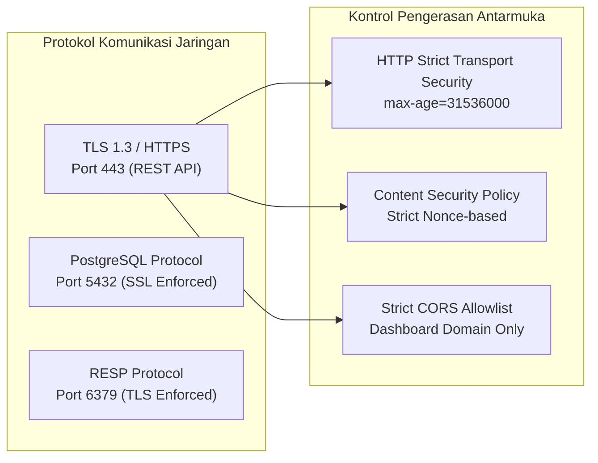

- **Enkripsi Transit:** Komunikasi antara CLI Agent, Web Frontend, dan Backend diwajibkan menggunakan **TLS 1.3** dengan cipher suite aman: `TLS_AES_256_GCM_SHA384` atau `TLS_CHACHA20_POLY1305_SHA256`.
- **HTTP Strict Transport Security (HSTS):** Penegakan header `Strict-Transport-Security: max-age=31536000; includeSubDomains; preload`.
- **Content Security Policy (CSP):** Perlindungan terhadap serangan XSS dan injeksi skrip dengan header CSP ketat berbasis nonce dinamis.
- **Cross-Origin Resource Sharing (CORS):** Membatasi akses request API hanya dari domain resmi dashboard web VulnFlow AI.

#### 2.5.3 Arsitektur Sanitasi Data & Filter PII/PoC (Guardrail AI)
Sistem menerapkan modul *Data Sanitizer* sebelum data temuan diteruskan ke cloud LLM:
1. *Strict Whitelisting:* Hanya kolom aman (`title`, `cwe_id`, `cvss_score`, `severity`) yang diteruskan.
2. *PoC & PII Stripping:* Modul memotong seluruh alamat IP privat/publik, port, domain intranet, dan payload PoC mentah.
3. *Adversarial Prompt Escaping:* Menghapus karakter kontrol, tanda kurung escape, dan injeksi instruksi jahat (*prompt injection*) dari banner layanan scanner.

#### 2.5.4 Pengerasan Keamanan PDF Generator: Custom Safe URL Fetcher (Anti-SSRF)
Untuk memenuhi persyaratan **NFR-SEC-002**, komponen *ReportWorker* WeasyPrint mengimplementasikan pemfilteran ketat terhadap seluruh sumber gambar eksternal (logo agensi, tangkapan layar PoC) guna mencegah serangan *Server-Side Request Forgery* (SSRF) dan pembacaan berkas lokal:

```python
# app/services/report_engine/safe_fetcher.py
import ipaddress
import urllib.parse
from weasyprint import default_url_fetcher

BLOCKED_IP_NETWORKS = [
    ipaddress.ip_network("127.0.0.0/8"),  # Loopback IPv4
    ipaddress.ip_network("10.0.0.0/8"),  # Private RFC 1918
    ipaddress.ip_network("172.16.0.0/12"),  # Private RFC 1918
    ipaddress.ip_network("192.168.0.0/16"),  # Private RFC 1918
    ipaddress.ip_network("169.254.0.0/16"),  # Cloud Metadata (AWS/GCP/Azure)
    ipaddress.ip_network("::1/128"),  # IPv6 Loopback
]


def safe_url_fetcher(url: str, timeout: int = 5, ssl_context=None):
    parsed = urllib.parse.urlsplit(url)

    # 1. Tolak protokol berbahaya selain HTTP / HTTPS (Blokir file://, gopher://, php://)
    if parsed.scheme not in ("http", "https"):
        raise PermissionError(
            f"Akses skema URI '{parsed.scheme}' diblokir oleh kebijakan keamanan anti-SSRF."
        )

    # 2. Resolusi DNS dan validasi alamat IP tujuan
    hostname = parsed.hostname
    if hostname is None:
        raise PermissionError("URL tanpa hostname valid diblokir oleh kebijakan anti-SSRF.")
    try:
        target_ip = ipaddress.ip_address(hostname)
    except ValueError:
        import socket

        target_ip = ipaddress.ip_address(socket.gethostbyname(hostname))

    # NB: properti is_private/is_loopback/is_link_local/is_reserved/is_unspecified
    # dan ip.ipv4_mapped (untuk varian IPv6 seperti ::ffff:127.0.0.1) lebih
    # lengkap daripada daftar manual BLOCKED_IP_NETWORKS — gunakan kombinasi
    # keduanya saat FASE 3.6 mengimplementasikan modul ini secara penuh.
    for blocked_net in BLOCKED_IP_NETWORKS:
        if target_ip in blocked_net:
            raise PermissionError(
                f"Permintaan ke IP privat/metadata cloud ({target_ip}) diblokir oleh anti-SSRF guard."
            )

    # 3. Lanjutkan fetcher jika lolos audit keamanan
    return default_url_fetcher(url, timeout=timeout, ssl_context=ssl_context)
```

---

### 2.6 Desain Antarmuka Eksternal & Kontrak REST API

#### 2.6.0 Ikhtisar Antarmuka

##### 2.6.0.1 Antarmuka Klien Baris Perintah (CLI Agent)
CLI Agent diimplementasikan dengan perintah berbasis sub-command yang ramah pengguna. Contoh interaksi terminal:

```bash
$ vulnflow --version
VulnFlow CLI Agent v1.0.0 (x86_64-linux)

$ vulnflow configure --token vf_live_89b21f92e4ab43... --workspace ws_corp_cybersec
[+] Configuration validated successfully! Connected as: "Auditor-01" (Agency Pro)

$ vulnflow push --project prj_bank_audit --type nuclei --file nuclei_results.json
[•] Parsing nuclei_results.json ...
    -> Found 14 findings (2 Critical, 4 High, 5 Medium, 3 Low)
    -> Score standard: CVSS v3.1 parsed from templates
[•] Normalizing payload into Unified Vulnerability Schema ... Done.
[•] Uploading 14 findings to VulnFlow Cloud (Target: prj_bank_audit) ...
[==================================================] 100% (Batch 1/1)
[✓] Success! Findings ingested successfully.
    Dashboard link: https://app.vulnflow.ai/workspaces/ws_corp_cybersec/projects/prj_bank_audit
```

##### 2.6.0.2 Antarmuka Web Dashboard
- **Security Posture Overview:** Ringkasan visual matriks risiko (diagram radar & baris keparahan temuan), tren remediasi, dan kuota laporan aktif.
- **Project Scope Manager:** Antarmuka pembuatan proyek, pendefinisian aset target (domain, URL, subnet IP), dan penentuan jangka waktu ROE.
- **Vulnerability Table (Interactive Grid):** Fitur filter multi-parameter (kategori CWE, host terdampak, severity), dropdown pengubah status triase (*Open, In-Review, Remediated, False Positive*), inline checkbox untuk memilih temuan yang akan dimasukkan ke laporan akhir, serta modal editor PoC.
- **Branding & Theme Studio:** Panel kustomisasi visual interaktif (*Live WYSIWYG*) untuk mengatur warna heksadesimal kop, mengunggah logo agensi, dan memposisikan tanda tangan *Lead Pentester*.

---

#### 2.6.1 Spesifikasi Kontrak REST API & JSON Schemas

Seluruh komunikasi API menerapkan standar OpenAPI 3.1. Berikut adalah skema data JSON yang mengikat integrasi sistem:

##### 2.6.1.1 Skema Data Ingesti Terpadu (Unified Vulnerability Schema)
Semua parser (Nmap, Nuclei, Manual Form) wajib menormalisasi data ke dalam struktur JSON berikut sebelum disimpan:

```json
{
  "$schema": "https://json-schema.org/draft/2020-12/schema",
  "title": "UnifiedVulnerabilityFinding",
  "type": "object",
  "required": [
    "title",
    "severity",
    "target_host",
    "source_tool",
    "proof_of_concept"
  ],
  "properties": {
    "title": {
      "type": "string",
      "minLength": 1,
      "maxLength": 255,
      "description": "Nama resmi kerentanan, misal: Apache Log4j RCE (CVE-2021-44228)"
    },
    "severity": {
      "type": "string",
      "enum": ["CRITICAL", "HIGH", "MEDIUM", "LOW", "INFO"]
    },
    "cvss_version": {
      "type": "string",
      "enum": ["3.1", "4.0"],
      "default": "3.1"
    },
    "cvss_score": {
      "type": "number",
      "minimum": 0.0,
      "maximum": 10.0
    },
    "cvss_vector": {
      "type": "string",
      "maxLength": 150,
      "description": "Formal CVSS Vector string, misal: CVSS:3.1/AV:N/AC:L/PR:N/UI:N/S:U/C:H/I:H/A:H"
    },
    "cwe_id": {
      "type": "string",
      "pattern": "^(CWE-[0-9]+|UNKNOWN)$",
      "default": "UNKNOWN",
      "description": "ID taksonomi CWE, misal: CWE-89 atau UNKNOWN"
    },
    "target_host": {
      "type": "string",
      "maxLength": 255,
      "description": "IP atau domain target, misal: 192.168.1.50 atau api.internal.corp"
    },
    "target_port": {
      "type": ["integer", "null"],
      "minimum": 1,
      "maximum": 65535,
      "description": "Nomor porta layanan target, bernilai null jika audit berbasis domain umum"
    },
    "protocol": {
      "type": "string",
      "enum": ["tcp", "udp", "http", "https", "icmp", "sctp", "other"],
      "default": "tcp"
    },
    "source_tool": {
      "type": "string",
      "enum": ["nmap", "nuclei", "manual"]
    },
    "proof_of_concept": {
      "type": "object",
      "required": ["raw_evidence"],
      "properties": {
        "raw_evidence": {
          "type": "string",
          "description": "String payload mentah, response header, atau log output terminal"
        },
        "reproduction_steps": {
          "type": "array",
          "items": { "type": "string" }
        },
        "attachment_urls": {
          "type": "array",
          "items": { "type": "string", "format": "uri" }
        }
      }
    }
  }
}
```

##### 2.6.1.2 Kontrak Endpoint Ingesti CLI
- **Metode:** `POST`
- **Path:** `/api/v1/workspaces/{workspace_id}/projects/{project_id}/findings/batch`
- **Headers:**
  - `Content-Type: application/json`
  - `X-VulnFlow-API-Key: vf_live_xxxxxxxxxxxxxxxxxxxxxxxx`
  - `Idempotency-Key: <SHA256_HASH_FILE>` untuk payload tunggal (1 request), atau `<SHA256_HASH_FILE>:<chunk_index>` untuk tiap fragmen saat CLI melakukan *chunked streaming* pada berkas > 200 MB (lihat SRS UC-07 Alur E3). Backend memperlakukan kunci ini murni sebagai pencegah pemrosesan ganda **per request HTTP**, bukan sebagai gerbang deduplikasi data — deduplikasi data lintas-fragmen tetap ditegakkan oleh `dedup_hash` per-temuan (EC-08), bukan oleh header ini.
- **Request Body:**
  ```json
  {
    "scan_metadata": {
      "scanner_name": "nuclei",
      "scanner_version": "v3.2.4",
      "scan_duration_seconds": 142
    },
    "findings": [
      {
        "title": "Git Config File Disclosure",
        "severity": "MEDIUM",
        "cvss_version": "3.1",
        "cvss_score": 5.3,
        "cvss_vector": "CVSS:3.1/AV:N/AC:L/PR:N/UI:N/S:U/C:L/I:N/A:N",
        "cwe_id": "CWE-538",
        "target_host": "staging.clientdomain.com",
        "target_port": 443,
        "protocol": "https",
        "source_tool": "nuclei",
        "proof_of_concept": {
          "raw_evidence": "HTTP/1.1 200 OK\n[core]\nrepositoryformatversion = 0\nfilemode = true..."
        }
      }
    ]
  }
  ```
- **Responses:**
  - `201 Created`: Seluruh data temuan berhasil diverifikasi dan disimpan.
  - `401 Unauthorized`: API Key tidak terdaftar atau telah dicabut.
  - `413 Payload Too Large`: Volume batch melampaui batas 50 temuan untuk Free Tier atau berkas unggahan > 10 MB (Koreksi RFC 9110).
  - `422 Unprocessable Content`: Validasi JSON Schema gagal pada salah satu objek temuan.

##### 2.6.1.3 Kontrak Endpoint AI Report Generation
- **Metode:** `POST`
- **Path:** `/api/v1/workspaces/{workspace_id}/projects/{project_id}/reports/ai-narratives`
- **Headers:**
  - `Authorization: Bearer <JWT_USER_SESSION>`
  - `Content-Type: application/json`
- **Request Body:**
  ```json
  {
    "tone": "formal_executive",
    "language": "id",
    "sections_requested": ["executive_summary", "business_impact", "remediation_roadmap"],
    "finding_ids": ["fnd_uuid_001", "fnd_uuid_002", "fnd_uuid_003"]
  }
  ```
- **Response `200 OK`:**
  ```json
  {
    "narratives": {
      "executive_summary": "Berdasarkan audit keamanan yang dilaksanakan pada sistem target...",
      "business_impact": "Eksploitasi kerentanan kategori High dapat menimbulkan kerugian operasional...",
      "remediations": [
        {
          "cwe_id": "CWE-89",
          "vuln_title": "SQL Injection",
          "remediation_guidance": "Gunakan prepared statement parameterized query pada seluruh controller autentikasi..."
        }
      ]
    },
    "tokens_consumed": 1420,
    "generated_at": "2026-09-23T18:15:00Z"
  }
  ```

##### 2.6.1.4 Kontrak Endpoint Autentikasi Pengguna & Sesi (FR-AUTH / UC-01, UC-02)
- **Endpoint Registrasi Akun:** `POST /api/v1/auth/register`
  - **Headers:** `Content-Type: application/json`
  - **Request Body JSON:**
    ```json
    {
      "email": "auditor@agency.corp",
      "password": "SecurePassword123!",
      "full_name": "Ahmad Dani",
      "workspace_name": "Agency Security Corp"
    }
    ```
  - **Responses:**
    - `201 Created`: Akun berhasil didaftarkan dan workspace default terbentuk.
      ```json
      {
        "user_id": "usr_uuid_7712",
        "email": "auditor@agency.corp",
        "full_name": "Ahmad Dani",
        "workspace_id": "wsp_uuid_9921",
        "access_token": "eyJhbGciOiJIUzI1NiIsInR5cCI6IkpXVCJ9...",
        "token_type": "bearer",
        "expires_in": 86400
      }
      ```
    - `409 Conflict`: Alamat email sudah terdaftar dalam sistem.
    - `422 Unprocessable Content`: Format email tidak valid atau kompleksitas kata sandi kurang (< 8 karakter, wajib angka & simbol).

- **Endpoint Login Sesi Pengguna:** `POST /api/v1/auth/login`
  - **Headers:** `Content-Type: application/json`
  - **Request Body JSON:**
    ```json
    {
      "email": "auditor@agency.corp",
      "password": "SecurePassword123!"
    }
    ```
  - **Responses:**
    - `200 OK`: Kredensial valid, mengembalikan token akses JWT dan daftar ruang kerja yang berhak diakses.
      ```json
      {
        "access_token": "eyJhbGciOiJIUzI1NiIsInR5cCI6IkpXVCJ9...",
        "token_type": "bearer",
        "expires_in": 86400,
        "user": {
          "id": "usr_uuid_7712",
          "email": "auditor@agency.corp",
          "full_name": "Ahmad Dani"
        },
        "workspaces": [
          {
            "id": "wsp_uuid_9921",
            "name": "Agency Security Corp",
            "role": "MANAGER"
          }
        ]
      }
      ```
    - `401 Unauthorized`: Kredensial email atau kata sandi tidak cocok.
    - `403 Forbidden`: Akun pengguna berstatus `SUSPENDED` oleh Superadmin (UC-18).

##### 2.6.1.5 Kontrak Endpoint Kompilasi Laporan PDF Asinkron (FR-REP / UC-14, UC-14d)
- **Metode & Path:** `POST /api/v1/workspaces/{workspace_id}/projects/{project_id}/reports/compile-pdf`
- **Headers:**
  - `Authorization: Bearer <JWT_USER_SESSION>`
  - `Content-Type: application/json`
- **Request Body JSON:**
  ```json
  {
    "finding_ids": [
      "fnd_uuid_001",
      "fnd_uuid_002"
    ],
    "include_ai_narratives": true,
    "theme_options": {
      "primary_color": "#0F172A",
      "secondary_color": "#3B82F6",
      "show_cover_page": true,
      "show_cvss_radar": true,
      "confidentiality_notice": "STRICTLY CONFIDENTIAL"
    }
  }
  ```
- **Responses:**
  - `202 Accepted`: Pekerjaan kompilasi dokumen berhasil dimasukkan ke dalam antrean latar belakang Celery/Redis.
    ```json
    {
      "job_id": "job_pdf_883192",
      "status": "QUEUED",
      "message": "Permintaan kompilasi PDF telah masuk dalam antrean latar belakang Celery.",
      "status_url": "/api/v1/workspaces/wsp_uuid_9921/reports/jobs/job_pdf_883192"
    }
    ```
  - `402 Payment Required`: Batas kuota laporan bulanan habis (Batas Free Tier: 3/3 Laporan tercapai).
  - `404 Not Found`: Entitas workspace atau proyek tidak ditemukan.

- **Endpoint Pemantauan Status Job Kompilasi PDF:** `GET /api/v1/workspaces/{workspace_id}/reports/jobs/{job_id}`
  - **Headers:** `Authorization: Bearer <JWT_USER_SESSION>`
  - **Responses:**
    - `200 OK (Status COMPLETED)`:
      ```json
      {
        "job_id": "job_pdf_883192",
        "status": "COMPLETED",
        "progress_percentage": 100,
        "report_id": "rep_uuid_1029",
        "download_url": "https://storage.vulnflow.ai/reports/rep_uuid_1029.pdf?X-Amz-Signature=...",
        "expires_in_seconds": 900
      }
      ```
    - `200 OK (Status PROCESSING)`:
      ```json
      {
        "job_id": "job_pdf_883192",
        "status": "PROCESSING",
        "progress_percentage": 65
      }
      ```
    - `500 Internal Server Error (Status FAILED)`:
      ```json
      {
        "job_id": "job_pdf_883192",
        "status": "FAILED",
        "error_message": "Gagal merender CSS Paged Media WeasyPrint akibat timeout rendering aset gambar."
      }
      ```

##### 2.6.1.6 Kontrak Endpoint Entri Temuan Manual & Kalkulasi CVSS (FR-INGEST-004 / UC-08, UC-08a)
- **Metode & Path:** `POST /api/v1/workspaces/{workspace_id}/projects/{project_id}/findings/manual`
- **Headers:**
  - `Authorization: Bearer <JWT_USER_SESSION>`
  - `Content-Type: application/json`
- **Request Body JSON:**
  ```json
  {
    "title": "Broken Object Level Authorization on User Profile Endpoint",
    "severity": "HIGH",
    "cvss_vector": "CVSS:3.1/AV:N/AC:L/PR:L/UI:N/S:U/C:H/I:H/A:N",
    "cwe_id": "CWE-639",
    "target_host": "api.targetapp.com",
    "target_port": 443,
    "protocol": "https",
    "proof_of_concept": {
      "raw_evidence": "GET /api/v1/users/9981 HTTP/1.1\nHost: api.targetapp.com\nAuthorization: Bearer TokenUser10",
      "reproduction_steps": [
        "Login sebagai akun pengguna biasa User A (ID: 10)",
        "Kirim request GET ke /api/v1/users/9981 milik User B",
        "Server mengembalikan data profil lengkap User B tanpa validasi otorisasi"
      ]
    }
  }
  ```
- **Responses:**
  - `201 Created`: Temuan manual berhasil disimpan dan skor CVSS (8.1) dikalkulasi secara otomatis oleh mesin backend.
    ```json
    {
      "id": "fnd_uuid_manual_01",
      "project_id": "prj_uuid_bank",
      "title": "Broken Object Level Authorization on User Profile Endpoint",
      "severity": "HIGH",
      "cvss_score": 8.1,
      "cvss_vector": "CVSS:3.1/AV:N/AC:L/PR:L/UI:N/S:U/C:H/I:H/A:N",
      "cwe_id": "CWE-639",
      "source_tool": "manual",
      "status": "OPEN",
      "created_at": "2026-09-28T00:30:00Z"
    }
    ```
  - `422 Unprocessable Content`: Vektor string CVSS v3.1 tidak valid atau melanggar format matematis FIRST.

##### 2.6.1.7 Standar Format Respons Galat Sistem (Uniform Error Envelope RFC 9110)
Seluruh respons kesalahan (*error responses*) pada API VulnFlow AI wajib mengikuti struktur amplop JSON konsisten:
```json
{
  "status": "error",
  "code": "ERROR_CODE_STRING",
  "message": "Pesan deskripsi kesalahan dalam Bahasa Indonesia baku yang informatif.",
  "details": {
    "field": "nama_kolom",
    "issue": "detail_pelanggaran_aturan"
  },
  "timestamp": "2026-09-28T00:30:00Z"
}
```

Daftar Kode Galat Standar (*Standard Error Codes*):
- `AUTHENTICATION_FAILED` (HTTP 401): Token JWT tidak valid, kadaluwarsa, atau kunci API CLI tidak terdaftar.
- `PERMISSION_DENIED` (HTTP 403): Pengguna tidak memiliki hak akses pada workspace, atau akun dibekukan (*SUSPENDED*).
- `QUOTA_EXHAUSTED` (HTTP 402): Batas kuota kompilasi laporan bulanan paket Free (3 laporan) telah habis.
- `RESOURCE_NOT_FOUND` (HTTP 404): Entitas yang diminta (proyek, temuan, berkas) tidak ditemukan.
- `BATCH_LIMIT_EXCEEDED` (HTTP 413): Jumlah temuan pada batch push melebihi 50 item (Batas Free Tier).
- `PAYLOAD_TOO_LARGE` (HTTP 413): Ukuran berkas log scanner melampaui batas 10 MB.
- `VALIDATION_FAILED` (HTTP 422): Ketidaksesuaian skema payload request terhadap validasi model Pydantic.
- `INTERNAL_SERVER_ERROR` (HTTP 500): Kegagalan tak terduga pada infrastruktur backend atau worker engine.

---

#### 2.6.2 Antarmuka AI LLM & Guardrail Prompt Engineering

##### 2.6.2.1 Arsitektur Sanitasi Data & Filter PII/PoC
Sebelum backend mengirimkan permintaan ke LLM, objek temuan kerentanan wajib melalui fungsi `SanitizeForLLM()`:

```python
def sanitize_for_llm(vulnerability_list: list[dict]) -> list[dict]:
    """
    Ekstraksi ketat: HANYA mengambil atribut taksonomi abstrak.
    Membuang bukti PoC, URL mentah, IP, dan rekaman lalu lintas.
    """
    sanitized_payload = []
    for item in vulnerability_list:
        sanitized_payload.append(
            {
                "vulnerability_name": item["title"],
                "cwe_category": item.get("cwe_id", "UNKNOWN"),
                "severity_level": item["severity"],
                "cvss_score": item.get("cvss_score"),
                "cvss_version": item.get("cvss_version", "3.1"),
                "attack_surface_type": "Web Application"
                if item.get("protocol") in ["http", "https"]
                else "Network Service",
            }
        )
    return sanitized_payload
```

##### 2.6.2.2 System Prompt & Skema JSON Output AI
Sistem menggunakan teknik *Constrained JSON Generation* dengan prompt baku terisolasi:

```text
SYSTEM INSTRUCTION:
Anda adalah Senior Cybersecurity Reporting Consultant bertaraf internasional.
Tugas Anda HANYA menyusun narasi pelaporan profesional berdasarkan daftar nama kerentanan yang diberikan.

ATURAN KESELAMATAN KETAT:
1. Jangan pernah meminta atau memproses kode eksploitasi mentah (PoC), IP address, atau payload serangan.
2. Format luaran HARUS berupa JSON valid tanpa teks pembuka atau penutup markdown selain blok JSON.
3. Gaya bahasa harus formal, persuasif bagi tingkat C-Level (Direksi), dan instruktif bagi tim teknis pengembang software.

SKEMA LUARAN JSON YANG DIHARUSKAN (harus persis sama dengan kontrak `NarrativeContent` §2.6.1.3 — model Pydantic `extra="forbid"` menolak bentuk lain):
{
  "executive_summary": "string narasi ringkasan manajerial komprehensif",
  "business_impact": "string uraian ancaman finansial, reputasi, dan kepatuhan",
  "remediations": [
    {
      "cwe_id": "string ID taksonomi CWE, misal CWE-89",
      "vuln_title": "string nama kerentanan",
      "remediation_guidance": "string panduan mitigasi teknis"
    }
  ]
}
```

##### 2.6.2.3 Strategi Penanganan Kegagalan & Fallback Template In-Memory
Jika pemanggilan API LLM gagal akibat batas kuota (*HTTP 429*), kegagalan penyedia (*HTTP 5xx*), atau penolakan respons:
1. **Exponential Backoff:** Sistem mencoba ulang (*retry*) maksimal 3 kali (interval 1s, 2s, 4s).
2. **Deterministic In-Memory Fallback Engine:** Jika seluruh *retry* gagal, sistem memuat repositori narasi kurasi internal berdasarkan CWE ID yang terdeteksi dari berkas statis lokal `app/data/cwe_catalog.json` ($\mathcal{O}(1)$ in-memory lookup $< 0.001$ ms). Pendekatan ini menjamin proses pembuatan laporan tidak pernah terhenti (*zero-downtime reporting*) bahkan saat infrastruktur basis data sedang mengalami beban puncak.

---

#### 2.6.3 Spesifikasi Kontrak Endpoint Pembayaran Midtrans Snap (FR-SUB / UC-16)

##### 2.6.3.1 Endpoint Checkout Transaksi Midtrans Snap
- **Method & Route:** `POST /api/v1/workspaces/{workspace_id}/billing/checkout`
- **Headers:** `Authorization: Bearer <JWT_MANAGER_TOKEN>`
- **Request Body JSON:**
  ```json
  {
    "tier": "PRO",
    "billing_cycle": "MONTHLY"
  }
  ```
- **Response HTTP 200 OK:**
  ```json
  {
    "order_id": "ORD-WSP01-1727452800",
    "gross_amount": 750000,
    "snap_token": "7a9f8b2c-4e1d-3a5b-8c7e-9f0a1b2c3d4e",
    "redirect_url": "https://app.sandbox.midtrans.com/snap/v2/vtweb/7a9f8b2c-4e1d-3a5b-8c7e-9f0a1b2c3d4e"
  }
  ```

##### 2.6.3.2 Endpoint Webhook Notifikasi Pembayaran Midtrans (Asinkron)
- **Method & Route:** `POST /api/v1/billing/webhook/midtrans`
- **Headers:** `Content-Type: application/json`
- **Request Body JSON (Dikirim oleh Midtrans Server):**
  ```json
  {
    "order_id": "ORD-WSP01-1727452800",
    "status_code": "200",
    "gross_amount": "750000.00",
    "signature_key": "9a8b7c6d5e4f3a2b1c0d9e8f7a6b5c4d3e2f1a0b9c8d7e6f5a4b3c2d1e0f9a8b...",
    "transaction_status": "settlement",
    "payment_type": "qris",
    "transaction_time": "2026-09-27 23:45:00"
  }
  ```
- **Response HTTP 200 OK:**
  ```json
  {
    "status": "OK",
    "message": "Payment notification processed successfully"
  }
  ```
> **Catatan Normalisasi Signature Midtrans:** Nilai `gross_amount` wajib dinormalisasi secara presisi menyertakan format dua desimal (misal `"750000.00"`) saat mengomputasi hash verifikasi `SHA-512(order_id + status_code + gross_amount + ServerKey)` untuk mencegah kegagalan validasi tanda tangan transaksi yang sah.

#### 2.6.4 Antarmuka Perangkat Lunak dan Jaringan

Diagram protokol jaringan & kontrol pengerasan sudah dirinci di §2.5.2 (tidak diduplikasi di sini). Tambahan khusus untuk lapisan antarmuka perangkat lunak:

- **Enkripsi At-Rest:** Seluruh kolom basis data yang memuat bukti teknis (`proof_of_concept.raw_evidence`) dienkripsi pada tingkat kolom (*Application-level Field Encryption*) menggunakan algoritma **AES-256-GCM** dengan kunci enkripsi yang disimpan terpisah pada variabel lingkungan aman.

---

### 2.7 Arsitektur Ketahanan Sistem & Penanganan Kasus Batas (System Resilience & Edge Case Mitigation Strategy)

Untuk menjamin kualitas keandalan tingkat tinggi (*High Reliability*) sesuai karakteristik **ISO/IEC 25010:2023** (*Fault Tolerance & Availability*) serta menghilangkan hambatan alur kerja pengguna (*Frictionless UX*), sistem mengimplementasikan pola pertahanan terstruktur terhadap **18 Kasus Batas Kritis (Edge Cases EC-01 s.d. EC-18)**. Rujukan teknis mendalam dan skenario pengujian QA diatur pada dokumen pelengkap [**DOCS/EDGE_CASES_AND_RESILIENCE.md**](file:///c:/Users/KaliCodeS3/Documents/Project/IPPL/DOCS/EDGE_CASES_AND_RESILIENCE.md).

#### 2.7.1 Matriks 18 Kasus Batas Kritis Alur Kerja (EC-01 s.d. EC-18)

| ID Kasus | Fase Alur Kerja | Kondisi Pemicu Kasus Batas (*Trigger*) | Mitigasi Arsitektural & Mekanisme Pertahanan | Respons / Status Kode HTTP |
| :---: | :--- | :--- | :--- | :---: |
| **EC-01** | Multi-Tenancy | Auditor tergabung dalam banyak workspace | CLI membaca `active_workspace_id` di `~/.vulnflow/config.json` lokal | Validasi Konteks Client & `403` |
| **EC-02** | Multi-Tenancy | Undangan anggota ke email yang belum terdaftar | Menerbitkan signed `invitation_token` (JWT berlaku 7 hari) | Auto-join saat registrasi |
| **EC-03** | Multi-Tenancy | Owner tunggal menghapus akun saat proyek aktif | Basis data menolak penghapusan sebelum *Transfer Ownership* | `HTTP 409 Conflict` |
| **EC-04** | Scoping & ROE | Host target berupa subdomain bertingkat | Normalisasi FQDN & Regex Suffix Tree di `ScopeEnforcer` | Pra-Pencocokan FQDN/CIDR |
| **EC-05** | Scoping & ROE | Perbedaan zona waktu pada tanggal ROE | Evaluasi waktu menggunakan `TIMESTAMPTZ` & timezone proyek | Konsistensi Jam Lokal Klien |
| **EC-06** | CLI Ingestion | Pemindaian scanner terpotong paksa (`Ctrl+C`) | Parser membaca *JSON Lines (JSONL / NDJSON)* baris per baris | Streaming Parser `try...except` |
| **EC-07** | CLI Ingestion | Jaringan terputus saat upload muatan batch besar/terpecah | HTTPX auto-retry 3x backoff & `Idempotency-Key` unik per-fragmen (`file_hash:chunk_index`) | Idempotent Chunked Batch Pipeline |
| **EC-08** | Ingestion DB | Rumus hash deduplikasi mengabaikan path URL | Rumus hash unik menyertakan path: SHA256(... + path) | Pencegahan Over-deduplication |
| **EC-09** | Ingestion DB | Celah non-jaringan tidak memiliki porta (`null`) | Field `target_port` nullable, fallback render `"N/A"` | Validasi Skema Pydantic V2 |
| **EC-10** | Ingestion DB | Batch scan menghasilkan 52 temuan pada akun Free | *Graceful degradation:* CLI tawarkan upload 50 teratas | `HTTP 413` + CLI User Prompt |
| **EC-11** | Triage & Edit | Dua auditor menyunting temuan secara bersamaan | *Optimistic Locking* dengan kolom `version` (INTEGER) | `HTTP 409 Conflict` |
| **EC-12** | Triage & Export | Temuan `FALSE_POSITIVE` tercentang ke laporan | Backend otomatis menonaktifkan `is_curated_for_report` | Aturan Bisnis Domain Service |
| **EC-13** | AI Generator | Server target memuat banner instruksi jahat | Sanitasi ketat teks & pemisahan `system_instruction` di LLM | Sanitizer Regex & Gemini Guard |
| **EC-14** | AI Generator | Kuota API LLM habis (`HTTP 429`) / timeout | **Deterministic In-Memory Fallback Engine** (`cwe_catalog.json`) | Fallback In-Memory O(1) < 1 ms |
| **EC-15** | PDF Generator | Pengguna mengklik tombol "Export PDF" berkali-kali | *Distributed Lock* Redis (`lock:report:{id}`) 10 detik | `HTTP 202` (Return Job Sama) |
| **EC-16** | PDF Generator | Worker WeasyPrint kehabisan memori (*PDF Bomb*) | Celery `on_failure` refund kuota & set status `FAILED` | Kompensasi Transaksi Kuota |
| **EC-17** | PDF Generator | Tautan download S3 kedaluwarsa setelah 15 menit | Endpoint proxy me-redirect ke presigned URL baru yang segar | `HTTP 307 Temporary Redirect` |
| **EC-18** | Midtrans | Server Midtrans mengirim webhook callback ganda | Handler memeriksa idempoten status `subscriptions.payment_status` | Webhook Idempotency Check |

#### 2.7.2 Pola Pertahanan Arsitektur: Zero Data Loss & Graceful Degradation

1. **Provisioning Biner Portabel Lintas Platform (`vulnflow setup-tools` & `vulnflow scan`):**
   CLI Agent mengidentifikasi platform OS (`windows`, `darwin`, `linux`) dan arsitektur CPU (`amd64`, `arm64`) secara otomatis via pustaka Python `platform`. Biner resmi ProjectDiscovery Nuclei diunduh langsung ke direktori lokal `~/.vulnflow/bin/` sehingga pengguna Windows/macOS biasa dapat langsung menjalankan scanning tanpa setup rumit.
2. **Perlindungan Legal & Penegakan Scope Audit (Legal Shield):**
   Setiap proyek pentest mewajibkan *Click-wrap Legal Attestation* terkait izin resmi ROE. Modul `ScopeEnforcer` secara otomatis mengarantina temuan di luar scope (`is_quarantined = true`) untuk melindungi agensi auditor dari tuntutan hukum pemindaian aset pihak ketiga tanpa izin.
3. **Penyelamatan Berkas Scan Interupsi (JSONL Streaming):**
   Parser CLI membaca luaran Nuclei per baris (*JSON Lines*), menjamin temuan yang telah didapat sebelum proses terputus paksa (`Ctrl+C`) tetap terselamatkan dan dapat diunggah ke cloud.
4. **Regenerasi Presigned URL Dinamis (Zero Expired Links):**
   Tautan unduh pada antarmuka web selalu mengarah ke proxy backend `GET /api/v1/workspaces/{w_id}/reports/{report_id}/download`, yang secara dinamis menghasilkan URL presigned S3 bertanda tangan segar dan me-redirect browser pengguna (`HTTP 307 Temporary Redirect`).

---

## BAB 3: DIAGRAM SEKUENSIAL SISTEM (SEQUENCE DIAGRAMS - SD)

Diagram sekuensial berikut memodelkan interaksi dinamis antar komponen perangkat lunak, protokol pertukaran data, penanganan kondisi alternatif/galat (*alt/else blocks*), dan penegakan batas arsitektur sesuai prinsip *Separation of Concerns*.

### 3.1 SD-01: Alur Pemindaian Lokal & Ingesti Data Terdistribusi (Local CLI ke SaaS Backend)
Diagram ini memodelkan siklus hidup dari saat pentester mengeksekusi scanner ofensif lokal di Kali Linux hingga data temuan diparsing, diotentikasi, dienkripsi, dan disimpan secara atomik pada basis data SaaS:

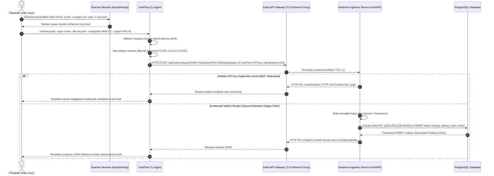

### 3.2 SD-02: Pembangkitan Narasi AI dengan Prinsip SoC & Deterministic Fallback
Diagram ini memodelkan isolasi ketat data sensitif (*Separation of Concerns*), pembersihan data bukti sebelum menyentuh AI pihak ketiga, serta mekanisme perlindungan kegagalan (*fallback rule engine*) berbasis katalog CWE statis in-memory:

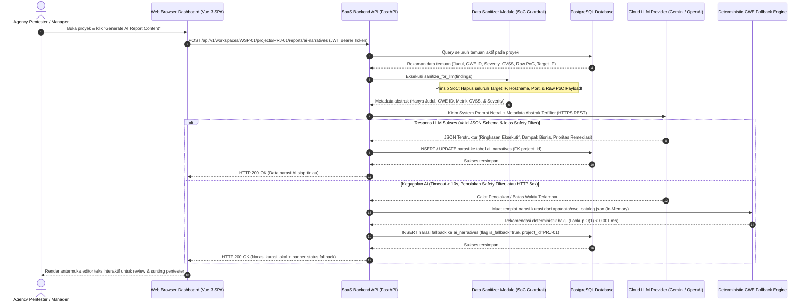

### 3.3 SD-03: Kompilasi Dokumen Laporan & Ekspor PDF White-Labeling Asinkron
Diagram ini memodelkan orkestrasi perakitan laporan formal pentest, verifikasi limitasi kuota langganan, antrean latar belakang Redis Celery (100% asinkron), penyematan identitas visual agensi (*white-labeling*) vs tanda air gratis (*watermarking*), hingga penyampaian *presigned download URL*:

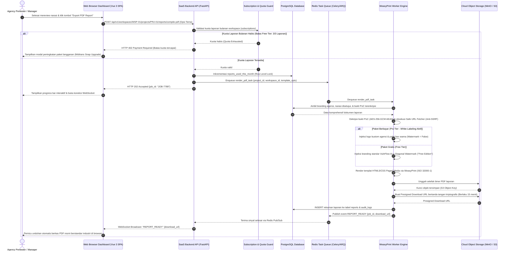

---

---

### 3.4 SD-04: Transaksi Pembayaran Midtrans Snap & Pembaruan Kuota Asinkron via Webhook
**Mencakup Use Case:** `UC-04` (Pengelolaan Workspace), `UC-15` (Pembayaran Langganan), `UC-16` (Penegakan Kuota Laporan).

Diagram sekuensial berikut merepresentasikan alur transaksi pembayaran e-commerce berbasis gateway pembayaran **Midtrans Snap**, mencakup pembangkitan token Snap, pemunculan antarmuka bayar QRIS/Virtual Account, penerimaan webhook asinkron dari server Midtrans, verifikasi *Signature Key* kriptografis SHA-512, hingga pengaktifan tier Pro secara atomik:

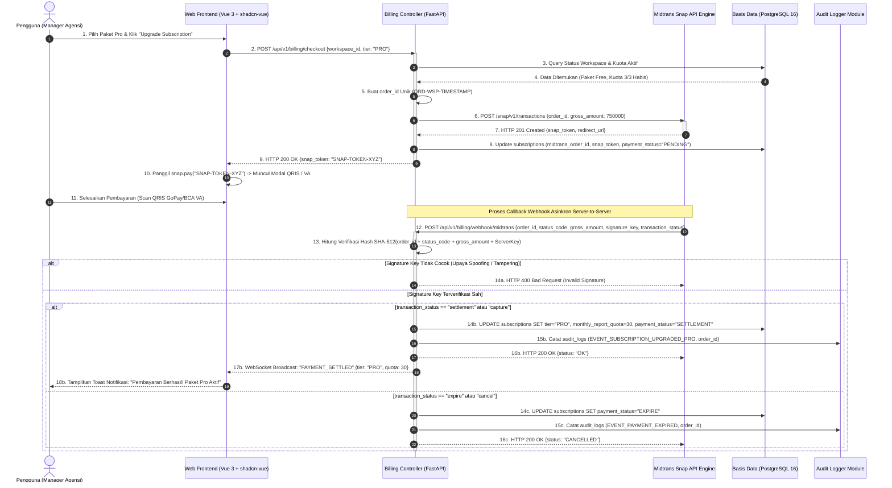

---

## BAB 4: DESAIN ANTARMUKA PENGGUNA (UI/UX DESIGN)

### 4.1 CLI User Experience (CLI UX)

Perkakas *VulnFlow CLI Agent* dirancang mengutamakan efisiensi alur kerja pentester di sistem operasi berbasis terminal (Kali Linux, Ubuntu, macOS):

#### 4.1.1 Struktur Perintah Baris Perintah & Argumen
Sintaksis CLI menggunakan `Typer` dengan konvensi POSIX:

```bash
# Inisialisasi Kredensial API Key
vulnflow configure --token vf_live_7a9f8b2c4e1d3a5... --workspace wsp_corp_01

# Ingesti Berkas Hasil Scan Nuclei
vulnflow push --type nuclei --file /home/kali/scans/target_nuclei.json --project PRJ-01

# Ingesti Berkas Hasil Scan Nmap XML
vulnflow push --type nmap --file /home/kali/scans/target_nmap.xml --project PRJ-01

# Verifikasi Konektivitas & Kuota
vulnflow status
```

#### 4.1.2 Tampilan Terminal & Indikator Progres ASCII
Saat pengguna menjalankan perintah `vulnflow push`, antarmuka konsol menyajikan indikator visual informatif:

```text
[+] VulnFlow AI Agent v2.5.0 (Kali Linux x86_64)
[*] Reading scan output: /home/kali/scans/target_nuclei.json
[*] Validating schema & extracting CVSS metrics...
    -> Found 14 findings (2 Critical, 5 High, 4 Medium, 3 Info)
[*] Verifying target against Project Scope (PRJ-01)... [OK: 100% In-Scope]
[*] Encrypting payload & computing Idempotency-Key...
[*] Transmitting batch to Cloud Gateway (TLS 1.3)...
    [========================================] 100% (Batch 1/1)
[✓] SUCCESS: 14 findings ingested (11 new, 3 deduplicated)
[*] Dashboard URL: https://app.vulnflow.ai/workspaces/wsp_01/projects/PRJ-01
```

#### 4.1.3 Standardisasi Kode Keluar (Exit Codes) & Diagnostik
- `0`: Eksekusi berhasil penuh (*Success*).
- `1`: Kesalahan umum / pembacaan berkas gagal (*General Error*).
- `2`: Skema berkas log tidak valid atau korup (*Malformed Scan File*).
- `10`: Kredensial API Key tidak sah atau dicabut (*Authentication Failure - HTTP 401*).
- `20`: Pelanggaran kuota batch Free melebihi 50 baris (*Batch Quota Limit - HTTP 413*).
- `30`: Terdeteksi target di luar batasan scope legal audit (*Out-of-Scope Warning*).

---

### 4.2 Web Dashboard UI/UX Wireframes & User Flows

Antarmuka web dibangun menggunakan arsitektur *Single Page Application (SPA)* berbasis Vue 3 (Composition API), Vue Router, Vite, dan Tailwind CSS dengan tema ramah praktisi keamanan (*Security Dark/Light Theme*). Komponen UI mengadopsi pustaka **shadcn-vue** (port Vue dari shadcn/ui berbasis Radix Vue) agar bahasa visual dan desain token tetap konsisten dengan spesifikasi awal.

**Dua kelompok rute dalam satu router Vue yang sama** (lihat PLAN.md FASE 6 untuk breakdown tugas lengkap):
- **Rute Publik** (`/`, `/about`, `/solutions`, `/solutions/:id`, `/contact`) — tanpa login, memenuhi 5 halaman wajib mata kuliah Desain Web. Spesifikasi UI/UX lengkapnya (Live Sandbox toggle, diagram pipa 4-Node, katalog triase mock, dsb.) berada di `Desweb/DOCS/Dokumentasi_Proyek_Desweb_VulnFlow_AI.docx` (UC-01 s.d. UC-05a) dan **tidak diduplikasi** di sini agar kedua dokumen tidak saling menyimpang.
- **Rute Terautentikasi** (`/app/*`, dijaga *navigation guard* JWT) — dashboard SaaS VulnFlow AI yang sesungguhnya, dirinci pada Wireframe 1–5 di bawah ini.

#### 4.2.1 Wireframe 1: Dasbor Utama & Sebaran Metrik CVSS

```text
+---------------------------------------------------------------------------------------------------+
|  [VULNFLOW AI]   Projects   Vulnerabilities   AI Ghostwriter   Reports   Billing     [User: John (Mgr)]|
+---------------------------------------------------------------------------------------------------+
|  Workspace: RedTeam Security Agency (PRO TIER)                      [+ New Project]  [+ Invite Member]   |
+---------------------------------------------------------------------------------------------------+
|  Active Project: PT Bank Mandiri API Audit (PRJ-01)                 Scope: 10.10.0.0/16, api.mandiri.com |
+---------------------------------------------------------------------------------------------------+
|                                                                                                   |
|  CVSS SEVERITY DISTRIBUTION                         RECENT SCANS INGESTED                         |
|  +----------------------------------------------+   +------------------------------------------+  |
|  | [CRITICAL: 2] [HIGH: 5] [MED: 8] [LOW: 4]    |   | 2026-09-26 14:20  Nuclei (14 findings)   |  |
|  | Total Vulnerabilities: 19                   |   | 2026-09-26 11:05  Nmap (8 services)      |  |
|  | In-Scope Compliance: 100%                    |   +------------------------------------------+  |
|  +----------------------------------------------+                                                 |
|                                                                                                   |
|  ACTIONS:  [Run AI Ghostwriter]   [Triage Findings]   [Export PDF Report (Pro White-label)]       |
+---------------------------------------------------------------------------------------------------+
```

#### 4.2.2 Wireframe 2: Papan Triase & Dekripsi Bukti Teknis PoC

```text
+---------------------------------------------------------------------------------------------------+
|  PROJECT PRJ-01 > VULNERABILITY TRIAGE BOARD                           [Filter: All Severities v] |
+-----+----------------------------------+----------+------+---------+----------------+-------------+
| ID  | Title                            | Target   | Port | CVSS    | Status         | Action      |
+-----+----------------------------------+----------+------+---------+----------------+-------------+
| V01 | SQL Injection (Error-Based)      | 10.10.1.5| 8443 | 9.8 (C) | [IN_REVIEW  v] | [View PoC]  |
| V02 | OpenSSH Remote Code Execution    | 10.10.1.2| 22   | 8.1 (H) | [OPEN       v] | [View PoC]  |
| V03 | SSL Weak Cipher Suites           | 10.10.1.5| 443  | 5.3 (M) | [ACCEPTED_R v] | [View PoC]  |
+-----+----------------------------------+----------+------+---------+----------------+-------------+
|                                                                                                   |
|  POP-UP MODAL: VIEW PROOF OF CONCEPT (V01)                                                         |
|  +---------------------------------------------------------------------------------------------+  |
|  | Status Enkripsi: [AES-256-GCM Decrypted On-the-Fly via Master Key]                         |  |
|  | Target Parameter: GET /api/v1/users?id=1' UNION SELECT username,password_hash FROM admin-- |  |
|  | HTTP Raw Response: 200 OK (DB Error: syntax error at or near UNION...)                     |  |
|  | PoC Screenshot: [screen_poc_sql.png (Encrypted S3 Attachment)] [Download Attachment]       |  |
|  | [Close]                                                                                     |  |
|  +---------------------------------------------------------------------------------------------+  |
+---------------------------------------------------------------------------------------------------+
```

#### 4.2.3 Wireframe 3: Editor Interaktif Tinjauan Narasi AI (WYSIWYG)

```text
+---------------------------------------------------------------------------------------------------+
|  PROJECT PRJ-01 > AI GHOSTWRITER NARRATIVE REVIEW                    Language: [Bahasa Indonesia v]|
+---------------------------------------------------------------------------------------------------+
|  Prinsip SoC Status: [PoC & Target IP Stripped] -> [Prompt Clean] -> [Gemini API 200 OK]          |
+---------------------------------------------------------------------------------------------------+
|  [B] [I] [U] [H1] [H2] [List] [Table] | Last auto-saved: 14:32 WIB               [Approve Draft]  |
+---------------------------------------------------------------------------------------------------+
|  EXECUTIVE SUMMARY:                                                                               |
|  Uji penetrasi terhadap infrastruktur perbankan digital PT Bank Mandiri mengidentifikasi total 19 |
|  kerentanan keamanan, di mana 2 temuan berstatus Critical yang berpotensi memicu pengambilalihan   |
|  basis data pelanggan secara penuh melalui serangan injeksi SQL tanpa autentikasi.                |
|                                                                                                   |
|  BUSINESS RISK IMPACT:                                                                            |
|  Kelemahan pada endpoint otentikasi dapat mengakibatkan kebocoran data nasabah perbankan,          |
|  pelanggaran kepatuhan regulasi OJK / UU PDP, dan potensi kerugian finansial reputasional.        |
|                                                                                                   |
|  STRATEGIC REMEDIATION ROADMAP:                                                                   |
|  1. Terapkan Parameterized Queries / Prepared Statements pada seluruh interaksi basis data.       |
|  2. Perbarui dependensi OpenSSH ke versi minimal 9.8p1 untuk mitigasi celah RCE regreSSHion.     |
+---------------------------------------------------------------------------------------------------+
```

#### 4.2.4 Wireframe 4: Pengaturan White-labeling & Live Preview Sampul

```text
+---------------------------------------------------------------------------------------------------+
|  WORKSPACE SETTINGS > WHITE-LABELING CUSTOMIZATION (PRO TIER ACTIVE)                              |
+--------------------------------------------------+------------------------------------------------+
|  AGENCY BRANDING CONTROLS                        |  LIVE COVER PAGE PREVIEW (ISO 32000-1)         |
|  Agency Name: [RedTeam Security Consultants    ] |  +------------------------------------------+  |
|  Upload Agency Logo:                             |  |  [ AGENCY LOGO TRANSPARENT ]             |  |
|  [ redteam_logo_white.png ] [Browse... (Max 2MB)]|  |                                          |  |
|  Brand Primary Color:   [#0F172A] (Navy Dark)    |  |  PENETRATION TESTING AUDIT REPORT        |  |
|  Brand Secondary Color: [#E11D48] (Crimson Red)  |  |  Prepared for: PT Bank Mandiri (Persero) |  |
|  Contrast Ratio Check: [WCAG AA Pass: 7.2:1]     |  |  Date: September 2026                    |  |
|  Lead Auditor Signature: [signature_lead.png   ] |  |  Auditor: John Doe, OSCP, CEH            |  |
|  Confidentiality Note:                           |  |  [Confidentiality NDA Notice Applied]    |  |
|  [Dokumen ini bersifat Strictly Confidential...] |  |  [NO VULNFLOW WATERMARK - 100% PRO BRAND]|  |
|  [Save Configuration]                            |  +------------------------------------------+  |
+--------------------------------------------------+------------------------------------------------+
```

#### 4.2.5 Wireframe 5: Meteran Kuota Real-time & Midtrans Snap Modal Upgrade

```text
+---------------------------------------------------------------------------------------------------+
|  WORKSPACE BILLING & USAGE MONITORING                                                             |
+---------------------------------------------------------------------------------------------------+
|  Current Plan: FREE TIER (3 Reports/mo)             Billing Cycle: 2026-09-01 s.d. 2026-09-30     |
|                                                                                                   |
|  MONTHLY PDF REPORT QUOTA USAGE:                                                                  |
|  [================================================] 3 / 3 Reports Used (0 Remaining) [QUOTA FULL]|
|                                                                                                   |
|  [Upgrade to Agency Pro ($49 / Rp 750.000 / month)] -> 30 Reports, No Watermark, Custom Logo      |
|                                                                                                   |
|  POP-UP MODAL: MIDTRANS SNAP PAYMENT GATEWAY (SANDBOX SIMULATOR)                                  |
|  +---------------------------------------------------------------------------------------------+  |
|  |  [MIDTRANS SECURE PAYMENT]                                    Order ID: ORD-WSP01-1727452800|  |
|  |  Total Amount: Rp 750.000 (Agency Pro Subscription - 1 Month)                               |  |
|  |  -----------------------------------------------------------------------------------------  |  |
|  |  SELECT PAYMENT METHOD:                                                                     |  |
|  |  (*) QRIS (GoPay, OVO, ShopeePay, BCA QR)    [ SHOW QR CODE DYNAMIC ]                       |  |
|  |  ( ) Virtual Account Bank Transfer           [ BCA: 70012-9842103841 ] [Copy VA]            |  |
|  |  ( ) Credit Card / Debit Online              [ Mandiri: 88708-12948102 ] [Copy VA]          |  |
|  |  -----------------------------------------------------------------------------------------  |  |
|  |  Sandbox Simulator: [Simulate Success Settlement] [Simulate Cancel]  | Status: [Waiting...]  |  |
|  +---------------------------------------------------------------------------------------------+  |
+---------------------------------------------------------------------------------------------------+
```

---

### 4.3 Design System, Desain Token & Aksesibilitas

Sistem desain VulnFlow AI mengacu pada standar *Atomic Design* dan *WCAG 2.1 Level AA*:

#### 4.3.1 Hierarki Tipografi (Inter & JetBrains Mono)
- **Primary Interface Font:** `Inter`, `sans-serif` (Antarmuka navigasi, judul, teks deskripsi).
  - H1: 24px / Bold / 32px Line-height
  - H2: 18px / Semi-bold / 24px Line-height
  - Body: 14px / Regular / 20px Line-height
  - Caption / Microcopy: 12px / Medium / 16px Line-height
- **Monospace Code Font:** `JetBrains Mono`, `monospace` (Terminal CLI, blok payload PoC, perintah curl, dan string vektor CVSS).

#### 4.3.2 Sistem Palet Warna Semantik & Kode Heksadesimal CVSS
Warna tingkat keparahan (*Severity Badges*) mengadopsi standar internasional FIRST CVSS:
- **Critical (CVSS 9.0 - 10.0):** Background `#7F1D1D`, Border `#DC2626`, Text `#FEF2F2`.
- **High (CVSS 7.0 - 8.9):** Background `#991B1B`, Border `#EF4444`, Text `#FEF2F2`.
- **Medium (CVSS 4.0 - 6.9):** Background `#C2410C`, Border `#F97316`, Text `#FFF7ED`.
- **Low (CVSS 0.1 - 3.9):** Background `#854D0E`, Border `#EAB308`, Text `#FEFCE8`.
- **Info / None (CVSS 0.0):** Background `#1E3A8A`, Border `#3B82F6`, Text `#EFF6FF`.

#### 4.3.3 Kepatuhan Aksesibilitas WCAG 2.1 Level AA
1. **Rasio Kontras Warna:** Seluruh pasangan teks dan latar belakang wajib memiliki rasio kontras minimal **4.5:1** untuk teks standar dan minimal **3.0:1** untuk elemen antarmuka besar / ikon.
2. **Navigasi Keyboard Penuh:** Seluruh menu dropdown, tombol triase, modal dialog, dan input teks dapat diakses menggunakan tombol `Tab`, `Enter`, dan `Escape` tanpa jebakan fokus (*no keyboard trap*).
3. **Screen Reader Optimization:** Seluruh elemen interaktif dan grafik status temuan dilengkapi atribut `aria-label`, `role="status"`, dan struktur heading semantik HTML5.

---

## BAB 5: MATRIKS KETERLACAKAN DESAIN SISTEM (DESIGN TRACEABILITY MATRIX - DTM)

Matriks berikut menjamin konsistensi mutlak (*bidirectional traceability*) antara spesifikasi kebutuhan pada **SRS v3.5.0 (Bab 4, 5, dan 6)** dengan implementasi arsitektur perangkat lunak pada **SDD v1.6.0** (Komponen C4, Tabel Basis Data The Lean 11 Tables, Kontrak REST API, dan Diagram Sekuensial):

| ID Use Case | Nama Use Case UML | Paket FR | Lapisan Komponen SDD (C4 Level 3) | Tabel Relasional Basis Data | Rute / Kontrak REST API Terkait | Sequence Diagram |
| :--- | :--- | :--- | :--- | :--- | :--- | :--- |
| **UC-01** | Registrasi Akun Baru | FR-AUTH-001 | `AuthRouter` $\rightarrow$ `DomainService` | `users`, `workspaces`, `workspace_members`, `subscriptions` | `POST /api/v1/auth/register` | SD-04 (AD-04) |
| **UC-02** | Autentikasi & Token Sesi | FR-AUTH-002 | `AuthRouter` $\rightarrow$ `JWTManager` | `users` (`token_version`, `status`) | `POST /api/v1/auth/login` | SD-04 (AD-04) |
| **UC-02a** | Pemulihan Kata Sandi | FR-AUTH-004 | `AuthRouter` $\rightarrow$ `EmailAdapter` | *Stateless Signed JWT* (HMAC-SHA256) | `POST /api/v1/auth/forgot-password` | AD-04 |
| **UC-03** | Manajemen Personal API Key | FR-AUTH-003 | `APIKeyRouter` $\rightarrow$ `KeyHasher` | `api_keys` (`key_hash` SHA-256) | `POST /api/v1/workspaces/{w_id}/api-keys` | SD-01 (AD-04) |
| **UC-04** | Kelola Ruang Kerja Multi-Tenant | FR-WSP-001 | `WorkspaceRouter` $\rightarrow$ `TenantGuard` | `workspaces` (`custom_logo_url`, warna hex) | `PATCH /api/v1/workspaces/{w_id}` | SD-04 (AD-04) |
| **UC-05** | Kelola Anggota Tim & RBAC | FR-WSP-002 | `WorkspaceRouter` $\rightarrow$ `RBACGuard` | `workspace_members` (`role` ENUM) | `POST /api/v1/workspaces/{w_id}/members` | AD-04 |
| **UC-06** | Kelola Proyek & Target Scope | FR-PRJ-001 | `ProjectRouter` $\rightarrow$ `ScopeService` | `projects` (`target_scope`, `roe_end_date`) | `POST /api/v1/workspaces/{w_id}/projects` | AD-01 / AD-04 |
| **UC-06a** | Tugaskan Pentester Proyek | FR-PRJ-002 | `ProjectRouter` $\rightarrow$ `ScopeService` | `projects` (`lead_pentester_id`) | `PATCH /api/v1/workspaces/{w_id}/projects/{p_id}/lead` | AD-04 |
| **UC-07** | Ingesti Log via CLI Agent | FR-INGEST-001 | `IngestRouter` $\rightarrow$ `IngestEngine` | `findings`, `proofs_of_concept` | `POST /api/v1/.../findings/batch` | SD-01 (AD-01) |
| **UC-07a** | Verifikasi API Key CLI | FR-INGEST-002 | `APIKeyMiddleware` | `api_keys` | `POST /api/v1/.../findings/batch` | SD-01 |
| **UC-07b** | Parse Nmap XML / Nuclei JSON | FR-INGEST-001 | `ParserAdapters` (Nmap/Nuclei) | `findings`, `proofs_of_concept` | `POST /api/v1/.../findings/batch` | SD-01 |
| **UC-07c** | Blokir Pelanggaran Kuota Batch | FR-INGEST-003 | `BatchValidator` | `subscriptions` | Respons `HTTP 413 Payload Too Large` | SD-01 |
| **UC-07d** | Karantina Temuan Out-of-Scope | FR-INGEST-001 | `ScopeEnforcer` | `findings` (`is_quarantined`) | `POST /api/v1/.../findings/batch` | SD-01 |
| **UC-08** | Entri Temuan Manual & CVSS | FR-INGEST-004 | `FindingRouter` $\rightarrow$ `CVSSCalculator` | `findings`, `proofs_of_concept` | `POST /api/v1/.../findings/manual` | AD-01 |
| **UC-08a** | Unggah Bukti PoC Manual | FR-INGEST-004 | `PoCEncryptionAdapter` | `proofs_of_concept` (AES-256-GCM) | `POST /api/v1/.../findings/manual` | SD-01 |
| **UC-09** | Triase Siklus Kerentanan | FR-TRG-001 | `FindingRouter` $\rightarrow$ `AuditLogger` | `findings` (`status`), `audit_logs` | `PATCH /api/v1/.../findings/{f_id}/status` | State Machine |
| **UC-09a** | Regresi Uji Ulang (Retest) | FR-TRG-002 | `FindingRouter` $\rightarrow$ `StateEngine` | `findings` (`status` RE-OPENED), `audit_logs` | `PATCH /api/v1/.../findings/{f_id}/retest` | State Machine |
| **UC-10** | Deduplikasi & Kurasi Temuan | FR-TRG-003 | `DeduplicationService` | `findings` (`dedup_hash` MD5/SHA) | Integrasi Pipeline Ingesti & Triase | SD-01 / AD-02 |
| **UC-11** | Pembangkitan Narasi AI | FR-AI-001 | `AIRouter` $\rightarrow$ `GeminiClient` | `ai_narratives` (`project_id`, `tokens_consumed`) | `POST /api/v1/.../reports/ai-narratives` | SD-02 (AD-02) |
| **UC-11a** | Sanitasi Data (Pemisahan PoC) | FR-AI-002 | `PromptSanitizationService` | Tidak disimpan (Diproses ephemeral in-memory) | Integrasi AI Generator | SD-02 |
| **UC-11b** | Fallback Template Lokal CWE | FR-AI-003 | `DeterministicFallbackEngine` | Berkas JSON In-Memory `cwe_catalog.json` | Fallback saat HTTP 429/5xx pada Gemini | SD-02 |
| **UC-12** | Review & Sunting Narasi AI | FR-AI-004 | `AIRouter` $\rightarrow$ `DomainService` | `ai_narratives` (`status` APPROVED) | `PUT /api/v1/.../reports/ai-narratives/{n_id}` | AD-02 |
| **UC-13** | Konfigurasi White-labeling | FR-REP-003 | `WorkspaceRouter` $\rightarrow$ `ThemeEngine` | `workspaces` (`custom_logo_url`, warna hex) | `PATCH /api/v1/workspaces/{w_id}/theme` | SD-03 (AD-03) |
| **UC-14** | Kompilasi Laporan PDF Asinkron | FR-REP-001 | `ReportRouter` $\rightarrow$ `ReportWorker` | `reports`, `subscriptions`, `audit_logs` | `POST /api/v1/.../reports/compile-pdf` | SD-03 (AD-03) |
| **UC-14a** | Verifikasi Kuota Bulanan | FR-REP-002 | `QuotaGuard` | `subscriptions` (`reports_used_this_month`) | Respons `HTTP 402 Payment Required` | SD-03 |
| **UC-14b/c**| White-label vs Watermarking | FR-REP-003 | `WeasyPrintAdapter` | `reports` (`watermark_applied`) | Eksekusi Renderer WeasyPrint | SD-03 |
| **UC-14d** | Antrean Asinkron Render Dokumen | FR-REP-001 | `Redis Celery Queue` $\rightarrow$ `Worker` | `reports` (`status` QUEUED/COMPLETED) | Respons `HTTP 202 Accepted` | SD-03 |
| **UC-15** | Pemantauan Kuota Laporan | FR-SUB-001 | `BillingRouter` $\rightarrow$ `QuotaService` | `subscriptions` | `GET /api/v1/workspaces/{w_id}/billing/subscription` | SD-03 / SD-04 |
| **UC-16** | Upgrade Midtrans Snap | FR-SUB-002 | `BillingRouter` $\rightarrow$ `MidtransClient` | `subscriptions` (`midtrans_order_id`, `snap_token`) | `POST /api/v1/workspaces/{w_id}/billing/checkout` | SD-04 (AD-04) |
| **UC-17** | Monitoring Telemetri AI Token | FR-ADM-001 | `AdminRouter` $\rightarrow$ `RedisMetrics` | `ai_narratives`, `audit_logs` | `GET /api/v1/admin/telemetry/ai` | C4 Level 2/3 |
| **UC-18** | Pembekuan Akun Pelanggar | FR-ADM-002 | `AdminRouter` $\rightarrow$ `AuthGuard` | `users` (`status` SUSPENDED), `audit_logs` | `POST /api/v1/admin/users/{u_id}/suspend` | Wireframe 1 |
| **UC-19** | Peninjauan Jejak Audit Sistem | FR-ADM-003 | `AdminRouter` $\rightarrow$ `AuditQueryEngine` | `audit_logs` (Partisi Bulanan) | `GET /api/v1/admin/audit-logs` | Bab 2.4.4 |

---

## BAB 6: PENUTUP & LEMBAR PENGESAHAN DESAIN TEKNIS

Dokumen Spesifikasi Desain Perangkat Lunak (*Software Design Description*) Versi 1.6.0 ini telah disusun secara komprehensif mengacu pada standar rekayasa perangkat lunak internasional **IEEE Std 1016:2009** dan **ISO/IEC/IEEE 42010:2011** untuk merealisasikan seluruh kebutuhan sistem yang didefinisikan pada dokumen **[Software Requirements Specification (SRS) v3.5.0](file:///c:/Users/KaliCodeS3/Documents/Project/IPPL/DOCS/SRS.md)**.

Dokumen ini menjadi acuan tunggal arsitektur dan cetak biru perancangan teknis bagi seluruh pengembang selama fase implementasi kode program, integrasi basis data, pengujian unit/integrasi, dan demonstrasi pengujian perangkat lunak sistem **VulnFlow AI** pada mata kuliah **Implementasi Perancangan Perangkat Lunak (IPPL)**.

---
*VulnFlow AI Engineering Team — Universitas / Institut Program Studi Informatika — 2026.*
